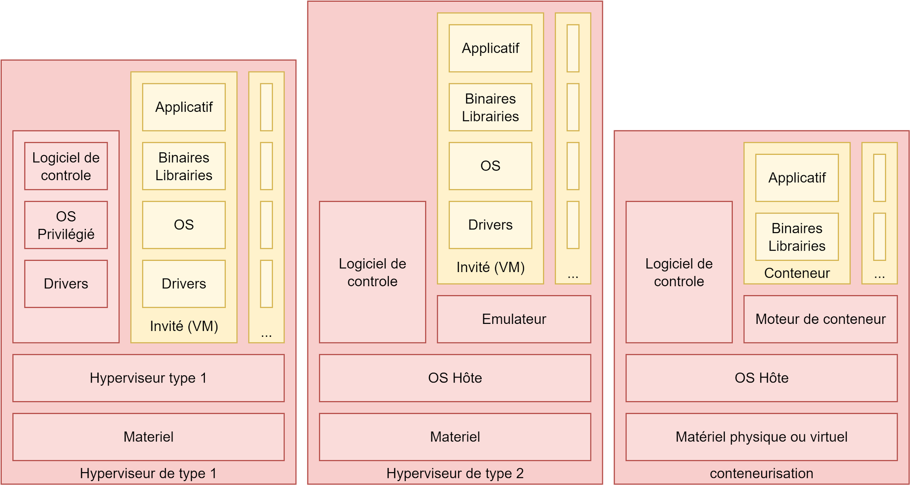

*[Virtualisation avancée, les notions essentielles](README.md) › Chapitre 2*

# 2. Serveur virtualisé

Il existe plusieurs façons de partager un serveur entre plusieurs systèmes. Elles diffèrent par l'endroit où se place la couche d'abstraction.

*Figure 1 : empilements comparés d'un hyperviseur de type 1, d'un hyperviseur de type 2 et d'une plateforme de conteneurs.*

<!-- Source du schéma (draw.io) : https://app.diagrams.net/?page-id=54EUpLZvDEcmd9ZNUH4Z&scale=auto#G1fWLtfPeYV-gSjBtzDSNkNKkGQIl-cnZL -->

## Hyperviseurs de type 1

Les hyperviseurs de type 1, dits **natifs** ou *bare metal*, s'exécutent directement sur le matériel, sans système d'exploitation hôte. Ils accèdent directement aux ressources matérielles et sont conçus pour héberger de nombreux systèmes invités. N'ayant pas d'OS hôte intermédiaire à traverser, ils offrent de meilleures performances et une meilleure isolation que les hyperviseurs de type 2. C'est la solution standard en centre de données.

Exemples : VMware ESXi (au cœur de vSphere), Microsoft Hyper-V, Xen, KVM (intégré au noyau Linux) et Proxmox VE (qui s'appuie sur KVM).

## Hyperviseurs de type 2

Les hyperviseurs de type 2, dits **hébergés**, s'exécutent comme une application au-dessus d'un système d'exploitation hôte. Ils sont plus simples à installer et à utiliser, mais l'OS hôte ajoute une surcharge et les rend moins performants. Ils conviennent aux postes de travail, au développement et aux tests.

Exemples : VMware Workstation, Oracle VirtualBox, Parallels Desktop.

## Paravirtualisation

En virtualisation complète, le système invité ignore qu'il est virtualisé. En paravirtualisation, il est au contraire modifié, ou équipé de pilotes spécifiques, pour coopérer avec l'hyperviseur. Il dialogue avec lui au travers d'interfaces dédiées au lieu de passer par du matériel émulé, ce qui réduit la surcharge et améliore les performances, en particulier pour les disques et le réseau.

Exemples : Xen en mode PV, KVM avec les pilotes virtio.

## Isolation par conteneurs

La conteneurisation est une forme de virtualisation légère qui isole des applications et leurs dépendances dans des conteneurs. Contrairement aux VM, les conteneurs partagent le noyau du système hôte : pas d'OS invité à démarrer, d'où leur légèreté et leur démarrage quasi instantané. Plusieurs conteneurs cohabitent sur un même hôte sans interférer. En contrepartie, l'isolation est moins forte qu'avec une VM, puisque le noyau est commun.

Exemples : Docker, Podman, LXC (voir le [chapitre 4](04-conteneurisation.md)).

## Synthèse

| | Hyperviseur de type 1 | Hyperviseur de type 2 | Conteneurs |
| --- | --- | --- | --- |
| S'exécute sur | le matériel | un OS hôte | le noyau de l'OS hôte |
| Unité isolée | VM avec son propre OS | VM avec son propre OS | processus applicatif |
| Isolation | très forte | forte | plus faible (noyau partagé) |
| Performances | élevées | moyennes | proches du natif |
| Démarrage | minutes | minutes | secondes |
| Usage typique | centre de données, cloud | poste de travail, tests | microservices, CI/CD |
| Exemples | ESXi, Hyper-V, KVM, Xen | VirtualBox, VMware Workstation | Docker, Podman, LXC |

> **À retenir**
>
> - Type 1 : directement sur le matériel, performant, standard en production.
> - Type 2 : au-dessus d'un OS, pratique sur un poste de travail, moins performant.
> - Paravirtualisation : l'invité coopère avec l'hyperviseur (pilotes virtio) pour gagner en performances.
> - Conteneurs : noyau partagé, très légers, isolation moindre qu'une VM.

**Pour aller plus loin**

- [Red Hat, « Qu'est-ce qu'un hyperviseur ? »](https://www.redhat.com/fr/topics/virtualization/what-is-a-hypervisor)
- [IBM, « Qu'est-ce que la virtualisation ? »](https://www.ibm.com/fr-fr/topics/virtualization)

---

[← 1. Virtualisation, concepts généraux](01-virtualisation-concepts-generaux.md) · [Sommaire](README.md#sommaire) · [3. Stockage virtualisé →](03-stockage-virtualise.md)
