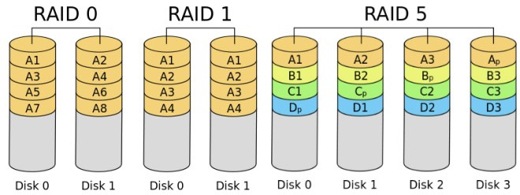
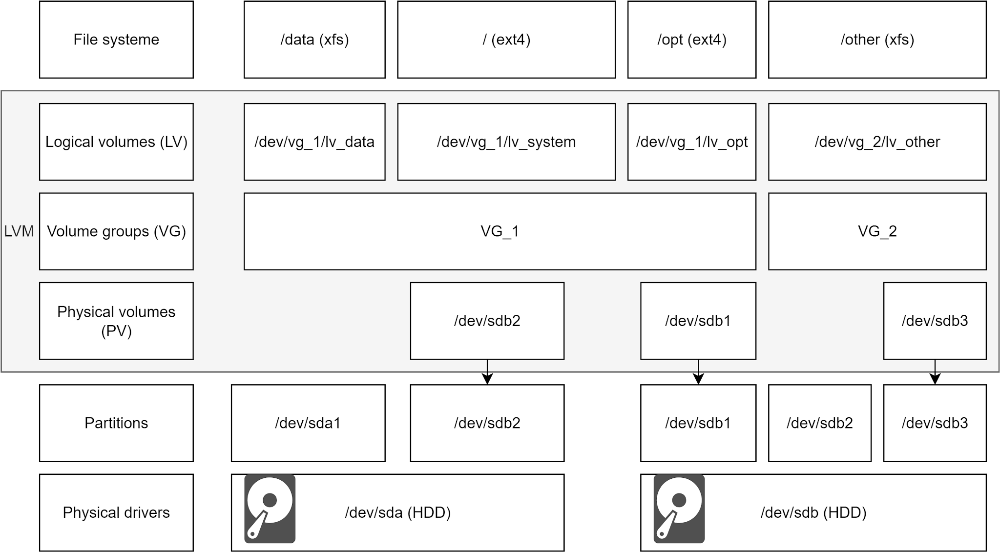

*[Virtualisation avancée, les notions essentielles](README.md) › Chapitre 3*

# 3. Stockage virtualisé

Le stockage virtualisé regroupe des ressources de stockage physiques, les gère de façon centralisée et les présente aux systèmes sous forme de ressources logiques. La gestion est simplifiée, l'espace mieux utilisé, et l'on s'adapte vite aux besoins changeants des applications.

## Disque virtuel et thin provisioning

- **Disque virtuel** (*virtual disk*) : abstraction logique d'un espace de stockage, utilisée pour stocker les données d'une VM. Il se configure, se redimensionne et se gère comme un disque physique, mais il est en réalité stocké sous forme de fichier ou de volume sur un ou plusieurs disques physiques (formats VMDK, VHDX, QCOW2…).
- **Thin provisioning** (allocation dynamique) : l'espace n'est consommé qu'au fur et à mesure de l'écriture des données, au lieu d'être réservé entièrement à la création (*thick provisioning*). On évite ainsi de gaspiller de l'espace inutilisé. En contrepartie, on peut promettre plus d'espace qu'il n'en existe réellement (surallocation). Un suivi attentif du taux de remplissage est alors indispensable, faute de quoi toutes les VM du pool risquent de se bloquer en même temps.

## Les architectures de stockage

**DAS** (*Direct Attached Storage*) : stockage local, relié directement au serveur sans passer par le réseau, via une interface SATA, SAS ou NVMe. Il est performant et peu coûteux, mais peu flexible à grande échelle : chaque serveur dispose seul de ses disques.

**SAN** (*Storage Area Network*) : réseau dédié qui relie les serveurs à des baies de stockage, avec un accès en mode bloc. Les serveurs voient des volumes (appelés LUN) comme s'il s'agissait de disques locaux. Le SAN centralise et partage le stockage, avec de hautes performances, de la redondance et une administration centralisée. Il s'appuie sur des protocoles comme Fibre Channel ou iSCSI. Ces solutions très complètes sont aussi coûteuses.

**NAS** (*Network Attached Storage*) : serveur de fichiers connecté au réseau, qui partage des fichiers avec les utilisateurs et les applications via les protocoles NFS (monde Unix) ou SMB (monde Windows). Il est idéal pour le partage de documents et le travail collaboratif.

On rencontre aussi de plus en plus le **stockage objet** (protocole S3), où chaque donnée est un objet identifié par une clé et accessible par une API HTTP. C'est le stockage de référence du cloud (Amazon S3, Ceph, MinIO).

| | DAS | SAN | NAS |
| --- | --- | --- | --- |
| Mode d'accès | bloc, local | bloc, via le réseau | fichier, via le réseau |
| Protocoles | SATA, SAS, NVMe | Fibre Channel, iSCSI | NFS, SMB |
| Partage entre serveurs | non | oui (LUN) | oui (partages réseau) |
| Coût | faible | élevé | modéré |
| Usage typique | serveur isolé | bases de données, clusters de virtualisation | partage de fichiers |

## RAID

Le **RAID** (*Redundant Array of Independent Disks*) combine plusieurs disques physiques en un seul volume logique. Selon le niveau choisi, il améliore les performances, la tolérance aux pannes, ou les deux, en répartissant les données sur plusieurs disques. Il constitue la base de la disponibilité des données dans un stockage virtualisé.

- **RAID 0** (*striping*, ou agrégation par bandes) : les données sont découpées en bandes réparties sur tous les disques. Les lectures et les écritures sont plus rapides, mais il n'y a aucune redondance : la panne d'un seul disque entraîne la perte de toutes les données. Il faut au moins 2 disques.
- **RAID 1** (*mirroring*, ou miroir) : les données sont copiées à l'identique, en temps réel, sur chaque disque. La tolérance aux pannes est excellente, mais la capacité utile se limite à celle d'un seul disque. Il faut au moins 2 disques.
- **RAID 5** : les blocs de données sont répartis sur tous les disques, accompagnés d'une parité elle aussi distribuée. En cas de panne d'un disque, ses données sont recalculées à partir des autres. Bon compromis entre capacité, performances et sécurité, c'est l'un des niveaux les plus répandus. Les écritures sont un peu ralenties par le calcul de parité et la reconstruction après une panne est longue. Il faut au moins 3 disques.



*Figure 2 : en RAID 0 les blocs sont répartis, en RAID 1 ils sont dupliqués, en RAID 5 ils sont répartis avec un bloc de parité (Ap, Bp…) tournant d'un disque à l'autre. (Source : Cburnett, Wikimedia Commons, CC BY-SA 3.0 ; voir les [crédits](../CREDITS.md))*

D'autres niveaux répondent à des besoins plus spécifiques :

- **RAID 6** : comme le RAID 5, mais avec une double parité. Il supporte la panne simultanée de deux disques, ce qui est précieux avec des disques de grande capacité dont la reconstruction dure longtemps. Il faut au moins 4 disques.
- **RAID 10** (1+0) : des paires de disques en miroir (RAID 1), elles-mêmes agrégées en RAID 0. Il combine redondance et hautes performances, au prix de la moitié de la capacité. Il est apprécié pour les bases de données. Il faut au moins 4 disques.

On peut enfin prévoir un ou plusieurs **disques de secours** (*hot spare*), qui remplacent automatiquement un disque défaillant et lancent aussitôt la reconstruction.

| Niveau | Principe | Disques min. | Capacité utile (n disques de taille C) | Pannes tolérées |
| --- | --- | --- | --- | --- |
| RAID 0 | répartition | 2 | n × C | aucune |
| RAID 1 | miroir | 2 | C | n − 1 |
| RAID 5 | répartition + parité | 3 | (n − 1) × C | 1 |
| RAID 6 | répartition + double parité | 4 | (n − 2) × C | 2 |
| RAID 10 | miroirs agrégés | 4 | (n / 2) × C | 1 garantie, jusqu'à n / 2 si elles touchent des miroirs différents |

> Attention : le RAID n'est pas une sauvegarde. Il protège contre la panne d'un disque, pas contre une suppression accidentelle, un rançongiciel ou la perte du serveur entier. Les sauvegardes restent indispensables.

## LVM

**LVM** (*Logical Volume Manager*) est le gestionnaire de volumes logiques de Linux, très utilisé sur les serveurs. Il ajoute une couche d'abstraction entre les disques physiques et les systèmes de fichiers, ce qui rend la gestion du stockage souple et dynamique :

- les volumes ne dépendent plus de la taille des disques : un volume peut s'étendre sur plusieurs disques ;
- on ajoute, supprime ou redimensionne des volumes à chaud, sans interrompre les services ;
- on peut migrer les données d'un disque à un autre (par exemple avant de remplacer un disque défaillant) en limitant les interruptions ;
- les instantanés (*snapshots*) facilitent les sauvegardes et les tests ;
- LVM sait aussi construire du RAID au niveau des volumes logiques.

LVM repose sur quatre notions :

- **Physical Volume (PV)** : un disque, une partition ou un autre périphérique de stockage confié à LVM.
- **Volume Group (VG)** : un regroupement de PV qui forme un espace de stockage commun.
- **Logical Volume (LV)** : un volume taillé dans l'espace d'un VG. Il s'utilise comme un disque (on y crée un système de fichiers) et peut être redimensionné ou déplacé sans affecter les autres volumes.
- **Extents** : les blocs de taille fixe (4 Mio par défaut) qui découpent les PV et les LV. Ce sont les unités d'allocation de LVM.



*Figure 3 : de bas en haut, les disques sont partitionnés, les partitions deviennent des volumes physiques (PV), regroupés en groupes de volumes (VG) dans lesquels on taille des volumes logiques (LV) qui portent les systèmes de fichiers.*

<!-- Source du schéma (draw.io) : https://app.diagrams.net/?page-id=cXBpNCS32hI19AK-VzXU&scale=auto#G1y_zsZ7JmoBmrrzWprRqkDJ6SUddxIMf1 -->

Exemple : créer un volume de 20 Go à partir de deux partitions, puis l'agrandir de 10 Go.

```bash
pvcreate /dev/sdb1 /dev/sdb2            # partitions → volumes physiques (PV)
vgcreate vg_1 /dev/sdb1 /dev/sdb2       # PV regroupés en groupe de volumes (VG)
lvcreate -n lv_data -L 20G vg_1         # volume logique (LV) de 20 Go
mkfs.xfs /dev/vg_1/lv_data              # système de fichiers XFS
mount /dev/vg_1/lv_data /data           # montage
lvextend -r -L +10G /dev/vg_1/lv_data   # +10 Go à chaud (LV et FS)
```

Lorsque le groupe de volumes est plein, on lui ajoute un nouveau disque, puis on agrandit le volume logique, toujours sans interruption :

```bash
pvcreate /dev/sdc1                      # nouveau disque → volume physique
vgextend vg_1 /dev/sdc1                 # ajouté au groupe de volumes existant
lvextend -r -l +100%FREE /dev/vg_1/lv_data   # LV agrandi de tout l'espace libre
```

> **À retenir**
>
> - Le thin provisioning économise l'espace mais impose de surveiller le remplissage.
> - DAS = local, SAN = bloc via le réseau, NAS = fichiers via le réseau.
> - RAID 0 accélère sans protéger, RAID 1 duplique, RAID 5 et 6 protègent par parité, RAID 10 combine miroir et performances. Le RAID ne remplace pas la sauvegarde.
> - LVM empile PV → VG → LV pour gérer le stockage Linux de façon souple ; on agrandit à chaud avec `vgextend` puis `lvextend -r`.

**Pour aller plus loin**

- [Dell, « Types de disques durs, RAID et contrôleurs RAID sur les serveurs PowerEdge »](https://www.dell.com/support/kbdoc/fr-ca/000137374/understanding-hard-drive-types-raid-and-raid-controllers-on-dell-poweredge-and-blade-chassis-servers)
- [Documentation Fedora-fr, « Concepts de base – LVM »](https://doc.fedora-fr.org/wiki/Concepts_de_base_%E2%80%93_LVM)

---

[← 2. Serveur virtualisé](02-serveur-virtualise.md) · [Sommaire](README.md#sommaire) · [4. Conteneurisation →](04-conteneurisation.md)
