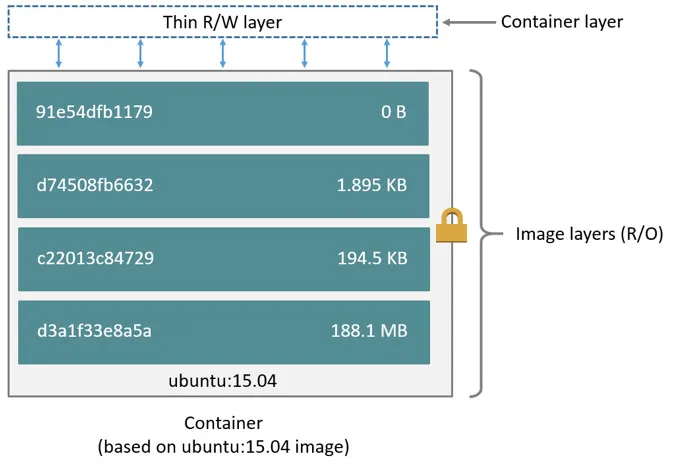
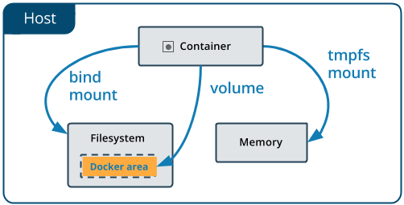
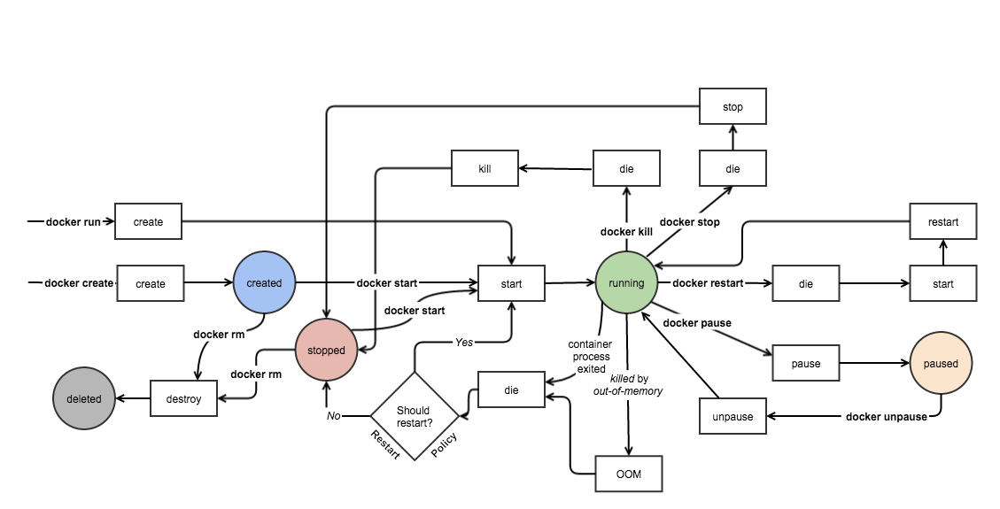

*[Virtualisation avancée, les notions essentielles](README.md) › Chapitre 4*

# 4. Conteneurisation

## Introduction à la conteneurisation

La conteneurisation a changé la façon de développer, de déployer et d'exploiter les applications. Elle consiste à empaqueter une application avec toutes ses bibliothèques, ses dépendances et sa configuration dans un environnement isolé : le conteneur. Un conteneur est autonome et se comporte de la même façon quel que soit l'environnement qui l'exécute. Contrairement aux VM, les conteneurs partagent le noyau du système hôte, ce qui les rend beaucoup plus légers.

Les conteneurs présentent trois avantages majeurs :

- **Portabilité** : le conteneur embarque l'application, ses dépendances et ses paramètres. Une image construite sur un poste de développement s'exécute à l'identique sur n'importe quel serveur doté d'un moteur de conteneurs. Plus besoin de vérifier quelle version de Java ou de Python est installée sur le serveur. De plus, une image est généralement bien plus légère qu'une image de VM, ce qui facilite sa distribution.
- **Isolation** : chaque conteneur est isolé des autres et de l'hôte. Les applications ne peuvent pas interférer entre elles, ce qui améliore la sécurité et la stabilité. On peut par exemple faire tourner côte à côte deux logiciels qui exigent des versions différentes de Python ou de Java.
- **Efficacité** : sans OS invité, un conteneur consomme peu de mémoire et d'espace disque et démarre en quelques secondes, voire moins. On en exécute un grand nombre sur une même machine.

| | Machine virtuelle | Conteneur |
| --- | --- | --- |
| Contenu | OS complet + application | application + dépendances |
| Noyau | propre à chaque VM | partagé avec l'hôte |
| Taille | plusieurs Go | quelques Mo à quelques centaines de Mo |
| Démarrage | minutes | secondes |
| Isolation | forte (matérielle) | plus faible (au niveau du noyau) |

## Fonctionnement de la conteneurisation

Un conteneur est un ou plusieurs **processus Linux** ordinaires, auxquels le noyau applique un ensemble de mécanismes d'isolation.

- **Namespaces** (espaces de noms) : le socle de l'isolation. Chaque namespace donne à un groupe de processus sa propre vue d'une ressource du système : arbre des processus (`pid`), interfaces réseau (`net`), points de montage (`mnt`), nom d'hôte (`uts`), communications inter-processus (`ipc`), utilisateurs (`user`). Un conteneur dispose ainsi de ses propres espaces de noms et ne voit pas les processus ou les interfaces réseau de ses voisins.
- **Cgroups** (*control groups*) : ils limitent et comptabilisent les ressources qu'un groupe de processus peut consommer (CPU, mémoire, entrées-sorties disque…). Un conteneur ne peut pas monopoliser la machine hôte.
- **Chroot** (*change root*) : il enferme un processus dans un répertoire qui devient sa racine `/`. Le processus ne voit alors que les fichiers de son image. Les moteurs de conteneurs utilisent aujourd'hui une variante plus sûre, `pivot_root`.
- **Systèmes de fichiers en couches** (*Union FS*, en pratique OverlayFS) : ils superposent plusieurs couches de fichiers pour n'en présenter qu'une seule. C'est ce qui permet de construire les images par couches et de partager les couches communes entre images (voir [Layers](#layers)).
- **Netfilter** : le cadre de filtrage de paquets du noyau Linux (piloté par `iptables` ou `nftables`). Les moteurs de conteneurs s'en servent pour isoler les conteneurs sur le plan réseau et pour rediriger les ports publiés.
- **Capabilities et seccomp** : ils restreignent les privilèges et les appels système autorisés aux processus du conteneur, pour réduire la surface d'attaque.

Tous ces mécanismes sont fournis par le **noyau Linux** ; le moteur de conteneurs se contente de les orchestrer. Le gestionnaire de services `systemd` démarre en général ce moteur, mais il ne fait pas partie des briques d'isolation.

Windows dispose de mécanismes comparables pour les conteneurs Windows. Pour exécuter des conteneurs Linux, Docker Desktop sur Windows ou macOS s'appuie en revanche sur une machine virtuelle Linux, transparente pour l'utilisateur (sous Windows, via WSL 2).

Plusieurs technologies de conteneurisation coexistent :

- **Docker** : pionnier et leader du domaine. Il fournit un écosystème complet pour construire, distribuer et exécuter des conteneurs. Ses images sont organisées en couches et se partagent via des registres comme Docker Hub.
- **Podman** : alternative développée par Red Hat, compatible avec les commandes Docker. Il fonctionne sans démon et peut lancer des conteneurs sans droits root (*rootless*), ce qui renforce l'isolation entre utilisateurs.
- **LXC** (*Linux Containers*) : technologie plus ancienne, orientée conteneurs système. Un conteneur LXC fait tourner une distribution Linux complète, avec son propre système d'initialisation, à la manière d'une VM légère. Docker et Podman, eux, sont orientés conteneurs applicatifs : un conteneur pour un processus principal.

La suite du chapitre se concentre sur Docker, la plateforme la plus utilisée.

## Les concepts importants

### Image

Une **image** est un modèle statique, en lecture seule, qui contient les fichiers, les bibliothèques et la configuration nécessaires pour exécuter une application. C'est la recette, ou le plan, à partir duquel on crée des conteneurs. Les images sont stockées dans des registres (Docker Hub, GitLab Container Registry, Harbor…) qui permettent de les partager et de les distribuer. Une image est désignée par son nom et une étiquette de version, par exemple `nginx:1.30`.

### Conteneur

Un **conteneur** est une instance en cours d'exécution d'une image. C'est là que l'application s'exécute réellement, isolée du reste du système et des autres conteneurs, avec son propre système de fichiers, ses processus et son interface réseau. Une même image peut donner naissance à autant de conteneurs que nécessaire : c'est la relation entre une classe et ses objets en programmation.

### Layers

Les images sont constituées de **couches** (*layers*) superposées grâce au système de fichiers en couches. Chaque couche ne contient que les différences par rapport à la précédente (typiquement, une couche par instruction du Dockerfile). Les couches communes à plusieurs images ne sont stockées et téléchargées qu'une seule fois. Les images sont immuables : toute modification produit une nouvelle couche, ce qui facilite le suivi des versions et les mises à jour.

Un conteneur, c'est une image à laquelle on ajoute une fine couche en lecture-écriture. On pourrait y stocker les données manipulées par l'application, mais c'est fortement déconseillé : ces données disparaissent avec le conteneur et sont difficiles à atteindre depuis l'extérieur. On utilise pour cela des volumes.



*Figure 4 : les couches de l'image sont en lecture seule et peuvent être partagées ; seule la couche du conteneur, au sommet, est modifiable. (Source : documentation Docker, Apache 2.0 ; voir les [crédits](../CREDITS.md))*

### Volumes

Les **volumes** stockent des données persistantes, dont la durée de vie dépasse celle du conteneur. Ils sont gérés par Docker et montés dans l'arborescence du conteneur. Les données survivent à l'arrêt et à la suppression du conteneur, et peuvent être partagées entre plusieurs conteneurs. C'est la solution à privilégier pour les bases de données ou les fichiers déposés par les utilisateurs.

Deux autres types de montage existent :

- les bind mounts montent un répertoire quelconque de l'hôte dans le conteneur, pratique en développement pour partager le code source ;
- les montages tmpfs placent les données en mémoire vive, sans persistance. Ils sont rapides et adaptés aux fichiers temporaires ou sensibles qui ne doivent pas toucher le disque.



*Figure 5 : où vivent les données selon le type de montage. (Source : documentation Docker, Apache 2.0 ; voir les [crédits](../CREDITS.md))*

### Réseau

Le réseau de Docker est modulaire et repose sur des pilotes (*drivers*). Les principaux sont :

- **bridge** (pont) : le pilote par défaut. Les conteneurs d'un même hôte communiquent entre eux sur un réseau privé, derrière une traduction d'adresses (NAT) vers l'extérieur.
- **host** (hôte) : supprime l'isolation réseau ; le conteneur utilise directement les interfaces de l'hôte.
- **overlay** : relie plusieurs hôtes Docker entre eux pour que les conteneurs communiquent d'une machine à l'autre, sans configuration de routage sur les systèmes. Il est utilisé par les orchestrateurs.
- **ipvlan** : donne un contrôle complet sur l'adressage IPv4 et IPv6 des conteneurs, y compris l'étiquetage VLAN (niveau 2) et le routage (niveau 3), pour s'intégrer finement au réseau existant.
- **macvlan** : attribue une adresse MAC propre au conteneur, qui apparaît alors comme une machine physique sur le réseau. C'est utile pour des applications anciennes qui s'attendent à être branchées directement sur le réseau.
- **none** : coupe complètement le conteneur du réseau.

Des **plugins** tiers permettent d'ajouter d'autres pilotes.

Enfin, la **publication de ports** expose un port du conteneur sur l'hôte pour accepter des connexions entrantes. C'est indispensable pour un serveur web, par exemple : `-p 8080:80` redirige le port 8080 de l'hôte vers le port 80 du conteneur.

## Docker en pratique

### Les commandes essentielles

| Commande | Rôle | Exemple |
| --- | --- | --- |
| `docker run` | créer et démarrer un conteneur à partir d'une image | `docker run -d -p 8080:80 --name web nginx` |
| `docker ps` | lister les conteneurs en cours (`-a` : tous) | `docker ps -a` |
| `docker images` | lister les images présentes localement | `docker images` |
| `docker pull` | télécharger une image depuis un registre | `docker pull ubuntu:24.04` |
| `docker build` | construire une image à partir d'un Dockerfile | `docker build -t mon-app:1.0 .` |
| `docker logs` | afficher la sortie d'un conteneur (`-f` : en continu) | `docker logs -f web` |
| `docker exec` | exécuter une commande dans un conteneur actif | `docker exec -it web bash` |
| `docker stop` | arrêter proprement un conteneur | `docker stop web` |
| `docker rm` | supprimer un conteneur arrêté | `docker rm web` |

Dans l'exemple `docker run -d -p 8080:80 --name web nginx`, l'option `-d` lance le conteneur en arrière-plan et `-p 8080:80` publie le port 80 du conteneur sur le port 8080 de l'hôte. Le site est alors accessible sur `http://localhost:8080`.

### Le cycle de vie d'un conteneur



*Figure 6 : états d'un conteneur (created, running, paused, stopped, deleted) et commandes qui les relient. La politique de redémarrage (restart policy) décide si un conteneur arrêté de façon inattendue, par exemple faute de mémoire (OOM), est relancé. (Source : documentation Docker, Apache 2.0 ; voir les [crédits](../CREDITS.md))*

### Dockerfile

Un **Dockerfile** est un fichier texte qui décrit, instruction par instruction, comment construire une image personnalisée : image de départ, dépendances, configuration, commande de démarrage. Il rend la construction de l'image automatique et reproductible.

Exemple pour une application Node.js :

```dockerfile
# Partir de l'image officielle Node.js
FROM node:24-alpine

# Définir le répertoire de travail dans le conteneur
WORKDIR /app

# Copier d'abord les fichiers de dépendances, pour profiter du cache des couches
COPY package*.json ./

# Installer les dépendances
RUN npm ci

# Copier le reste du code de l'application
COPY . .

# Documenter le port écouté par l'application
EXPOSE 3000

# Commande lancée au démarrage du conteneur
CMD ["node", "app.js"]
```

Construction et lancement :

```bash
docker build -t mon-app:1.0 .
docker run -d -p 3000:3000 mon-app:1.0
```

L'ordre des instructions compte : chaque instruction produit une couche, et Docker réutilise les couches inchangées. En copiant `package.json` avant le reste du code, on évite de réinstaller les dépendances à chaque modification du code.

### Docker Compose

**Docker Compose** simplifie le déploiement d'applications composées de plusieurs conteneurs. Un fichier YAML décrit les services, les réseaux et les volumes ; une seule commande démarre l'ensemble.

Exemple de fichier `compose.yaml` pour un serveur web et une base de données :

```yaml
services:
  web:
    image: nginx:1.30
    ports:
      - "8080:80"
    depends_on:
      - db

  db:
    image: postgres:17
    environment:
      POSTGRES_PASSWORD: mysecretpassword   # en production : un secret
    volumes:
      - db-data:/var/lib/postgresql/data    # données persistantes

volumes:
  db-data:
```

```bash
docker compose up -d     # créer et démarrer tous les services
docker compose ps        # voir leur état
docker compose down      # tout arrêter et supprimer (le volume db-data reste)
```

Les services d'un même fichier Compose partagent un réseau : le conteneur `web` joint la base de données par son nom de service, `db`. La clé `version:` que l'on rencontre dans d'anciens exemples est désormais inutile.

> **À retenir**
>
> - Un conteneur est un processus isolé par le noyau (namespaces, cgroups) qui partage le noyau de l'hôte.
> - Une image est un modèle immuable, en couches ; un conteneur en est une instance, avec une couche modifiable.
> - Les données à conserver vont dans des volumes, jamais dans la couche du conteneur.
> - Dockerfile = construire une image ; Docker Compose = décrire et lancer une application multi-conteneurs.

**Pour aller plus loin**

- [Documentation Docker, glossaire](https://docs.docker.com/glossary/)
- [Documentation Docker, « Storage »](https://docs.docker.com/engine/storage/)
- [Documentation Docker, « Networking overview »](https://docs.docker.com/engine/network/)

---

[← 3. Stockage virtualisé](03-stockage-virtualise.md) · [Sommaire](README.md#sommaire) · [5. Orchestration →](05-orchestration.md)
