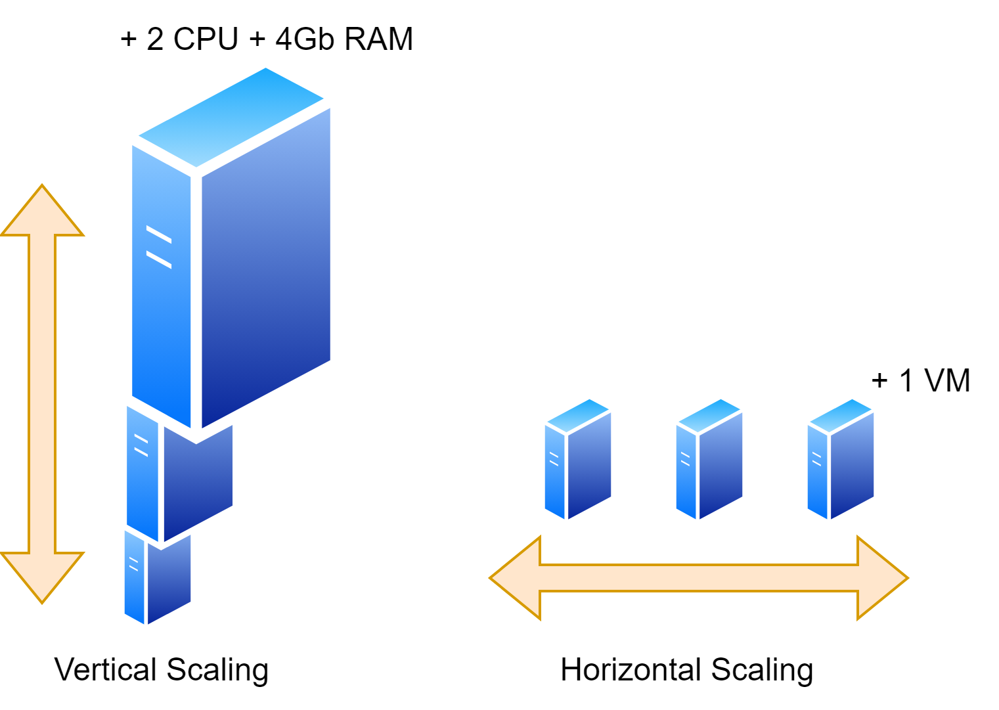
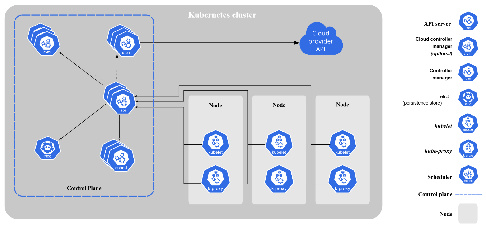
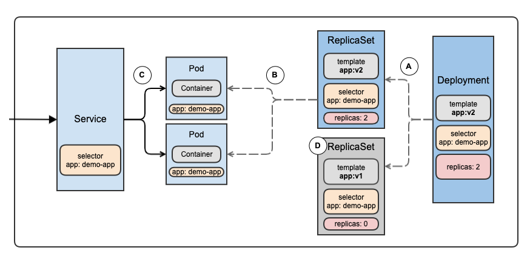

*[Virtualisation avancée, les notions essentielles](README.md) › Chapitre 5*

# 5. Orchestration

## Automatisation et orchestration

### Automatisation

L'**automatisation** consiste à exécuter une tâche précise sans intervention humaine, en remplaçant une opération manuelle par un script ou un outil. Elle porte sur une tâche ou une suite de tâches bien délimitée. Exemples :

- un script qui déploie une machine virtuelle ;
- une sauvegarde lancée chaque jour à heure fixe ;
- l'installation et la configuration automatiques d'un logiciel sur un serveur.

### Orchestration

L'**orchestration** va plus loin : elle coordonne de multiples tâches automatisées pour mener à bien un processus complet. Elle décide du *comment* et du *quand*, et fait collaborer plusieurs systèmes et services. Exemples :

- gérer le déploiement, la mise à l'échelle, la mise à jour et la surveillance de nombreux conteneurs ou VM ;
- construire une infrastructure complète : créer les VM, configurer le réseau, installer les applications, dans le bon ordre ;
- remplacer automatiquement une VM ou un conteneur défaillant, tout en répartissant la charge sur les ressources disponibles.

Autrement dit, l'orchestration est l'art de coordonner les ressources informatiques (serveurs, VM, conteneurs) pour assurer leur bon fonctionnement, leur mise à l'échelle, leur mise à jour et leur dépannage.

Les architectures modernes comptent des centaines, voire des milliers de composants. À cette échelle, gérer à la main les déploiements, les mises à jour et la montée en charge devient impossible. L'orchestration apporte une réponse automatisée et rend les systèmes adaptatifs : ils absorbent un pic de demande et se rétablissent seuls après une défaillance. Elle sert la performance, l'évolutivité et la résilience des systèmes.

## Le scaling

Le **scaling** (mise à l'échelle) est la capacité à ajuster la capacité d'un système à sa charge de travail. Lorsqu'il est automatique, c'est l'orchestrateur qui le met en œuvre (on parle d'*autoscaling*).

1. **Scaling vertical** (*scale-up* / *scale-down*) : on augmente la capacité d'une instance existante en lui ajoutant des ressources (CPU, mémoire, disque). C'est simple, mais limité par la capacité de la machine physique qui héberge l'instance, et cela nécessite souvent un redémarrage.
2. **Scaling horizontal** (*scale-out* / *scale-in*) : on augmente la capacité du système en ajoutant des instances supplémentaires et en répartissant la charge entre elles. Cette approche est plus souple et souvent plus économique : on ajoute des serveurs à la demande et le coût suit la capacité ajoutée. Elle améliore aussi la tolérance aux pannes. En revanche, toutes les applications ne la supportent pas : il faut qu'elles soient conçues pour fonctionner en plusieurs exemplaires (application dite *sans état*, ou *stateless*).



*Figure 7 : le scaling vertical grossit une machine, le scaling horizontal en ajoute de nouvelles.*

## Orchestration de machines virtuelles

La virtualisation de serveurs permet d'exécuter plusieurs systèmes d'exploitation sur une seule machine physique, chacun fonctionnant comme s'il disposait de son propre serveur. L'orchestration vise ici à coordonner et à optimiser l'ensemble des VM réparties sur un parc d'hôtes.

### Outils courants

- **VMware vCenter Server** : la console centrale de gestion des infrastructures vSphere.
- **Microsoft System Center Virtual Machine Manager (SCVMM)** : la suite de gestion et d'orchestration des environnements Hyper-V.
- **Proxmox VE** : solution open source qui gère en cluster des VM KVM et des conteneurs LXC.
- **OpenStack** : plateforme open source pour construire un cloud privé de type IaaS ; elle orchestre le calcul, le réseau et le stockage.

### Fonctionnalités

- **Déploiement de VM** : création, configuration et démarrage automatisés, souvent à partir de modèles (*templates*).
- **Gestion du cycle de vie** : suivi de chaque VM, de sa création à sa suppression, en passant par ses mises à jour et ses migrations.
- **Allocation des ressources** : attribution dynamique de CPU, de mémoire et de stockage selon la charge, et répartition des VM entre les hôtes.
- **Migration à chaud** : déplacement d'une VM d'un hôte à un autre sans interruption de service, comme avec VMware vMotion.
- **Haute disponibilité et reprise après panne** : en cas de défaillance d'un hôte, ses VM redémarrent automatiquement sur les hôtes restants.

## Orchestration de conteneurs

Une VM isole un système d'exploitation complet ; un conteneur isole une application. Une application moderne se compose souvent de dizaines de conteneurs, répartis sur plusieurs machines, qui naissent et disparaissent en permanence. L'orchestration de conteneurs gère ces unités pour assurer une exploitation fluide et fiable.

### Outils courants

- **Kubernetes** : la plateforme open source de référence. Elle gère le déploiement, la mise à l'échelle et l'exploitation de conteneurs sur un cluster de machines. Elle existe en version gérée chez tous les grands fournisseurs de cloud (Amazon EKS, Azure AKS, Google GKE) et en distributions d'entreprise (Red Hat OpenShift, Rancher).
- **Docker Swarm** : l'orchestrateur intégré à Docker, plus simple que Kubernetes, adapté aux petits clusters.
- **HashiCorp Nomad** : orchestrateur léger capable de gérer des conteneurs comme des applications classiques.
- **Amazon ECS** (*Elastic Container Service*) : le service d'orchestration de conteneurs propre à AWS.
- **Apache Mesos** : gestionnaire de clusters historique, aujourd'hui largement supplanté par Kubernetes.

### Fonctionnalités

- **Déploiement** : lancement, configuration et mise à jour automatisés des conteneurs.
- **Gestion du cycle de vie** : suivi des conteneurs de leur création à leur arrêt.
- **Découverte de services et répartition de charge** : les conteneurs se trouvent entre eux par leur nom et le trafic est réparti entre les instances.
- **Mise à l'échelle automatique** : ajustement du nombre de conteneurs selon le trafic ou la consommation de ressources.
- **Persistance des données** : attribution de volumes de stockage dont la durée de vie dépasse celle des conteneurs.
- **Tolérance aux pannes** : remplacement automatique des conteneurs ou des nœuds défaillants pour que l'application reste disponible.

## Kubernetes

**Kubernetes**, souvent abrégé K8s, est un système open source qui automatise le déploiement, la mise à l'échelle et la gestion des applications conteneurisées. Il regroupe les conteneurs d'une application en unités logiques, faciles à gérer et à découvrir. Conçu à l'origine par Google, il est maintenu par la Cloud Native Computing Foundation (CNCF).

Son principe central est **déclaratif** : on décrit l'état désiré (« je veux 3 instances de mon application en version 2 ») et Kubernetes agit en permanence pour que l'état réel du cluster y corresponde. C'est la boucle de réconciliation.

### Architecture de base

Un cluster Kubernetes se compose de deux types de nœuds.

**Le plan de contrôle** (*control plane*, autrefois appelé nœud maître ou *master*) prend les décisions globales pour le cluster : il planifie les applications, détecte les événements et y réagit (par exemple en démarrant un nouveau conteneur). Il comprend :

- **kube-apiserver** : le serveur d'API HTTPS, point d'entrée unique pour communiquer avec le cluster (c'est lui que contacte la commande `kubectl`) ;
- **etcd** : la base de données clé-valeur distribuée qui conserve tout l'état du cluster ;
- **kube-scheduler** : il choisit le nœud sur lequel placer chaque nouveau pod, en fonction des ressources disponibles et des contraintes exprimées ;
- **kube-controller-manager** : il exécute les boucles de contrôle qui surveillent l'état du cluster via l'API et agissent pour atteindre l'état désiré ;
- **cloud-controller-manager** (optionnel) : l'équivalent pour les ressources du fournisseur de cloud (équilibreurs de charge, disques…), qu'il pilote via l'API de ce dernier.

**Les nœuds de travail** (*worker nodes*) sont les machines, virtuelles ou physiques, qui exécutent les applications. Chacun porte :

- **kubelet** : l'agent qui démarre et surveille les conteneurs des pods affectés au nœud, et rend compte de leur état au serveur d'API ;
- **kube-proxy** : il maintient les règles réseau du nœud qui permettent d'atteindre les Services ;
- **le runtime de conteneurs** : il exécute réellement les conteneurs (containerd ou CRI-O ; Kubernetes n'utilise plus directement Docker depuis la version 1.24).

Des **modules complémentaires** (*add-ons*) ajoutent des fonctionnalités au cluster : DNS interne, interface web, collecte de métriques, etc.



*Figure 8 : tous les composants dialoguent avec le serveur d'API, seul à accéder à etcd. (Source : documentation Kubernetes, CC BY 4.0 ; voir les [crédits](../CREDITS.md))*

### Les ressources Kubernetes

Tout ce que gère Kubernetes est une **ressource** (ou objet), stockée dans etcd. Chaque ressource comporte des métadonnées (`metadata` : nom, étiquettes…), un état désiré (`spec`) et un état observé (`status`), mis à jour par le cluster.

On décrit les ressources dans des fichiers YAML appelés manifestes. Exemple de Deployment qui maintient deux instances d'un serveur nginx :

```yaml
apiVersion: apps/v1
kind: Deployment
metadata:
  name: nginx-deployment
spec:
  replicas: 2                 # nombre d'instances souhaité
  selector:
    matchLabels:
      app: nginx              # les pods gérés par ce Deployment
  template:                   # modèle des pods à créer
    metadata:
      labels:
        app: nginx
    spec:
      containers:
        - name: nginx
          image: nginx:1.30
          ports:
            - containerPort: 80
```

Pour déployer le manifeste puis vérifier le résultat :

```bash
kubectl apply -f nginx-deployment.yaml
kubectl get deployments,pods
```

Les ressources les plus courantes :

- **Namespace** : partition logique d'un cluster, qui isole les ressources de plusieurs équipes ou environnements.
- **Pod** : la plus petite unité déployable. Un pod regroupe un ou plusieurs conteneurs étroitement liés, qui partagent la même adresse IP et peuvent partager des volumes. Le plus souvent, un pod contient un seul conteneur applicatif.
- **ReplicaSet** : il garantit qu'un nombre donné de pods identiques tourne en permanence. Si un pod disparaît, il en recrée un.
- **Deployment** : la méthode à privilégier pour déployer une application. Il pilote des ReplicaSets et gère les mises à jour progressives (*rolling updates*) ainsi que les retours arrière (*rollbacks*).
- **Service** : il donne un point d'accès stable (nom DNS et adresse IP) à un ensemble de pods, choisis par leurs étiquettes, et répartit le trafic entre eux. Selon son type, il est accessible depuis l'intérieur du cluster uniquement (`ClusterIP`), sur un port de chaque nœud (`NodePort`) ou via un équilibreur de charge externe (`LoadBalancer`).
- **ConfigMap** et Secret : ils injectent la configuration et les données sensibles (mots de passe, clés) dans les pods, séparément de l'image.
- **Volumes**, PersistentVolume et PersistentVolumeClaim : ils fournissent aux pods un stockage, éventuellement persistant au-delà de leur durée de vie.
- **Ingress** : il expose des Services HTTP(S) vers l'extérieur, avec un routage par nom de domaine ou par chemin.



*Figure 9 : lors d'une mise à jour, le Deployment (A) crée un nouveau ReplicaSet qui lance les nouveaux pods (B) ; le Service (C) envoie le trafic à tous les pods portant l'étiquette `app: demo-app` ; l'ancien ReplicaSet (D) est ramené à 0 réplica.*

### Caractéristiques clés

- **Mise à l'échelle automatique** (*autoscaling*) : Kubernetes ajuste le nombre de pods selon des critères comme la consommation de CPU ou de mémoire.
- **Répartition de charge** : le trafic réseau est distribué entre les pods d'un même Service.
- **Auto-réparation** : Kubernetes vérifie en continu la santé des conteneurs (sondes *liveness* et *readiness*) et remplace ceux qui ne répondent plus.
- **Tolérance aux pannes** : grâce à la réplication, à la détection automatique des défaillances et au redémarrage des instances, l'application continue de fonctionner même si certains composants tombent.
- **Mises à jour sans interruption** : les nouvelles versions sont déployées progressivement, et l'on revient en arrière en une commande en cas de problème.
- **Gestion du stockage** : Kubernetes monte automatiquement le système de stockage choisi (disques locaux, stockage réseau, stockage cloud).

### Outils et extensions

- **kubectl** : l'outil en ligne de commande pour piloter un cluster.
- **Helm** : le gestionnaire de paquets de Kubernetes. Ses *charts* permettent de définir, d'installer et de mettre à jour des applications complètes.
- **kubeadm** : un outil pour initialiser facilement un cluster.
- **Minikube**, kind ou k3s : des outils pour créer un cluster léger, souvent à un seul nœud, sur un poste de travail, pour le développement et les tests.

> **À retenir**
>
> - L'automatisation exécute une tâche ; l'orchestration coordonne de nombreuses tâches pour gérer un système entier.
> - Scaling vertical = machine plus grosse ; scaling horizontal = plus de machines.
> - Kubernetes est déclaratif : on décrit l'état désiré, le plan de contrôle le fait advenir et le maintient.
> - Pod = unité de base ; Deployment = application et ses mises à jour ; Service = point d'accès stable.

**Pour aller plus loin**

- [Kubernetes, « Vue d'ensemble »](https://kubernetes.io/fr/docs/concepts/overview/)
- [Kubernetes, « Composants de Kubernetes »](https://kubernetes.io/fr/docs/concepts/overview/components/)
- [IBM, « Qu'est-ce que l'orchestration de conteneurs ? »](https://www.ibm.com/fr-fr/topics/container-orchestration)
- [Red Hat, « Qu'est-ce que l'orchestration ? »](https://www.redhat.com/fr/topics/automation/what-is-orchestration)

---

[← 4. Conteneurisation](04-conteneurisation.md) · [Sommaire](README.md#sommaire) · [6. Cloud →](06-cloud.md)
