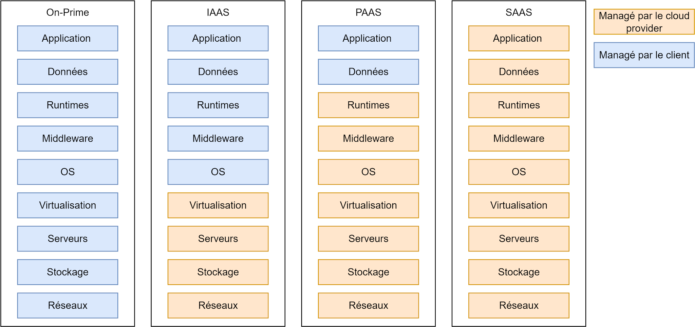

*[Virtualisation avancée, les notions essentielles](README.md) › Chapitre 6*

# 6. Cloud

## Introduction au cloud

Le **cloud computing** (informatique en nuage) consiste à fournir à la demande, via le réseau, des services informatiques : puissance de calcul, stockage, bases de données, logiciels… Plutôt que d'acheter et d'exploiter leurs propres serveurs, entreprises et particuliers consomment ces ressources chez un fournisseur, via Internet, et paient selon leur usage. Ce modèle a bouleversé la manière dont les organisations déploient et exploitent leurs applications et leurs données.

La virtualisation est le socle technique du cloud : c'est elle qui permet de découper et de louer finement des ressources physiques partagées entre de nombreux clients.

Les avantages du cloud sont nombreux :

- **Agilité et élasticité** : les ressources s'allouent, s'étendent ou se réduisent en quelques minutes, au rythme de la demande.
- **Réduction des investissements** : le paiement à l'usage évite d'investir dans du matériel coûteux. On ne paie que ce que l'on consomme : les dépenses d'investissement (CAPEX) deviennent des dépenses de fonctionnement (OPEX).
- **Rapidité de mise en œuvre** : un service se déploie en quelques clics ou quelques lignes de code, ce qui raccourcit le délai de mise sur le marché.
- **Disponibilité et redondance** : les fournisseurs proposent une infrastructure redondante, répartie sur plusieurs centres de données (zones et régions), qui réduit le risque d'interruption.
- **Accès universel** : les ressources sont accessibles de partout, ce qui facilite la collaboration et le travail à distance.

Dans une infrastructure traditionnelle, l'organisation investit dans ses serveurs, ses salles et ses équipes de maintenance. Le cloud transfère une partie de cette responsabilité au fournisseur. L'entreprise peut alors se concentrer sur ses applications et ses services plutôt que sur l'exploitation du matériel.

## Les modèles de service

Le cloud propose trois grands modèles de service, qui se distinguent par la part de l'empilement gérée par le fournisseur.

### IaaS, Infrastructure as a Service

L'**IaaS** fournit des ressources d'infrastructure virtuelles : machines virtuelles, stockage, réseaux. Le client les configure à sa guise et gère tout ce qui se trouve au-dessus : système d'exploitation, middleware, applications. C'est le modèle le plus souple.

*Exemple :* une jeune entreprise en forte croissance doit étendre rapidement son infrastructure. Grâce à l'IaaS, elle loue à la demande calcul, stockage et réseau, et adapte son environnement à ses besoins sans investir dans du matériel. Services typiques : Amazon EC2, Azure Virtual Machines, OVHcloud Public Cloud.

### PaaS, Platform as a Service

Le **PaaS** fournit une plateforme complète de développement et d'exécution : environnements d'exécution, bases de données gérées, outils préconfigurés. Les développeurs déploient leur code sans se soucier des serveurs ni des systèmes sous-jacents, ce qui accélère le développement et la mise en production.

*Exemples :* Heroku, Google App Engine, Azure App Service, Scalingo.

### SaaS, Software as a Service

Le **SaaS** fournit des applications complètes, hébergées par le fournisseur et utilisées via Internet, généralement dans un navigateur. Rien à installer ni à maintenir : les mises à jour sont automatiques.

*Exemple :* une entreprise veut se doter d'un logiciel de gestion de la relation client (CRM). Plutôt que de l'installer sur chaque poste, elle souscrit à un CRM en SaaS : les employés y accèdent depuis leur navigateur, sans se soucier de la maintenance. Services typiques : Salesforce, Microsoft 365, Google Workspace.

Ces modèles offrent des niveaux de contrôle différents : à chacun de choisir selon qu'il veut gérer des ressources, développer des applications ou simplement utiliser un logiciel. Lorsqu'une organisation a besoin d'un contrôle total sur son environnement, elle conserve son infrastructure sur site (*on-premise*).

*Figure 10 : de gauche à droite, le fournisseur (en orange) prend en charge une part croissante de l'empilement ; le client (en bleu) n'en gère plus qu'une part décroissante. La colonne « On-Prime » désigne l'hébergement sur site (*on-premise*).*

<!-- Source du schéma (draw.io) : https://app.diagrams.net/?page-id=GBStZavkyGiN6YYiA_E0&scale=auto#G1Y2tp5pJnp4KH7Wphgl4elJzLfcWbzrsz -->

D'autres modèles, plus récents, s'intercalent entre ceux-ci :

- **CaaS** (*Containers as a Service*) : le fournisseur exécute et orchestre les conteneurs du client (Kubernetes géré, AWS Fargate, Google Cloud Run).
- **FaaS** (*Functions as a Service*) : le client ne déploie que des fonctions, exécutées à la demande et facturées à l'appel (AWS Lambda, Azure Functions). C'est le cœur de l'approche *serverless*.

Quel que soit le modèle, la sécurité suit un modèle de responsabilité partagée : le fournisseur sécurise ce qu'il gère (matériel, centres de données, hyperviseurs…), le client reste responsable de ce qu'il configure (accès, données, applications).

## Les modèles de déploiement

Les modèles de déploiement définissent où se trouvent les ressources et avec qui elles sont partagées.

### Cloud public

Le fournisseur met ses ressources à disposition de tous ses clients via Internet. Plusieurs clients partagent la même infrastructure physique (on parle de mutualisation ou *multi-tenant*) et profitent ainsi des économies d'échelle. C'est une option économique, notamment pour les petites entreprises et les jeunes pousses, qui n'ont pas à investir dans du matériel.

### Cloud privé

L'infrastructure est dédiée à **une seule organisation**, sur site ou dans un centre de données privé. Elle offre davantage de contrôle sur la sécurité et la personnalisation, mais demande des investissements plus lourds en matériel et en exploitation.

### Cloud hybride

Le cloud hybride **combine** cloud public et cloud privé. L'entreprise confie au cloud public ses charges de travail les moins sensibles et conserve ses données et applications critiques dans son cloud privé. Elle gagne en souplesse tout en maintenant un haut niveau de sécurité. Lorsqu'on combine plusieurs fournisseurs de cloud public, on parle de multicloud.

### Cloud communautaire

Les ressources sont partagées entre **plusieurs organisations aux besoins communs** (même secteur, même réglementation). On combine ainsi les avantages de la mutualisation avec des exigences spécifiques de sécurité et de conformité, par exemple dans la santé ou le secteur public.

## Les défis du cloud

### Sécurité et confidentialité

Stocker et traiter des données chez un tiers soulève des questions de sécurité et de protection de la vie privée. Les entreprises doivent mettre en place des mesures de sécurité solides et respecter les lois et normes en vigueur, comme le RGPD en Europe.

### Souveraineté

Un fournisseur soumis à une loi étrangère peut être contraint de livrer des données à ses autorités, même si elles sont hébergées en Europe (c'est le cas du *Cloud Act* américain). Pour les données sensibles, on se tourne vers des offres de cloud de confiance, comme celles qualifiées SecNumCloud par l'ANSSI en France.

### Dépendance à Internet

L'accès au cloud repose sur une connexion fiable : une coupure rend applications et données indisponibles. Côté fournisseur, les centres de données doivent eux aussi résister aux coupures de courant et de réseau.

### Migration et intégration

Migrer des systèmes existants vers le cloud est complexe et demande une planification soignée. Faire communiquer services cloud et systèmes restés sur site pose aussi des difficultés.

### Contrôle réduit et dépendance au fournisseur

Une partie du contrôle sur l'infrastructure est déléguée au fournisseur, ce qui limite parfois la personnalisation. Les services propres à un fournisseur rendent aussi le départ vers un concurrent difficile : c'est l'enfermement propriétaire (*vendor lock-in*).

### Maîtrise des coûts

Le paiement à l'usage est un avantage, mais aussi un piège : des ressources oubliées ou surdimensionnées font vite grimper la facture. Le pilotage financier du cloud s'appelle le FinOps.

## Tendances

Le cloud évolue rapidement. Quelques tendances qui dessinent son avenir :

- **Edge computing** : les objets connectés (IoT) produisent d'énormes volumes de données. L'edge computing les traite au plus près de leur source, en périphérie du réseau, pour réduire la latence et gagner en réactivité.
- **Intelligence artificielle et apprentissage automatique** : le cloud fournit la puissance de calcul (notamment des GPU) nécessaire pour entraîner des modèles et analyser de grands volumes de données.
- **Serverless** : les développeurs exécutent leur code sans se soucier de l'infrastructure, qui s'adapte automatiquement à la charge.
- **Cloud durable** (*green cloud*) : les préoccupations environnementales poussent à des centres de données plus économes en énergie pour réduire l'empreinte carbone du numérique.

> **À retenir**
>
> - Le cloud fournit des ressources informatiques à la demande, payées à l'usage ; la virtualisation en est le socle.
> - IaaS = infrastructure, PaaS = plateforme, SaaS = logiciel : plus on monte, plus le fournisseur gère.
> - Public, privé, hybride, communautaire : le modèle de déploiement dit où sont les ressources et avec qui on les partage.
> - Sécurité, souveraineté, dépendance au fournisseur et maîtrise des coûts sont les principaux points de vigilance.

**Pour aller plus loin**

- [IBM, « What is cloud computing? »](https://www.ibm.com/topics/cloud-computing)
- [IBM, « IaaS, PaaS, SaaS »](https://www.ibm.com/topics/iaas-paas-saas)
- [Intel, « Qu'est-ce que le cloud computing ? »](https://www.intel.fr/content/www/fr/fr/cloud-computing/what-is-cloud-computing.html)
- [ANSSI, qualification SecNumCloud](https://cyber.gouv.fr/secnumcloud)

---

[← 5. Orchestration](05-orchestration.md) · [Sommaire](README.md#sommaire) · [7. Le DevOps →](07-le-devops.md)
