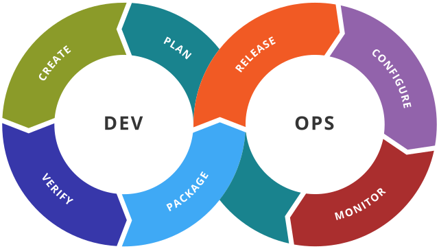

*[Virtualisation avancée, les notions essentielles](README.md) › Chapitre 7*

# 7. Le DevOps

Dans une organisation traditionnelle, les équipes de développement (*Dev*) et d'exploitation (*Ops*) poursuivent des objectifs opposés : les premières veulent livrer vite des nouveautés, les secondes veulent préserver la stabilité de la production. Souvent rattachées à des managers différents, elles communiquent peu. Ces silos entraînent des reproches mutuels lors des incidents et des processus manuels qui ralentissent tout.

Le **DevOps** est une culture et un ensemble de pratiques qui rapprochent ces deux mondes. Son objectif : livrer des applications plus souvent, plus vite et avec une meilleure qualité, en partageant les responsabilités. Il répond au besoin des entreprises d'évoluer au rythme du marché, tout en réduisant les conflits entre équipes.

*Figure 11 : le cycle DevOps est une boucle continue où la supervision de la production alimente la planification suivante. (Source : Kharnagy, Wikimedia Commons, CC BY-SA 4.0 ; voir les [crédits](../CREDITS.md))*

## Les principes fondamentaux

- **Automatisation** : elle est au cœur du DevOps. Compilation, tests, déploiement : toute tâche manuelle et répétitive est automatisée. Les processus vont plus vite, les erreurs humaines diminuent et les résultats sont reproductibles. La virtualisation et les conteneurs garantissent des environnements d'exécution homogènes, du poste du développeur à la production.
- **Collaboration** : développeurs, testeurs et exploitants travaillent ensemble, partagent l'information et visent un objectif commun.
- **Intégration et livraison continues** : l'intégration continue (CI) consiste à intégrer très fréquemment les modifications du code dans une base commune, chacune étant vérifiée par des tests automatisés. La livraison continue (CD) prolonge la démarche : le logiciel est toujours prêt à être déployé, et la mise en production se déclenche d'un clic. Dans le déploiement continu, elle se fait même automatiquement dès que les tests passent.
- **Mesure et amélioration continue** : la supervision constante de la production détecte rapidement les problèmes. Les retours d'expérience, après les succès comme après les incidents, permettent aux équipes de progresser en continu, sans chercher de coupable.

## Avantages et défis

**Avantages**

- **Agilité** : des cycles de développement et de déploiement courts permettent de répondre vite aux évolutions du marché.
- **Qualité** : les tests automatisés garantissent une qualité constante du code livré.
- **Réduction des risques** : des déploiements fréquents et petits sont moins risqués que de grosses mises en production occasionnelles.
- **Collaboration** : la communication permanente entre Dev et Ops améliore la compréhension mutuelle.

**Défis**

- **Changement culturel** : faire évoluer la culture de l'entreprise vers la collaboration et la responsabilité partagée est souvent la partie la plus difficile.
- **Complexité technique** : les nouveaux outils et pratiques demandent un apprentissage et doivent s'intégrer à l'existant.
- **Sécurité** : l'automatisation des déploiements impose des contrôles de sécurité rigoureux tout au long de la chaîne. Intégrer la sécurité dès le départ est l'objet du DevSecOps.

## Outils et pratiques

- **Gestion de versions** : Git permet de suivre toutes les modifications du code, de travailler à plusieurs et de revenir en arrière. Il est généralement associé à une forge comme GitLab ou GitHub.
- **Automatisation des builds et des tests** : Jenkins, GitLab CI ou GitHub Actions construisent des pipelines d'intégration continue qui compilent et testent le code à chaque modification.
- **Provisionnement de l'infrastructure** : l'Infrastructure as Code crée et gère les environnements de façon cohérente et reproductible, avec des outils comme Terraform et Ansible (voir le [chapitre 8](08-infrastructure-as-code.md)).
- **Conteneurisation** : Docker isole les applications et leurs dépendances, pour un déploiement rapide et identique sur toutes les plateformes.
- **Supervision** : Prometheus, Grafana ou la suite Elastic mesurent le comportement des applications en production (voir le [chapitre 9](09-monitoring.md)).

> **À retenir**
>
> - Le DevOps rapproche développement et exploitation autour d'objectifs communs.
> - Ses piliers : automatisation, collaboration, intégration et livraison continues, mesure et amélioration continue.
> - Le principal défi n'est pas technique mais culturel.

**Pour aller plus loin**

- Gene Kim, Kevin Behr et George Spafford, *The Phoenix Project*, roman sur la transformation DevOps d'une entreprise
- [Microsoft Azure, « Qu'est-ce que le DevOps ? »](https://azure.microsoft.com/fr-fr/resources/cloud-computing-dictionary/what-is-devops)
- [Red Hat, « Le DevOps, qu'est-ce que c'est ? »](https://www.redhat.com/fr/topics/devops)

---

[← 6. Cloud](06-cloud.md) · [Sommaire](README.md#sommaire) · [8. Infrastructure as Code →](08-infrastructure-as-code.md)
