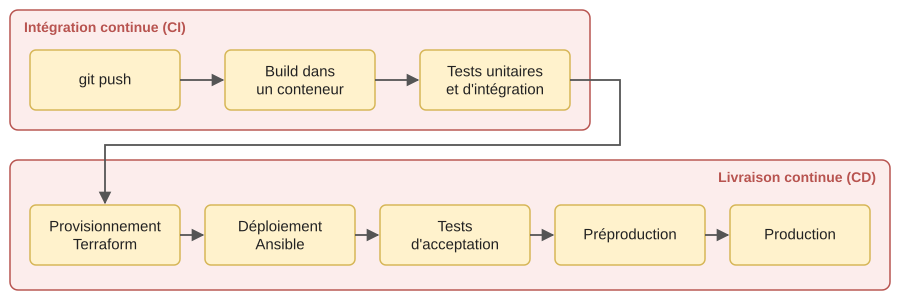

*[Virtualisation avancée, les notions essentielles](README.md) › Chapitre 8*

# 8. Infrastructure as Code

## Introduction à l'IaC

L'**Infrastructure as Code** (IaC) consiste à décrire et à provisionner l'infrastructure (serveurs, réseaux, stockage, configuration) au moyen de fichiers de code, plutôt que par des opérations manuelles. Création, configuration et gestion de l'infrastructure deviennent automatiques, cohérentes et répétables. L'IaC simplifie l'administration, rapproche les équipes Dev et Ops, réduit les erreurs humaines et rend les déploiements reproductibles.

## Les principes clés

**Décrire l'infrastructure dans du code.** Au lieu de configurer chaque composant à la main, on écrit des fichiers qui décrivent les ressources nécessaires : serveurs, réseaux, règles de pare-feu, logiciels installés. L'état souhaité de l'infrastructure est ainsi défini de façon reproductible.

**Automatiser le déploiement.** Une fois l'infrastructure décrite, l'outil d'IaC se charge de la créer conformément à la description. Toute évolution passe par une modification du code, ce qui garantit la cohérence entre les environnements de développement, de test et de production.

**Versionner l'infrastructure.** Le code d'infrastructure se gère comme le code d'une application : il est stocké dans un gestionnaire de versions comme Git. On collabore plus facilement (relecture des modifications), on sait qui a changé quoi et quand, et l'on revient en arrière en cas de problème.

**Viser l'idempotence.** Appliquer deux fois le même code doit produire le même résultat : si l'infrastructure est déjà dans l'état décrit, l'outil ne fait rien. C'est ce qui rend l'IaC sûre à rejouer.

L'IaC distingue deux approches :

- **déclarative** : on décrit le résultat attendu (« un serveur nginx doit être installé ») et l'outil détermine les actions nécessaires (Terraform, Puppet, Kubernetes) ;
- **impérative** : on décrit la suite d'actions à exécuter (« installer nginx, puis copier tel fichier »), comme dans un script shell.

L'IaC apporte ainsi :

- **la reproductibilité** : le même code produit des environnements identiques ;
- **des déploiements fiables** : l'automatisation élimine les erreurs des manipulations manuelles ;
- **l'évolutivité** : ajouter des ressources revient à modifier quelques lignes de code ;
- **une documentation à jour** : le code décrit précisément l'infrastructure réelle et sert de référence à toute l'équipe.

## Panorama des outils

Le bon outil dépend des besoins et du contexte. On distingue les outils de provisionnement, qui créent les ressources, et les outils de gestion de configuration, qui configurent les systèmes existants.

### Ansible

**Ansible** est un outil open source de gestion de configuration et d'automatisation, créé en 2012 et racheté par Red Hat en 2015. Il décrit les configurations dans des fichiers YAML appelés playbooks, exécutés dans l'ordre sur les machines cibles. Ses modules sont déclaratifs et idempotents : contrairement à un script bash, rejouer un playbook donne un résultat prévisible. Ansible est sans agent : il se connecte aux machines cibles par SSH, sans rien installer dessus. Sa simplicité en fait l'un des outils les plus utilisés.

### Chef et Puppet

**Chef** et Puppet sont des outils de gestion de configuration plus anciens. Ils décrivent l'état souhaité des systèmes dans des « recettes » (Chef) ou des « manifestes » (Puppet) et veillent à ce que les machines y restent conformes. Ils sont adaptés aux très grands parcs de serveurs. À la différence d'Ansible, ils exigent un agent installé sur chaque machine gérée, qui récupère régulièrement sa configuration auprès d'un serveur central. Leurs éditeurs commercialisent surtout des versions sous licence pour un usage professionnel.

### Terraform

**Terraform**, édité par HashiCorp (groupe IBM depuis 2025), est dédié au provisionnement de l'infrastructure : création, modification et suppression de VM, de réseaux, d'espaces de stockage, de services cloud… Il décrit l'état désiré dans des fichiers de configuration déclaratifs, et sait prévisualiser les changements avant de les appliquer. Il est multicloud : il pilote AWS, Azure, Google Cloud, OVHcloud, VMware, Proxmox et bien d'autres. Depuis le changement de licence de Terraform en 2023, sa variante open source OpenTofu, hébergée par la Linux Foundation puis accueillie à la CNCF en 2025, est une alternative compatible.

| | Ansible | Chef / Puppet | Terraform |
| --- | --- | --- | --- |
| Rôle principal | configuration, déploiement d'applications | configuration | provisionnement d'infrastructure |
| Approche | playbooks exécutés dans l'ordre, modules déclaratifs | déclarative | déclarative |
| Agent sur les cibles | non (SSH) | oui | non (API des fournisseurs) |
| Langage | YAML | DSL Ruby / DSL Puppet | HCL |

Ces outils sont complémentaires : on crée typiquement les machines avec Terraform, puis on les configure avec Ansible.

## Ansible en pratique

### L'inventaire

L'**inventaire** est un fichier (au format INI ou YAML) qui liste les machines gérées par Ansible, par adresse IP ou par nom. Ces machines doivent être joignables en SSH depuis le poste qui exécute Ansible. On les regroupe en groupes selon leur rôle, par exemple `serveurs_web` et `serveurs_db` :

```ini
[serveurs_web]
192.168.1.10
192.168.1.11

[serveurs_db]
db.example.com
```

Pour vérifier la connectivité et l'authentification SSH vers toutes les machines :

```bash
ansible all -i inventaire.ini -m ping
```

### Playbooks, tâches et modules

Un **playbook** est un fichier YAML qui associe des groupes de machines à une liste de tâches. Chaque tâche appelle un module, c'est-à-dire une action prête à l'emploi : copier un fichier, installer un paquet, gérer un service… Ansible en fournit plusieurs milliers.

```yaml
- name: Configurer les serveurs web
  hosts: serveurs_web
  become: true                         # exécuter en tant que root
  vars:
    logiciel_name: nginx
  tasks:
    - name: Installer {{ logiciel_name }}
      ansible.builtin.apt:
        name: "{{ logiciel_name }}"
        state: present                 # état souhaité : le paquet est installé
        update_cache: true

    - name: Copier le fichier de configuration
      ansible.builtin.copy:
        src: fichier.conf
        dest: /etc/fichier.conf
```

```bash
ansible-playbook -i inventaire.ini site.yml
```

### Variables et facts

Les **variables** adaptent un même playbook à différents environnements : dans l'exemple ci-dessus, `logiciel_name` peut valoir `nginx` en production et `apache2` ailleurs. Elles rendent les automatisations souples et réutilisables.

Ansible collecte aussi automatiquement des informations sur chaque machine, les facts (système d'exploitation, processeur, adresses réseau…), utilisables comme des variables dans les playbooks :

```bash
$ ansible localhost -m setup
[...]
"ansible_processor": [
    "0",
    "AuthenticAMD",
    "AMD Ryzen 5 4500U with Radeon Graphics"
[...]
```

### Gestion des erreurs

Par défaut, Ansible arrête de traiter une machine dès qu'une tâche échoue. Plusieurs mécanismes permettent d'affiner ce comportement. Ici, `ignore_errors` laisse le playbook continuer malgré l'échec de la commande, dont le résultat est enregistré pour être examiné par la tâche suivante :

```yaml
- name: Lancer une commande qui peut échouer
  ansible.builtin.command: /usr/bin/example-command -x -y -z
  register: command_result
  ignore_errors: true

- name: Arrêter le play si la commande a échoué
  ansible.builtin.fail:
    msg: "La commande a échoué"
  when: "'FAILED' in command_result.stderr"
```

Pour des traitements plus élaborés, les blocs `block` / `rescue` / `always` fonctionnent comme un `try` / `catch` / `finally`.

### Rôles

Les **rôles** regroupent tâches, variables, fichiers et modèles selon une arborescence standard, pour structurer et réutiliser les configurations. La plateforme [Ansible Galaxy](https://galaxy.ansible.com/) propose des milliers de rôles prêts à l'emploi, par exemple pour installer une pile ELK.

### Ansible Vault

**Ansible Vault** chiffre les informations sensibles (mots de passe, clés d'API) pour pouvoir les versionner sans les exposer :

```bash
ansible-vault create secrets.yml
```

### Les templates

Les **templates** Ansible reposent sur le moteur Jinja2. Ils génèrent des fichiers de configuration à partir de variables, de boucles et de conditions :

- une variable s'écrit entre doubles accolades : `{{ variable }}` ;
- une instruction s'écrit entre accolades et pourcentages : `` ;
- un commentaire s'écrit entre accolades et dièses : `{# commentaire #}`.

```jinja
{# Définition de la liste #}


{# Parcours de la liste pour afficher chaque valeur #}

Valeur : {{ value }}

```

## Terraform en pratique

Une configuration Terraform se compose de fichiers `.tf`, écrits dans le langage HCL, qui décrivent les ressources à créer et leurs paramètres.

Les **providers** sont des extensions qui permettent à Terraform de dialoguer avec l'API d'un service : fournisseur de cloud, hyperviseur, équipement réseau, plateforme de conteneurs… Il en existe des milliers, répertoriés dans le [registre Terraform](https://registry.terraform.io/browse/providers) (voir aussi la [documentation des providers](https://developer.hashicorp.com/terraform/language/providers)).

Exemple : une instance (VM) EC2 chez AWS, créée à partir de la dernière image Ubuntu de la région, dont on récupère l'adresse IP publique.

```hcl
terraform {
  required_providers {
    aws = {
      source  = "hashicorp/aws"
      version = "~> 6.0"
    }
  }
}

provider "aws" {
  region = "eu-west-3"                      # région de Paris
}

# Recherche de l'image Ubuntu 24.04 la plus récente dans la région
data "aws_ami" "ubuntu" {
  most_recent = true
  owners      = ["099720109477"]            # Canonical

  filter {
    name   = "name"
    values = ["ubuntu/images/hvm-ssd-gp3/ubuntu-noble-24.04-amd64-server-*"]
  }
}

resource "aws_instance" "example" {
  ami           = data.aws_ami.ubuntu.id
  instance_type = "t3.micro"
}

output "ip_publique" {
  value = aws_instance.example.public_ip
}
```

Les notions à connaître :

- **Provider** : l'extension qui fait le lien avec l'API d'un service.
- **Ressource** (*resource*) : un objet d'infrastructure à gérer, comme une instance de calcul ou un réseau virtuel.
- **Source de données** (*data*) : une lecture d'information existante chez le fournisseur, sans rien créer (ici, l'identifiant de l'image Ubuntu la plus récente de la région).
- **Variable** (*variable*) et valeur de sortie (*output*) : les paramètres d'entrée d'une configuration et les données qu'elle renvoie, réutilisables par d'autres configurations.
- **Module** : un ensemble de fichiers Terraform regroupés dans un dossier, qui forme un composant réutilisable.
- **État** (*state*) : le fichier `terraform.tfstate`, dans lequel Terraform mémorise l'infrastructure qu'il gère et la correspondance entre le code et les ressources réelles. En équipe, il est stocké de façon centralisée et protégé, car il peut contenir des secrets.
- **Plan** : l'étape qui compare le code à l'état réel et calcule les actions nécessaires (création, modification, suppression) pour atteindre l'état souhaité.
- **Apply** : l'étape qui exécute effectivement ces actions.

Le cycle de travail tient en quatre commandes :

```bash
terraform init      # initialiser le répertoire et télécharger les providers
terraform plan      # afficher les changements qui seront appliqués
terraform apply     # appliquer les changements
terraform destroy   # supprimer toutes les ressources gérées
```

## CI/CD

La **CI/CD** (intégration continue / livraison continue) automatise les étapes qui mènent d'une modification du code à sa mise en production : construction, tests, déploiement. Les équipes livrent ainsi plus vite et plus sûrement. Docker, Terraform et Ansible y sont des briques de base.



*Figure 12 : une chaîne CI/CD type, de la modification du code à la mise en production.*

### Exemple d'intégration continue

1. Un développeur pousse ses modifications vers le dépôt Git du projet.
2. L'outil de CI (GitLab CI, Jenkins, GitHub Actions…) détecte la nouvelle modification.
3. Il déclenche automatiquement la construction (*build*) de l'application dans un conteneur Docker, ce qui garantit un environnement identique à chaque fois.
4. Les tests unitaires et d'intégration s'exécutent dans ce conteneur pour vérifier que les modifications n'ont rien cassé (absence de régression).

### Exemple de livraison continue

1. Si les tests réussissent, l'outil déclenche un déploiement automatique vers un environnement de test.
2. Terraform provisionne l'infrastructure nécessaire (machines virtuelles, réseaux…), ce qui garantit un environnement cohérent.
3. Ansible déploie l'application sur les machines nouvellement créées et configure ses dépendances et ses paramètres.
4. Des tests d'acceptation automatisés valident le bon fonctionnement de l'application dans cet environnement.
5. Le même processus est rejoué sur un environnement de préproduction, pour une validation fonctionnelle par le client ou une équipe de recette, puis les changements sont appliqués en production.

Sur Kubernetes, l'étape de déploiement est de plus en plus confiée à un agent GitOps plutôt qu'au pipeline lui-même (voir [GitOps](#gitops)).

## GitOps

Le **GitOps** pousse la logique de l'IaC jusqu'au déploiement : le dépôt Git devient la **source de vérité unique** de l'état désiré du système, et un agent veille en permanence à ce que la réalité corresponde à ce dépôt. Le terme a été proposé en 2017 par la société Weaveworks. C'est la démarche présentée dans la conférence fil rouge du module, qui assemble GitLab, Ansible, Terraform et Kubernetes.

### Les quatre principes

Le projet OpenGitOps, hébergé par la CNCF, résume la démarche en quatre principes :

1. **Déclaratif** : l'état désiré du système est décrit, pas la suite d'actions pour l'atteindre (manifestes Kubernetes, charts Helm…).
2. **Versionné et immuable** : cet état est stocké dans Git, qui en conserve l'historique complet. Chaque changement est un commit.
3. **Tiré automatiquement** : un agent récupère lui-même l'état désiré depuis le dépôt (modèle *pull*).
4. **Réconcilié en continu** : l'agent compare sans cesse l'état réel à l'état désiré et corrige les écarts.

On reconnaît la **boucle de réconciliation** de Kubernetes (voir le [chapitre 5](05-orchestration.md#kubernetes)), étendue d'un cran. Kubernetes rapproche le cluster des objets enregistrés dans etcd ; l'agent GitOps rapproche ces objets du contenu de Git.

### Push ou pull

Dans une chaîne CI/CD classique, c'est le pipeline qui déploie : sa dernière étape exécute `kubectl apply` ou `helm upgrade` sur le cluster (modèle *push*). En GitOps, un agent installé dans le cluster vient chercher les changements (modèle *pull*).

| | Push (pipeline CI/CD) | Pull (GitOps) |
| --- | --- | --- |
| Qui déploie ? | le pipeline, à la fin de son exécution | un agent dans le cluster, en continu |
| Accès au cluster | le pipeline détient des identifiants d'administration | les identifiants restent dans le cluster ; l'agent ne fait que lire le dépôt |
| Modification manuelle du cluster | invisible jusqu'au prochain déploiement | détectée (dérive, *drift*) et annulée |
| Retour arrière | relancer un ancien pipeline | `git revert` |
| Traçabilité | journaux du pipeline | historique Git : qui a changé quoi, quand, après quelle relecture |

### Le déroulé type

On sépare généralement deux dépôts : celui du **code de l'application** et celui de sa **configuration de déploiement** (manifestes, valeurs Helm).

1. Un développeur pousse une modification du code. La CI construit l'image, la teste et la publie dans le registre (`mon-app:1.4.2`).
2. La CI, ou un robot, propose dans le dépôt de configuration une merge request qui remplace l'ancienne étiquette d'image par `1.4.2`.
3. Après relecture, la merge request est fusionnée.
4. L'agent GitOps détecte le nouveau commit et applique les manifestes au cluster.
5. Kubernetes met à jour les pods progressivement (*rolling update*).

Un retour arrière se fait de la même façon : on annule le commit, et l'agent ramène le cluster à l'état précédent.

### Argo CD et Flux

Deux outils open source, tous deux projets diplômés (*graduated*) de la CNCF, dominent le domaine :

- **Argo CD** : un serveur installé dans le cluster, avec une interface web qui montre l'état de synchronisation de chaque application ;
- **Flux** : un ensemble de contrôleurs Kubernetes, piloté en ligne de commande et entièrement par des ressources Kubernetes.

Avec Argo CD, une application se déclare elle-même par une ressource Kubernetes, qui associe un dossier d'un dépôt Git à un namespace du cluster :

```yaml
apiVersion: argoproj.io/v1alpha1
kind: Application
metadata:
  name: mon-app
  namespace: argocd
spec:
  project: default
  source:
    repoURL: https://gitlab.example.com/equipe/mon-app-config.git
    targetRevision: main          # branche suivie
    path: k8s/production          # dossier des manifestes
  destination:
    server: https://kubernetes.default.svc   # le cluster où tourne Argo CD
    namespace: mon-app
  syncPolicy:
    automated:
      prune: true                 # supprimer ce qui a disparu du dépôt
      selfHeal: true              # annuler les modifications manuelles
```

### Les limites

- **Les secrets** : Git ne doit jamais contenir de mot de passe en clair. On y stocke des secrets chiffrés (Sealed Secrets, SOPS) ou de simples références vers un coffre-fort (External Secrets Operator et HashiCorp Vault, par exemple).
- **Ce qui n'est pas dans Kubernetes** : les VM, les réseaux ou les comptes cloud restent le plus souvent créés par Terraform depuis un pipeline. Des outils comme Crossplane étendent la réconciliation à ces ressources, en les décrivant à leur tour comme des objets Kubernetes.
- **L'ordre de déploiement** : un état désiré n'exprime pas naturellement « d'abord la base de données, ensuite l'application ». Il faut des mécanismes dédiés, comme les *sync waves* d'Argo CD ou les dépendances entre ressources de Flux.

> **À retenir**
>
> - L'IaC décrit l'infrastructure dans du code versionné, reproductible et idempotent.
> - Terraform crée l'infrastructure (provisionnement), Ansible la configure (gestion de configuration).
> - Ansible : inventaire + playbooks, sans agent, via SSH. Terraform : `init`, `plan`, `apply`, avec un fichier d'état.
> - La CI/CD enchaîne automatiquement build, tests et déploiements jusqu'en production.
> - GitOps : Git est la source de vérité de l'état désiré ; un agent dans le cluster (Argo CD, Flux) le tire et le réconcilie en continu. Retour arrière = `git revert`.

**Pour aller plus loin**

- [Documentation Ansible](https://docs.ansible.com/)
- [Documentation Terraform](https://developer.hashicorp.com/terraform/docs)
- [OpenTofu](https://opentofu.org/)
- [OpenGitOps, les principes du GitOps](https://opengitops.dev/)
- [Documentation Argo CD](https://argo-cd.readthedocs.io/en/stable/)
- [Documentation Flux](https://fluxcd.io/flux/)

---

[← 7. Le DevOps](07-le-devops.md) · [Sommaire](README.md#sommaire) · [9. Monitoring →](09-monitoring.md)
