<p align="center">
  
</p>

# Virtualisation avancée, les notions essentielles

## Introduction

Ce document rassemble les notions à maîtriser pour suivre le module de virtualisation avancée : virtualisation des serveurs et du stockage, conteneurs, orchestration, cloud, DevOps, Infrastructure as Code et monitoring. Chaque chapitre se termine par un encadré À retenir et une sélection de lectures pour approfondir. Les encadrés « À retenir » forment le socle attendu à l'évaluation ; le reste du texte l'explique et l'approfondit. Un glossaire en fin de document reprend les termes clés.

**À l'issue de ce cours, vous saurez :**

- expliquer ce qu'est la virtualisation, la distinguer de l'émulation et citer ses domaines d'application ;
- comparer les hyperviseurs de type 1 et de type 2, la paravirtualisation et la conteneurisation ;
- choisir une architecture de stockage (DAS, SAN, NAS), un niveau de RAID et organiser des volumes avec LVM ;
- construire et lancer des conteneurs Docker, puis décrire comment Kubernetes les orchestre ;
- situer les modèles de service (IaaS, PaaS, SaaS) et de déploiement du cloud ;
- expliquer la démarche DevOps et le rôle de l'Infrastructure as Code (Ansible, Terraform, CI/CD) ;
- définir une stratégie de monitoring et formuler des objectifs de service (SLA, SLO, SLI).

## Sommaire

- [Introduction](#introduction)

1. [Virtualisation, concepts généraux](#1-virtualisation-concepts-généraux)
   - [Historique](#historique)
   - [Virtualisation et émulation](#virtualisation-et-émulation)
   - [Avantages et inconvénients](#avantages-et-inconvénients)
   - [Les domaines d'application](#les-domaines-dapplication)
2. [Serveur virtualisé](#2-serveur-virtualisé)
   - [Hyperviseurs de type 1](#hyperviseurs-de-type-1)
   - [Hyperviseurs de type 2](#hyperviseurs-de-type-2)
   - [Paravirtualisation](#paravirtualisation)
   - [Isolation par conteneurs](#isolation-par-conteneurs)
   - [Synthèse](#synthèse)
3. [Stockage virtualisé](#3-stockage-virtualisé)
   - [Disque virtuel et thin provisioning](#disque-virtuel-et-thin-provisioning)
   - [Les architectures de stockage](#les-architectures-de-stockage)
   - [RAID](#raid)
   - [LVM](#lvm)
4. [Conteneurisation](#4-conteneurisation)
   - [Introduction à la conteneurisation](#introduction-à-la-conteneurisation)
   - [Fonctionnement de la conteneurisation](#fonctionnement-de-la-conteneurisation)
   - [Les concepts importants](#les-concepts-importants)
   - [Docker en pratique](#docker-en-pratique)
5. [Orchestration](#5-orchestration)
   - [Automatisation et orchestration](#automatisation-et-orchestration)
   - [Le scaling](#le-scaling)
   - [Orchestration de machines virtuelles](#orchestration-de-machines-virtuelles)
   - [Orchestration de conteneurs](#orchestration-de-conteneurs)
   - [Kubernetes](#kubernetes)
6. [Cloud](#6-cloud)
   - [Introduction au cloud](#introduction-au-cloud)
   - [Les modèles de service](#les-modèles-de-service)
   - [Les modèles de déploiement](#les-modèles-de-déploiement)
   - [Les défis du cloud](#les-défis-du-cloud)
   - [Tendances](#tendances)
7. [Le DevOps](#7-le-devops)
   - [Les principes fondamentaux](#les-principes-fondamentaux)
   - [Avantages et défis](#avantages-et-défis)
   - [Outils et pratiques](#outils-et-pratiques)
8. [Infrastructure as Code](#8-infrastructure-as-code)
   - [Introduction à l'IaC](#introduction-à-liac)
   - [Les principes clés](#les-principes-clés)
   - [Panorama des outils](#panorama-des-outils)
   - [Ansible en pratique](#ansible-en-pratique)
   - [Terraform en pratique](#terraform-en-pratique)
   - [CI/CD](#cicd)
9. [Monitoring](#9-monitoring)
   - [Pourquoi superviser](#pourquoi-superviser)
   - [Les types de monitoring](#les-types-de-monitoring)
   - [Les principaux outils](#les-principaux-outils)
   - [SLA, SLO et SLI](#sla-slo-et-sli)
10. [Glossaire](#10-glossaire)

---

## 1. Virtualisation, concepts généraux

### Historique

La virtualisation existe presque depuis les débuts de l'informatique. Son principe est simple : intercaler une couche d'abstraction entre le matériel et les logiciels, afin de faire fonctionner plusieurs systèmes d'exploitation ou applications sur une même machine.

Tout commence dans les années 1960 chez IBM, avec le CP-40, capable de faire tourner plusieurs systèmes d'exploitation indépendants sur un même ordinateur central (*mainframe*). La virtualisation moderne prend son essor à la fin des années 1990 sur l'architecture x86, celle des PC et des serveurs du marché : VMware parvient alors à exécuter plusieurs systèmes d'exploitation sur une seule machine physique. La technologie s'est ensuite diversifiée (virtualisation au niveau du système d'exploitation, virtualisation d'applications, conteneurs). Elle a profondément changé l'exploitation des infrastructures : meilleure utilisation du matériel, gestion plus souple, déploiements plus rapides.

**Les dates clés :**

| Année | Événement |
| --- | --- |
| 1967 | IBM met en service le CP-40, l'un des premiers systèmes de virtualisation, qui exécute plusieurs instances de système d'exploitation sur un mainframe. |
| 1972 | IBM commercialise VM/370, qui popularise les machines virtuelles sur ses ordinateurs centraux. |
| 1999 | VMware (fondée en 1998 par Diane Greene, Mendel Rosenblum, Scott Devine, Edouard Bugnion et Ellen Wang) lance VMware Workstation : la virtualisation arrive sur les PC x86. |
| 2003 | Première version publique de Xen, hyperviseur open source issu de l'université de Cambridge, qui popularise la paravirtualisation sur les serveurs. |
| 2006 | Amazon Web Services lance EC2 (*Elastic Compute Cloud*) : la location de machines virtuelles à la demande donne naissance au cloud computing moderne. |
| 2007 | KVM est intégré au noyau Linux, qui devient lui-même un hyperviseur. |
| 2009 | VMware Infrastructure devient VMware vSphere, plateforme de référence pour la virtualisation des centres de données. |
| 2013 | Lancement de Docker, qui démocratise les conteneurs et accompagne l'essor du DevOps. |
| 2014 | Google dévoile Kubernetes, orchestrateur de conteneurs open source, confié en 2015 à la Cloud Native Computing Foundation (CNCF). |
| 2016 | Microsoft lance le Windows Subsystem for Linux (WSL). Annoncé en 2019 et disponible en 2020, WSL 2 exécute un vrai noyau Linux dans une machine virtuelle légère. |
| 2020 | Apple annonce le passage des Mac à ses processeurs ARM (Apple Silicon) : les outils de virtualisation et d'émulation doivent s'adapter à cette nouvelle architecture. |

### Virtualisation et émulation

La virtualisation consiste à créer une version virtuelle d'une ressource (système d'exploitation, serveur, réseau, stockage) au moyen d'une couche d'abstraction. Il ne faut pas la confondre avec l'émulation, même si les deux sont souvent combinées :

- **Émulation** : simulation logicielle d'un matériel ou d'un environnement différent de celui de l'hôte. Elle permet d'exécuter un programme sur un matériel normalement incompatible (par exemple un logiciel ARM sur un processeur x86). Elle est souple mais coûteuse en performances.
- **Virtualisation** : création d'instances isolées qui s'exécutent sur le même type de matériel que l'hôte. Les instructions des invités s'exécutent directement sur le processeur, ce qui limite la perte de performances.

Deux termes reviendront tout au long du cours :

- **Hôte** (*host*) : le système physique sur lequel s'exécutent les machines virtuelles ou les conteneurs.
- **Invité** (*guest*) : le système d'exploitation ou l'application qui s'exécute à l'intérieur d'une machine virtuelle ou d'un conteneur.

La plupart des solutions de virtualisation savent aussi émuler certains périphériques (carte réseau, contrôleur disque, carte graphique) pour les présenter aux invités.

### Avantages et inconvénients

#### Les avantages

- **Optimisation des ressources** : plusieurs machines virtuelles (VM) partagent une même machine physique. Le matériel, rarement utilisé à pleine charge par un seul système, est mieux rentabilisé.
- **Isolation et sécurité** : chaque VM est isolée des autres. Une panne ou une compromission sur l'une n'affecte pas directement ses voisines, ce qui limite la propagation des logiciels malveillants.
- **Flexibilité et agilité** : créer, dupliquer, déplacer ou supprimer une VM prend quelques minutes. Les déploiements et les tests en environnement isolé s'en trouvent accélérés.
- **Économies** : moins de serveurs physiques, c'est moins d'achats, de maintenance, de place en salle et de consommation électrique.
- **Migration et haute disponibilité** : une VM peut être déplacée d'un hôte à un autre, y compris à chaud. On équilibre ainsi la charge et on redémarre les VM ailleurs en cas de panne matérielle.
- **Indépendance vis-à-vis du matériel** : l'invité voit un matériel virtuel standard, ce qui facilite le remplacement des serveurs physiques.

#### Les inconvénients

- **Surcoût de performances** (*overhead*) : la couche d'abstraction entre le matériel et l'application consomme un peu de ressources.
- **Complexité** : l'exploitation d'une infrastructure virtualisée demande des compétences spécifiques.
- **Dépendance à l'hyperviseur** : si l'hyperviseur ou son hôte tombe, toutes les VM hébergées sont touchées. On parle de point unique de défaillance (*single point of failure*).
- **Licences logicielles** : certains éditeurs facturent selon le nombre de cœurs physiques de l'hôte ou de VM. Rester en conformité peut devenir complexe et coûteux.
- **Sécurité** : l'isolation renforce la sécurité, mais une mauvaise configuration de l'hyperviseur ou des réseaux virtuels ouvre de nouveaux risques.
- **Migrations délicates** : certaines applications demandent des ajustements importants pour passer d'un serveur physique à un environnement virtuel sans perdre en performances.

Bien maîtrisée, la virtualisation apporte efficacité, flexibilité et indépendance vis-à-vis du matériel. Ses limites doivent toutefois être connues pour faire les bons choix d'architecture.

### Les domaines d'application

La virtualisation s'applique à presque toutes les couches d'un système d'information.

#### Virtualisation des serveurs

C'est l'usage le plus courant. Des solutions comme VMware vSphere, Microsoft Hyper-V ou Proxmox Virtual Environment découpent un serveur physique en plusieurs machines virtuelles indépendantes. Chez un hébergeur, une VM louée est souvent appelée VPS (*Virtual Private Server*).

#### Virtualisation des réseaux

Elle crée des réseaux virtuels isolés au-dessus d'une infrastructure physique commune. On segmente et sécurise ainsi les flux, et on simplifie la configuration. Commutateurs, routeurs et pare-feu peuvent tous être virtualisés. Trois technologies sont à connaître :

- **VLAN** (*Virtual Local Area Network*, norme IEEE 802.1Q) : découpage logique d'un réseau physique en plusieurs réseaux distincts, au niveau 2 du modèle OSI. Chaque VLAN est isolé des autres, ce qui améliore la sécurité et la maîtrise du trafic.
- **VPN** (*Virtual Private Network*) : connexion chiffrée entre des sites ou des utilisateurs distants, au travers d'Internet, pour accéder aux ressources internes comme si l'on était sur place. Il s'agit le plus souvent d'une virtualisation de la couche 3 du modèle OSI, avec des protocoles comme IPsec, WireGuard ou OpenVPN (TLS). Les opérateurs proposent aussi des VPN MPLS entre sites.
- **SDN** (*Software-Defined Networking*) : le plan de contrôle (les décisions de routage) est séparé du plan de données (l'acheminement des paquets) et centralisé dans un contrôleur logiciel. Le réseau devient programmable, et un même équipement peut changer de rôle selon sa configuration.

#### Virtualisation du stockage

Les disques physiques sont regroupés en un pool de stockage virtuel. On alloue ensuite de l'espace à la demande, sans être limité par la capacité d'un disque en particulier. Ceph, VMware vSAN ou, à l'échelle d'un serveur, LVM permettent cet usage (voir le [chapitre 3](#3-stockage-virtualisé)).

#### Virtualisation d'applications

Les applications s'exécutent dans des environnements isolés, indépendamment du système sous-jacent, ce qui simplifie leur déploiement et leur compatibilité. Les conteneurs (Docker, LXC) en sont aujourd'hui la forme la plus répandue. Il existe aussi des outils de virtualisation applicative au sens strict, comme Microsoft App-V, qui encapsulent une application de bureau.

#### Virtualisation du poste de travail (VDI)

La VDI (*Virtual Desktop Infrastructure*) héberge les postes de travail dans le centre de données. Les utilisateurs accèdent à leur bureau depuis n'importe quel terminal, les données restent centralisées et l'administration est simplifiée. Citrix Virtual Apps and Desktops et Microsoft Remote Desktop Services sont des solutions répandues.

> **À retenir**
>
> - La virtualisation intercale une couche d'abstraction entre le matériel et les logiciels pour partager une même machine entre plusieurs systèmes isolés.
> - L'émulation simule un matériel *différent* ; la virtualisation exécute des invités sur le *même* type de matériel, avec peu de pertes.
> - Elle s'applique aux serveurs, aux réseaux (VLAN, VPN, SDN), au stockage, aux applications et aux postes de travail.

**Pour aller plus loin**

- [Red Hat, « Qu'est-ce que la virtualisation ? »](https://www.redhat.com/fr/topics/virtualization)
- [IBM, « Qu'est-ce que la virtualisation ? »](https://www.ibm.com/fr-fr/topics/virtualization)

---

## 2. Serveur virtualisé

Il existe plusieurs façons de partager un serveur entre plusieurs systèmes. Elles diffèrent par l'endroit où se place la couche d'abstraction.

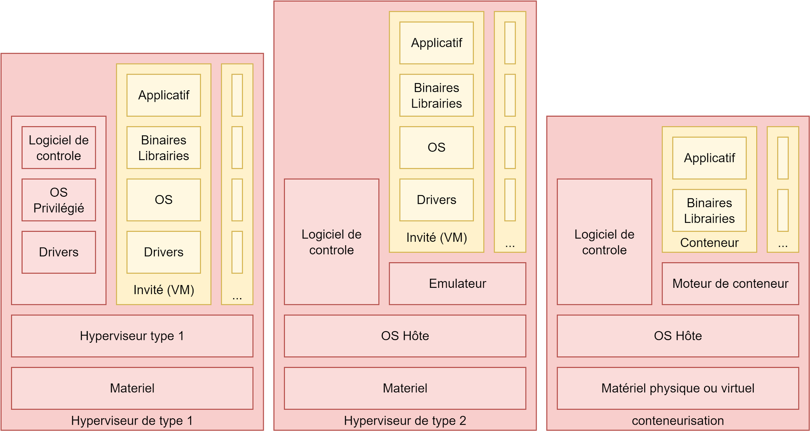

*Figure 1 : empilements comparés d'un hyperviseur de type 1, d'un hyperviseur de type 2 et d'une plateforme de conteneurs.*

<!-- Source du schéma (draw.io) : https://app.diagrams.net/?page-id=54EUpLZvDEcmd9ZNUH4Z&scale=auto#G1fWLtfPeYV-gSjBtzDSNkNKkGQIl-cnZL -->

### Hyperviseurs de type 1

Les hyperviseurs de type 1, dits **natifs** ou *bare metal*, s'exécutent directement sur le matériel, sans système d'exploitation hôte. Ils accèdent directement aux ressources matérielles et sont conçus pour héberger de nombreux systèmes invités. N'ayant pas d'OS hôte intermédiaire à traverser, ils offrent de meilleures performances et une meilleure isolation que les hyperviseurs de type 2. C'est la solution standard en centre de données.

Exemples : VMware ESXi (au cœur de vSphere), Microsoft Hyper-V, Xen, KVM (intégré au noyau Linux) et Proxmox VE (qui s'appuie sur KVM).

### Hyperviseurs de type 2

Les hyperviseurs de type 2, dits **hébergés**, s'exécutent comme une application au-dessus d'un système d'exploitation hôte. Ils sont plus simples à installer et à utiliser, mais l'OS hôte ajoute une surcharge et les rend moins performants. Ils conviennent aux postes de travail, au développement et aux tests.

Exemples : VMware Workstation, Oracle VirtualBox, Parallels Desktop.

### Paravirtualisation

En virtualisation complète, le système invité ignore qu'il est virtualisé. En paravirtualisation, il est au contraire modifié, ou équipé de pilotes spécifiques, pour coopérer avec l'hyperviseur. Il dialogue avec lui au travers d'interfaces dédiées au lieu de passer par du matériel émulé, ce qui réduit la surcharge et améliore les performances, en particulier pour les disques et le réseau.

Exemples : Xen en mode PV, KVM avec les pilotes virtio.

### Isolation par conteneurs

La conteneurisation est une forme de virtualisation légère qui isole des applications et leurs dépendances dans des conteneurs. Contrairement aux VM, les conteneurs partagent le noyau du système hôte : pas d'OS invité à démarrer, d'où leur légèreté et leur démarrage quasi instantané. Plusieurs conteneurs cohabitent sur un même hôte sans interférer. En contrepartie, l'isolation est moins forte qu'avec une VM, puisque le noyau est commun.

Exemples : Docker, Podman, LXC (voir le [chapitre 4](#4-conteneurisation)).

### Synthèse

| | Hyperviseur de type 1 | Hyperviseur de type 2 | Conteneurs |
| --- | --- | --- | --- |
| S'exécute sur | le matériel | un OS hôte | le noyau de l'OS hôte |
| Unité isolée | VM avec son propre OS | VM avec son propre OS | processus applicatif |
| Isolation | très forte | forte | plus faible (noyau partagé) |
| Performances | élevées | moyennes | proches du natif |
| Démarrage | minutes | minutes | secondes |
| Usage typique | centre de données, cloud | poste de travail, tests | microservices, CI/CD |
| Exemples | ESXi, Hyper-V, KVM, Xen | VirtualBox, VMware Workstation | Docker, Podman, LXC |

> **À retenir**
>
> - Type 1 : directement sur le matériel, performant, standard en production.
> - Type 2 : au-dessus d'un OS, pratique sur un poste de travail, moins performant.
> - Paravirtualisation : l'invité coopère avec l'hyperviseur (pilotes virtio) pour gagner en performances.
> - Conteneurs : noyau partagé, très légers, isolation moindre qu'une VM.

**Pour aller plus loin**

- [Red Hat, « Qu'est-ce qu'un hyperviseur ? »](https://www.redhat.com/fr/topics/virtualization/what-is-a-hypervisor)
- [IBM, « Qu'est-ce que la virtualisation ? »](https://www.ibm.com/fr-fr/topics/virtualization)

---

## 3. Stockage virtualisé

Le stockage virtualisé regroupe des ressources de stockage physiques, les gère de façon centralisée et les présente aux systèmes sous forme de ressources logiques. La gestion est simplifiée, l'espace mieux utilisé, et l'on s'adapte vite aux besoins changeants des applications.

### Disque virtuel et thin provisioning

- **Disque virtuel** (*virtual disk*) : abstraction logique d'un espace de stockage, utilisée pour stocker les données d'une VM. Il se configure, se redimensionne et se gère comme un disque physique, mais il est en réalité stocké sous forme de fichier ou de volume sur un ou plusieurs disques physiques (formats VMDK, VHDX, QCOW2…).
- **Thin provisioning** (allocation dynamique) : l'espace n'est consommé qu'au fur et à mesure de l'écriture des données, au lieu d'être réservé entièrement à la création (*thick provisioning*). On évite ainsi de gaspiller de l'espace inutilisé. En contrepartie, on peut promettre plus d'espace qu'il n'en existe réellement (surallocation). Un suivi attentif du taux de remplissage est alors indispensable, faute de quoi toutes les VM du pool risquent de se bloquer en même temps.

### Les architectures de stockage

**DAS** (*Direct Attached Storage*) : stockage local, relié directement au serveur sans passer par le réseau, via une interface SATA, SAS ou NVMe. Il est performant et peu coûteux, mais peu flexible à grande échelle : chaque serveur dispose seul de ses disques.

**SAN** (*Storage Area Network*) : réseau dédié qui relie les serveurs à des baies de stockage, avec un accès en mode bloc. Les serveurs voient des volumes (appelés LUN) comme s'il s'agissait de disques locaux. Le SAN centralise et partage le stockage, avec de hautes performances, de la redondance et une administration centralisée. Il s'appuie sur des protocoles comme Fibre Channel ou iSCSI. Ces solutions très complètes sont aussi coûteuses.

**NAS** (*Network Attached Storage*) : serveur de fichiers connecté au réseau, qui partage des fichiers avec les utilisateurs et les applications via les protocoles NFS (monde Unix) ou SMB (monde Windows). Il est idéal pour le partage de documents et le travail collaboratif.

On rencontre aussi de plus en plus le **stockage objet** (protocole S3), où chaque donnée est un objet identifié par une clé et accessible par une API HTTP. C'est le stockage de référence du cloud (Amazon S3, Ceph, MinIO).

| | DAS | SAN | NAS |
| --- | --- | --- | --- |
| Mode d'accès | bloc, local | bloc, via le réseau | fichier, via le réseau |
| Protocoles | SATA, SAS, NVMe | Fibre Channel, iSCSI | NFS, SMB |
| Partage entre serveurs | non | oui (LUN) | oui (partages réseau) |
| Coût | faible | élevé | modéré |
| Usage typique | serveur isolé | bases de données, clusters de virtualisation | partage de fichiers |

### RAID

Le **RAID** (*Redundant Array of Independent Disks*) combine plusieurs disques physiques en un seul volume logique. Selon le niveau choisi, il améliore les performances, la tolérance aux pannes, ou les deux, en répartissant les données sur plusieurs disques. Il constitue la base de la disponibilité des données dans un stockage virtualisé.

- **RAID 0** (*striping*, ou agrégation par bandes) : les données sont découpées en bandes réparties sur tous les disques. Les lectures et les écritures sont plus rapides, mais il n'y a aucune redondance : la panne d'un seul disque entraîne la perte de toutes les données. Il faut au moins 2 disques.
- **RAID 1** (*mirroring*, ou miroir) : les données sont copiées à l'identique, en temps réel, sur chaque disque. La tolérance aux pannes est excellente, mais la capacité utile se limite à celle d'un seul disque. Il faut au moins 2 disques.
- **RAID 5** : les blocs de données sont répartis sur tous les disques, accompagnés d'une parité elle aussi distribuée. En cas de panne d'un disque, ses données sont recalculées à partir des autres. Bon compromis entre capacité, performances et sécurité, c'est l'un des niveaux les plus répandus. Les écritures sont un peu ralenties par le calcul de parité et la reconstruction après une panne est longue. Il faut au moins 3 disques.

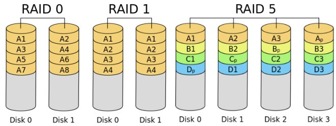

*Figure 2 : en RAID 0 les blocs sont répartis, en RAID 1 ils sont dupliqués, en RAID 5 ils sont répartis avec un bloc de parité (Ap, Bp…) tournant d'un disque à l'autre.*

D'autres niveaux répondent à des besoins plus spécifiques :

- **RAID 6** : comme le RAID 5, mais avec une double parité. Il supporte la panne simultanée de deux disques, ce qui est précieux avec des disques de grande capacité dont la reconstruction dure longtemps. Il faut au moins 4 disques.
- **RAID 10** (1+0) : des paires de disques en miroir (RAID 1), elles-mêmes agrégées en RAID 0. Il combine redondance et hautes performances, au prix de la moitié de la capacité. Il est apprécié pour les bases de données. Il faut au moins 4 disques.

On peut enfin prévoir un ou plusieurs **disques de secours** (*hot spare*), qui remplacent automatiquement un disque défaillant et lancent aussitôt la reconstruction.

| Niveau | Principe | Disques min. | Capacité utile (n disques de taille C) | Pannes tolérées |
| --- | --- | --- | --- | --- |
| RAID 0 | répartition | 2 | n × C | aucune |
| RAID 1 | miroir | 2 | C | n − 1 |
| RAID 5 | répartition + parité | 3 | (n − 1) × C | 1 |
| RAID 6 | répartition + double parité | 4 | (n − 2) × C | 2 |
| RAID 10 | miroirs agrégés | 4 | (n / 2) × C | 1 garantie, jusqu'à n / 2 si elles touchent des miroirs différents |

> Attention : le RAID n'est pas une sauvegarde. Il protège contre la panne d'un disque, pas contre une suppression accidentelle, un rançongiciel ou la perte du serveur entier. Les sauvegardes restent indispensables.

### LVM

**LVM** (*Logical Volume Manager*) est le gestionnaire de volumes logiques de Linux, très utilisé sur les serveurs. Il ajoute une couche d'abstraction entre les disques physiques et les systèmes de fichiers, ce qui rend la gestion du stockage souple et dynamique :

- les volumes ne dépendent plus de la taille des disques : un volume peut s'étendre sur plusieurs disques ;
- on ajoute, supprime ou redimensionne des volumes à chaud, sans interrompre les services ;
- on peut migrer les données d'un disque à un autre (par exemple avant de remplacer un disque défaillant) en limitant les interruptions ;
- les instantanés (*snapshots*) facilitent les sauvegardes et les tests ;
- LVM sait aussi construire du RAID au niveau des volumes logiques.

LVM repose sur quatre notions :

- **Physical Volume (PV)** : un disque, une partition ou un autre périphérique de stockage confié à LVM.
- **Volume Group (VG)** : un regroupement de PV qui forme un espace de stockage commun.
- **Logical Volume (LV)** : un volume taillé dans l'espace d'un VG. Il s'utilise comme un disque (on y crée un système de fichiers) et peut être redimensionné ou déplacé sans affecter les autres volumes.
- **Extents** : les blocs de taille fixe (4 Mio par défaut) qui découpent les PV et les LV. Ce sont les unités d'allocation de LVM.

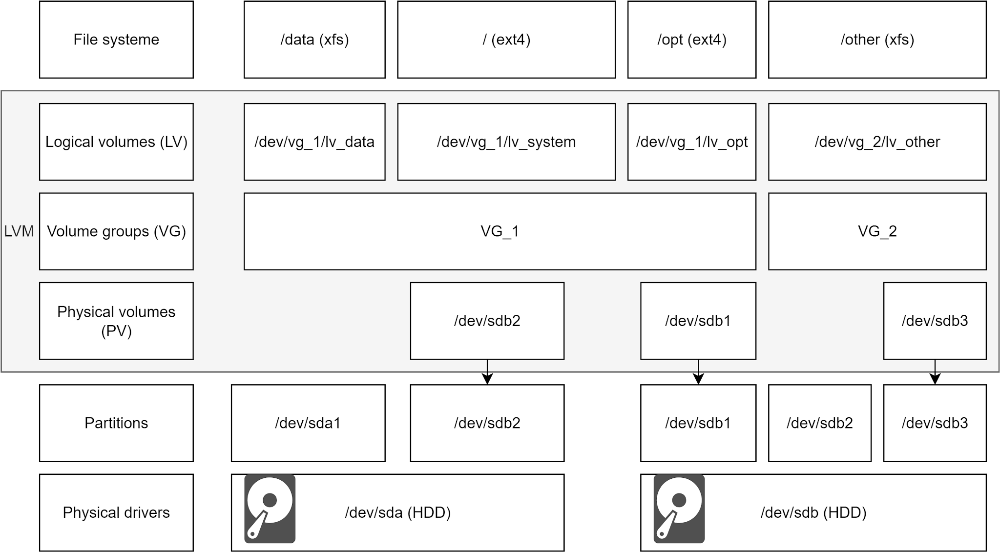

*Figure 3 : de bas en haut, les disques sont partitionnés, les partitions deviennent des volumes physiques (PV), regroupés en groupes de volumes (VG) dans lesquels on taille des volumes logiques (LV) qui portent les systèmes de fichiers.*

<!-- Source du schéma (draw.io) : https://app.diagrams.net/?page-id=cXBpNCS32hI19AK-VzXU&scale=auto#G1y_zsZ7JmoBmrrzWprRqkDJ6SUddxIMf1 -->

Exemple : créer un volume de 20 Go à partir de deux partitions, puis l'agrandir de 10 Go.

```bash
pvcreate /dev/sdb1 /dev/sdb2            # partitions → volumes physiques (PV)
vgcreate vg_1 /dev/sdb1 /dev/sdb2       # PV regroupés en groupe de volumes (VG)
lvcreate -n lv_data -L 20G vg_1         # volume logique (LV) de 20 Go
mkfs.xfs /dev/vg_1/lv_data              # système de fichiers XFS
mount /dev/vg_1/lv_data /data           # montage
lvextend -r -L +10G /dev/vg_1/lv_data   # +10 Go à chaud (LV et FS)
```

Lorsque le groupe de volumes est plein, on lui ajoute un nouveau disque, puis on agrandit le volume logique, toujours sans interruption :

```bash
pvcreate /dev/sdc1                      # nouveau disque → volume physique
vgextend vg_1 /dev/sdc1                 # ajouté au groupe de volumes existant
lvextend -r -l +100%FREE /dev/vg_1/lv_data   # LV agrandi de tout l'espace libre
```

> **À retenir**
>
> - Le thin provisioning économise l'espace mais impose de surveiller le remplissage.
> - DAS = local, SAN = bloc via le réseau, NAS = fichiers via le réseau.
> - RAID 0 accélère sans protéger, RAID 1 duplique, RAID 5 et 6 protègent par parité, RAID 10 combine miroir et performances. Le RAID ne remplace pas la sauvegarde.
> - LVM empile PV → VG → LV pour gérer le stockage Linux de façon souple ; on agrandit à chaud avec `vgextend` puis `lvextend -r`.

**Pour aller plus loin**

- [Dell, « Types de disques durs, RAID et contrôleurs RAID sur les serveurs PowerEdge »](https://www.dell.com/support/kbdoc/fr-ca/000137374/understanding-hard-drive-types-raid-and-raid-controllers-on-dell-poweredge-and-blade-chassis-servers)
- [Documentation Fedora-fr, « Concepts de base – LVM »](https://doc.fedora-fr.org/wiki/Concepts_de_base_%E2%80%93_LVM)

---

## 4. Conteneurisation

### Introduction à la conteneurisation

La conteneurisation a changé la façon de développer, de déployer et d'exploiter les applications. Elle consiste à empaqueter une application avec toutes ses bibliothèques, ses dépendances et sa configuration dans un environnement isolé : le conteneur. Un conteneur est autonome et se comporte de la même façon quel que soit l'environnement qui l'exécute. Contrairement aux VM, les conteneurs partagent le noyau du système hôte, ce qui les rend beaucoup plus légers.

Les conteneurs présentent trois avantages majeurs :

- **Portabilité** : le conteneur embarque l'application, ses dépendances et ses paramètres. Une image construite sur un poste de développement s'exécute à l'identique sur n'importe quel serveur doté d'un moteur de conteneurs. Plus besoin de vérifier quelle version de Java ou de Python est installée sur le serveur. De plus, une image est généralement bien plus légère qu'une image de VM, ce qui facilite sa distribution.
- **Isolation** : chaque conteneur est isolé des autres et de l'hôte. Les applications ne peuvent pas interférer entre elles, ce qui améliore la sécurité et la stabilité. On peut par exemple faire tourner côte à côte deux logiciels qui exigent des versions différentes de Python ou de Java.
- **Efficacité** : sans OS invité, un conteneur consomme peu de mémoire et d'espace disque et démarre en quelques secondes, voire moins. On en exécute un grand nombre sur une même machine.

| | Machine virtuelle | Conteneur |
| --- | --- | --- |
| Contenu | OS complet + application | application + dépendances |
| Noyau | propre à chaque VM | partagé avec l'hôte |
| Taille | plusieurs Go | quelques Mo à quelques centaines de Mo |
| Démarrage | minutes | secondes |
| Isolation | forte (matérielle) | plus faible (au niveau du noyau) |

### Fonctionnement de la conteneurisation

Un conteneur est un ou plusieurs **processus Linux** ordinaires, auxquels le noyau applique un ensemble de mécanismes d'isolation.

- **Namespaces** (espaces de noms) : le socle de l'isolation. Chaque namespace donne à un groupe de processus sa propre vue d'une ressource du système : arbre des processus (`pid`), interfaces réseau (`net`), points de montage (`mnt`), nom d'hôte (`uts`), communications inter-processus (`ipc`), utilisateurs (`user`). Un conteneur dispose ainsi de ses propres espaces de noms et ne voit pas les processus ou les interfaces réseau de ses voisins.
- **Cgroups** (*control groups*) : ils limitent et comptabilisent les ressources qu'un groupe de processus peut consommer (CPU, mémoire, entrées-sorties disque…). Un conteneur ne peut pas monopoliser la machine hôte.
- **Chroot** (*change root*) : il enferme un processus dans un répertoire qui devient sa racine `/`. Le processus ne voit alors que les fichiers de son image. Les moteurs de conteneurs utilisent aujourd'hui une variante plus sûre, `pivot_root`.
- **Systèmes de fichiers en couches** (*Union FS*, en pratique OverlayFS) : ils superposent plusieurs couches de fichiers pour n'en présenter qu'une seule. C'est ce qui permet de construire les images par couches et de partager les couches communes entre images (voir [Layers](#layers)).
- **Netfilter** : le cadre de filtrage de paquets du noyau Linux (piloté par `iptables` ou `nftables`). Les moteurs de conteneurs s'en servent pour isoler les conteneurs sur le plan réseau et pour rediriger les ports publiés.
- **Capabilities et seccomp** : ils restreignent les privilèges et les appels système autorisés aux processus du conteneur, pour réduire la surface d'attaque.

Tous ces mécanismes sont fournis par le **noyau Linux** ; le moteur de conteneurs se contente de les orchestrer. Le gestionnaire de services `systemd` démarre en général ce moteur, mais il ne fait pas partie des briques d'isolation.

Windows dispose de mécanismes comparables pour les conteneurs Windows. Pour exécuter des conteneurs Linux, Docker Desktop sur Windows ou macOS s'appuie en revanche sur une machine virtuelle Linux, transparente pour l'utilisateur (sous Windows, via WSL 2).

Plusieurs technologies de conteneurisation coexistent :

- **Docker** : pionnier et leader du domaine. Il fournit un écosystème complet pour construire, distribuer et exécuter des conteneurs. Ses images sont organisées en couches et se partagent via des registres comme Docker Hub.
- **Podman** : alternative développée par Red Hat, compatible avec les commandes Docker. Il fonctionne sans démon et peut lancer des conteneurs sans droits root (*rootless*), ce qui renforce l'isolation entre utilisateurs.
- **LXC** (*Linux Containers*) : technologie plus ancienne, orientée conteneurs système. Un conteneur LXC fait tourner une distribution Linux complète, avec son propre système d'initialisation, à la manière d'une VM légère. Docker et Podman, eux, sont orientés conteneurs applicatifs : un conteneur pour un processus principal.

La suite du chapitre se concentre sur Docker, la plateforme la plus utilisée.

### Les concepts importants

#### Image

Une **image** est un modèle statique, en lecture seule, qui contient les fichiers, les bibliothèques et la configuration nécessaires pour exécuter une application. C'est la recette, ou le plan, à partir duquel on crée des conteneurs. Les images sont stockées dans des registres (Docker Hub, GitLab Container Registry, Harbor…) qui permettent de les partager et de les distribuer. Une image est désignée par son nom et une étiquette de version, par exemple `nginx:1.30`.

#### Conteneur

Un **conteneur** est une instance en cours d'exécution d'une image. C'est là que l'application s'exécute réellement, isolée du reste du système et des autres conteneurs, avec son propre système de fichiers, ses processus et son interface réseau. Une même image peut donner naissance à autant de conteneurs que nécessaire : c'est la relation entre une classe et ses objets en programmation.

#### Layers

Les images sont constituées de **couches** (*layers*) superposées grâce au système de fichiers en couches. Chaque couche ne contient que les différences par rapport à la précédente (typiquement, une couche par instruction du Dockerfile). Les couches communes à plusieurs images ne sont stockées et téléchargées qu'une seule fois. Les images sont immuables : toute modification produit une nouvelle couche, ce qui facilite le suivi des versions et les mises à jour.

Un conteneur, c'est une image à laquelle on ajoute une fine couche en lecture-écriture. On pourrait y stocker les données manipulées par l'application, mais c'est fortement déconseillé : ces données disparaissent avec le conteneur et sont difficiles à atteindre depuis l'extérieur. On utilise pour cela des volumes.

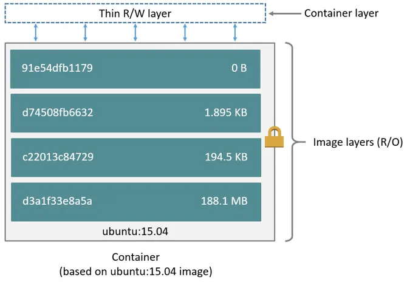

*Figure 4 : les couches de l'image sont en lecture seule et peuvent être partagées ; seule la couche du conteneur, au sommet, est modifiable. (Source : documentation Docker)*

#### Volumes

Les **volumes** stockent des données persistantes, dont la durée de vie dépasse celle du conteneur. Ils sont gérés par Docker et montés dans l'arborescence du conteneur. Les données survivent à l'arrêt et à la suppression du conteneur, et peuvent être partagées entre plusieurs conteneurs. C'est la solution à privilégier pour les bases de données ou les fichiers déposés par les utilisateurs.

Deux autres types de montage existent :

- les bind mounts montent un répertoire quelconque de l'hôte dans le conteneur, pratique en développement pour partager le code source ;
- les montages tmpfs placent les données en mémoire vive, sans persistance. Ils sont rapides et adaptés aux fichiers temporaires ou sensibles qui ne doivent pas toucher le disque.

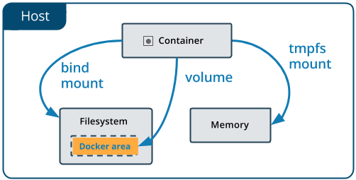

*Figure 5 : où vivent les données selon le type de montage. (Source : documentation Docker)*

#### Réseau

Le réseau de Docker est modulaire et repose sur des pilotes (*drivers*). Les principaux sont :

- **bridge** (pont) : le pilote par défaut. Les conteneurs d'un même hôte communiquent entre eux sur un réseau privé, derrière une traduction d'adresses (NAT) vers l'extérieur.
- **host** (hôte) : supprime l'isolation réseau ; le conteneur utilise directement les interfaces de l'hôte.
- **overlay** : relie plusieurs hôtes Docker entre eux pour que les conteneurs communiquent d'une machine à l'autre, sans configuration de routage sur les systèmes. Il est utilisé par les orchestrateurs.
- **ipvlan** : donne un contrôle complet sur l'adressage IPv4 et IPv6 des conteneurs, y compris l'étiquetage VLAN (niveau 2) et le routage (niveau 3), pour s'intégrer finement au réseau existant.
- **macvlan** : attribue une adresse MAC propre au conteneur, qui apparaît alors comme une machine physique sur le réseau. C'est utile pour des applications anciennes qui s'attendent à être branchées directement sur le réseau.
- **none** : coupe complètement le conteneur du réseau.

Des **plugins** tiers permettent d'ajouter d'autres pilotes.

Enfin, la **publication de ports** expose un port du conteneur sur l'hôte pour accepter des connexions entrantes. C'est indispensable pour un serveur web, par exemple : `-p 8080:80` redirige le port 8080 de l'hôte vers le port 80 du conteneur.

### Docker en pratique

#### Les commandes essentielles

| Commande | Rôle | Exemple |
| --- | --- | --- |
| `docker run` | créer et démarrer un conteneur à partir d'une image | `docker run -d -p 8080:80 --name web nginx` |
| `docker ps` | lister les conteneurs en cours (`-a` : tous) | `docker ps -a` |
| `docker images` | lister les images présentes localement | `docker images` |
| `docker pull` | télécharger une image depuis un registre | `docker pull ubuntu:24.04` |
| `docker build` | construire une image à partir d'un Dockerfile | `docker build -t mon-app:1.0 .` |
| `docker logs` | afficher la sortie d'un conteneur (`-f` : en continu) | `docker logs -f web` |
| `docker exec` | exécuter une commande dans un conteneur actif | `docker exec -it web bash` |
| `docker stop` | arrêter proprement un conteneur | `docker stop web` |
| `docker rm` | supprimer un conteneur arrêté | `docker rm web` |

Dans l'exemple `docker run -d -p 8080:80 --name web nginx`, l'option `-d` lance le conteneur en arrière-plan et `-p 8080:80` publie le port 80 du conteneur sur le port 8080 de l'hôte. Le site est alors accessible sur `http://localhost:8080`.

#### Le cycle de vie d'un conteneur

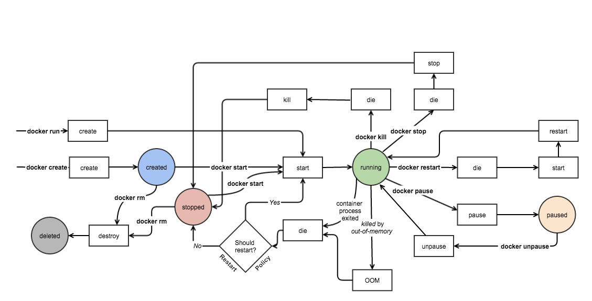

*Figure 6 : états d'un conteneur (created, running, paused, stopped, deleted) et commandes qui les relient. La politique de redémarrage (restart policy) décide si un conteneur arrêté de façon inattendue, par exemple faute de mémoire (OOM), est relancé.*

#### Dockerfile

Un **Dockerfile** est un fichier texte qui décrit, instruction par instruction, comment construire une image personnalisée : image de départ, dépendances, configuration, commande de démarrage. Il rend la construction de l'image automatique et reproductible.

Exemple pour une application Node.js :

```dockerfile
# Partir de l'image officielle Node.js
FROM node:24-alpine

# Définir le répertoire de travail dans le conteneur
WORKDIR /app

# Copier d'abord les fichiers de dépendances, pour profiter du cache des couches
COPY package*.json ./

# Installer les dépendances
RUN npm ci

# Copier le reste du code de l'application
COPY . .

# Documenter le port écouté par l'application
EXPOSE 3000

# Commande lancée au démarrage du conteneur
CMD ["node", "app.js"]
```

Construction et lancement :

```bash
docker build -t mon-app:1.0 .
docker run -d -p 3000:3000 mon-app:1.0
```

L'ordre des instructions compte : chaque instruction produit une couche, et Docker réutilise les couches inchangées. En copiant `package.json` avant le reste du code, on évite de réinstaller les dépendances à chaque modification du code.

#### Docker Compose

**Docker Compose** simplifie le déploiement d'applications composées de plusieurs conteneurs. Un fichier YAML décrit les services, les réseaux et les volumes ; une seule commande démarre l'ensemble.

Exemple de fichier `compose.yaml` pour un serveur web et une base de données :

```yaml
services:
  web:
    image: nginx:1.30
    ports:
      - "8080:80"
    depends_on:
      - db

  db:
    image: postgres:17
    environment:
      POSTGRES_PASSWORD: mysecretpassword   # en production : un secret
    volumes:
      - db-data:/var/lib/postgresql/data    # données persistantes

volumes:
  db-data:
```

```bash
docker compose up -d     # créer et démarrer tous les services
docker compose ps        # voir leur état
docker compose down      # tout arrêter et supprimer (le volume db-data reste)
```

Les services d'un même fichier Compose partagent un réseau : le conteneur `web` joint la base de données par son nom de service, `db`. La clé `version:` que l'on rencontre dans d'anciens exemples est désormais inutile.

> **À retenir**
>
> - Un conteneur est un processus isolé par le noyau (namespaces, cgroups) qui partage le noyau de l'hôte.
> - Une image est un modèle immuable, en couches ; un conteneur en est une instance, avec une couche modifiable.
> - Les données à conserver vont dans des volumes, jamais dans la couche du conteneur.
> - Dockerfile = construire une image ; Docker Compose = décrire et lancer une application multi-conteneurs.

**Pour aller plus loin**

- [Documentation Docker, glossaire](https://docs.docker.com/glossary/)
- [Documentation Docker, « Storage »](https://docs.docker.com/engine/storage/)
- [Documentation Docker, « Networking overview »](https://docs.docker.com/engine/network/)

---

## 5. Orchestration

### Automatisation et orchestration

#### Automatisation

L'**automatisation** consiste à exécuter une tâche précise sans intervention humaine, en remplaçant une opération manuelle par un script ou un outil. Elle porte sur une tâche ou une suite de tâches bien délimitée. Exemples :

- un script qui déploie une machine virtuelle ;
- une sauvegarde lancée chaque jour à heure fixe ;
- l'installation et la configuration automatiques d'un logiciel sur un serveur.

#### Orchestration

L'**orchestration** va plus loin : elle coordonne de multiples tâches automatisées pour mener à bien un processus complet. Elle décide du *comment* et du *quand*, et fait collaborer plusieurs systèmes et services. Exemples :

- gérer le déploiement, la mise à l'échelle, la mise à jour et la surveillance de nombreux conteneurs ou VM ;
- construire une infrastructure complète : créer les VM, configurer le réseau, installer les applications, dans le bon ordre ;
- remplacer automatiquement une VM ou un conteneur défaillant, tout en répartissant la charge sur les ressources disponibles.

Autrement dit, l'orchestration est l'art de coordonner les ressources informatiques (serveurs, VM, conteneurs) pour assurer leur bon fonctionnement, leur mise à l'échelle, leur mise à jour et leur dépannage.

Les architectures modernes comptent des centaines, voire des milliers de composants. À cette échelle, gérer à la main les déploiements, les mises à jour et la montée en charge devient impossible. L'orchestration apporte une réponse automatisée et rend les systèmes adaptatifs : ils absorbent un pic de demande et se rétablissent seuls après une défaillance. Elle sert la performance, l'évolutivité et la résilience des systèmes.

### Le scaling

Le **scaling** (mise à l'échelle) est la capacité à ajuster la capacité d'un système à sa charge de travail. Lorsqu'il est automatique, c'est l'orchestrateur qui le met en œuvre (on parle d'*autoscaling*).

1. **Scaling vertical** (*scale-up* / *scale-down*) : on augmente la capacité d'une instance existante en lui ajoutant des ressources (CPU, mémoire, disque). C'est simple, mais limité par la capacité de la machine physique qui héberge l'instance, et cela nécessite souvent un redémarrage.
2. **Scaling horizontal** (*scale-out* / *scale-in*) : on augmente la capacité du système en ajoutant des instances supplémentaires et en répartissant la charge entre elles. Cette approche est plus souple et souvent plus économique : on ajoute des serveurs à la demande et le coût suit la capacité ajoutée. Elle améliore aussi la tolérance aux pannes. En revanche, toutes les applications ne la supportent pas : il faut qu'elles soient conçues pour fonctionner en plusieurs exemplaires (application dite *sans état*, ou *stateless*).

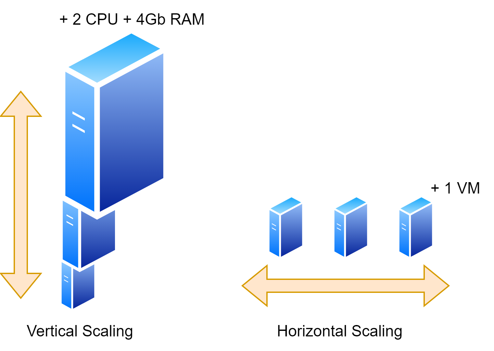

*Figure 7 : le scaling vertical grossit une machine, le scaling horizontal en ajoute de nouvelles.*

### Orchestration de machines virtuelles

La virtualisation de serveurs permet d'exécuter plusieurs systèmes d'exploitation sur une seule machine physique, chacun fonctionnant comme s'il disposait de son propre serveur. L'orchestration vise ici à coordonner et à optimiser l'ensemble des VM réparties sur un parc d'hôtes.

#### Outils courants

- **VMware vCenter Server** : la console centrale de gestion des infrastructures vSphere.
- **Microsoft System Center Virtual Machine Manager (SCVMM)** : la suite de gestion et d'orchestration des environnements Hyper-V.
- **Proxmox VE** : solution open source qui gère en cluster des VM KVM et des conteneurs LXC.
- **OpenStack** : plateforme open source pour construire un cloud privé de type IaaS ; elle orchestre le calcul, le réseau et le stockage.

#### Fonctionnalités

- **Déploiement de VM** : création, configuration et démarrage automatisés, souvent à partir de modèles (*templates*).
- **Gestion du cycle de vie** : suivi de chaque VM, de sa création à sa suppression, en passant par ses mises à jour et ses migrations.
- **Allocation des ressources** : attribution dynamique de CPU, de mémoire et de stockage selon la charge, et répartition des VM entre les hôtes.
- **Migration à chaud** : déplacement d'une VM d'un hôte à un autre sans interruption de service, comme avec VMware vMotion.
- **Haute disponibilité et reprise après panne** : en cas de défaillance d'un hôte, ses VM redémarrent automatiquement sur les hôtes restants.

### Orchestration de conteneurs

Une VM isole un système d'exploitation complet ; un conteneur isole une application. Une application moderne se compose souvent de dizaines de conteneurs, répartis sur plusieurs machines, qui naissent et disparaissent en permanence. L'orchestration de conteneurs gère ces unités pour assurer une exploitation fluide et fiable.

#### Outils courants

- **Kubernetes** : la plateforme open source de référence. Elle gère le déploiement, la mise à l'échelle et l'exploitation de conteneurs sur un cluster de machines. Elle existe en version gérée chez tous les grands fournisseurs de cloud (Amazon EKS, Azure AKS, Google GKE) et en distributions d'entreprise (Red Hat OpenShift, Rancher).
- **Docker Swarm** : l'orchestrateur intégré à Docker, plus simple que Kubernetes, adapté aux petits clusters.
- **HashiCorp Nomad** : orchestrateur léger capable de gérer des conteneurs comme des applications classiques.
- **Amazon ECS** (*Elastic Container Service*) : le service d'orchestration de conteneurs propre à AWS.
- **Apache Mesos** : gestionnaire de clusters historique, aujourd'hui largement supplanté par Kubernetes.

#### Fonctionnalités

- **Déploiement** : lancement, configuration et mise à jour automatisés des conteneurs.
- **Gestion du cycle de vie** : suivi des conteneurs de leur création à leur arrêt.
- **Découverte de services et répartition de charge** : les conteneurs se trouvent entre eux par leur nom et le trafic est réparti entre les instances.
- **Mise à l'échelle automatique** : ajustement du nombre de conteneurs selon le trafic ou la consommation de ressources.
- **Persistance des données** : attribution de volumes de stockage dont la durée de vie dépasse celle des conteneurs.
- **Tolérance aux pannes** : remplacement automatique des conteneurs ou des nœuds défaillants pour que l'application reste disponible.

### Kubernetes

**Kubernetes**, souvent abrégé K8s, est un système open source qui automatise le déploiement, la mise à l'échelle et la gestion des applications conteneurisées. Il regroupe les conteneurs d'une application en unités logiques, faciles à gérer et à découvrir. Conçu à l'origine par Google, il est maintenu par la Cloud Native Computing Foundation (CNCF).

Son principe central est **déclaratif** : on décrit l'état désiré (« je veux 3 instances de mon application en version 2 ») et Kubernetes agit en permanence pour que l'état réel du cluster y corresponde. C'est la boucle de réconciliation.

#### Architecture de base

Un cluster Kubernetes se compose de deux types de nœuds.

**Le plan de contrôle** (*control plane*, autrefois appelé nœud maître ou *master*) prend les décisions globales pour le cluster : il planifie les applications, détecte les événements et y réagit (par exemple en démarrant un nouveau conteneur). Il comprend :

- **kube-apiserver** : le serveur d'API HTTPS, point d'entrée unique pour communiquer avec le cluster (c'est lui que contacte la commande `kubectl`) ;
- **etcd** : la base de données clé-valeur distribuée qui conserve tout l'état du cluster ;
- **kube-scheduler** : il choisit le nœud sur lequel placer chaque nouveau pod, en fonction des ressources disponibles et des contraintes exprimées ;
- **kube-controller-manager** : il exécute les boucles de contrôle qui surveillent l'état du cluster via l'API et agissent pour atteindre l'état désiré ;
- **cloud-controller-manager** (optionnel) : l'équivalent pour les ressources du fournisseur de cloud (équilibreurs de charge, disques…), qu'il pilote via l'API de ce dernier.

**Les nœuds de travail** (*worker nodes*) sont les machines, virtuelles ou physiques, qui exécutent les applications. Chacun porte :

- **kubelet** : l'agent qui démarre et surveille les conteneurs des pods affectés au nœud, et rend compte de leur état au serveur d'API ;
- **kube-proxy** : il maintient les règles réseau du nœud qui permettent d'atteindre les Services ;
- **le runtime de conteneurs** : il exécute réellement les conteneurs (containerd ou CRI-O ; Kubernetes n'utilise plus directement Docker depuis la version 1.24).

Des **modules complémentaires** (*add-ons*) ajoutent des fonctionnalités au cluster : DNS interne, interface web, collecte de métriques, etc.

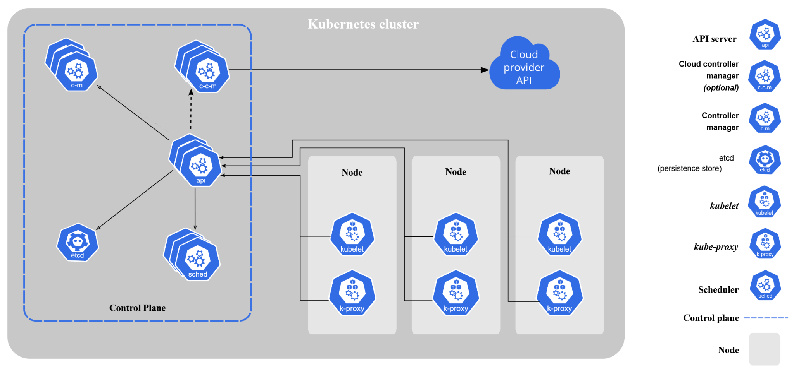

*Figure 8 : tous les composants dialoguent avec le serveur d'API, seul à accéder à etcd. (Source : documentation Kubernetes)*

#### Les ressources Kubernetes

Tout ce que gère Kubernetes est une **ressource** (ou objet), stockée dans etcd. Chaque ressource comporte des métadonnées (`metadata` : nom, étiquettes…), un état désiré (`spec`) et un état observé (`status`), mis à jour par le cluster.

On décrit les ressources dans des fichiers YAML appelés manifestes. Exemple de Deployment qui maintient deux instances d'un serveur nginx :

```yaml
apiVersion: apps/v1
kind: Deployment
metadata:
  name: nginx-deployment
spec:
  replicas: 2                 # nombre d'instances souhaité
  selector:
    matchLabels:
      app: nginx              # les pods gérés par ce Deployment
  template:                   # modèle des pods à créer
    metadata:
      labels:
        app: nginx
    spec:
      containers:
        - name: nginx
          image: nginx:1.30
          ports:
            - containerPort: 80
```

Pour déployer le manifeste puis vérifier le résultat :

```bash
kubectl apply -f nginx-deployment.yaml
kubectl get deployments,pods
```

Les ressources les plus courantes :

- **Namespace** : partition logique d'un cluster, qui isole les ressources de plusieurs équipes ou environnements.
- **Pod** : la plus petite unité déployable. Un pod regroupe un ou plusieurs conteneurs étroitement liés, qui partagent la même adresse IP et peuvent partager des volumes. Le plus souvent, un pod contient un seul conteneur applicatif.
- **ReplicaSet** : il garantit qu'un nombre donné de pods identiques tourne en permanence. Si un pod disparaît, il en recrée un.
- **Deployment** : la méthode à privilégier pour déployer une application. Il pilote des ReplicaSets et gère les mises à jour progressives (*rolling updates*) ainsi que les retours arrière (*rollbacks*).
- **Service** : il donne un point d'accès stable (nom DNS et adresse IP) à un ensemble de pods, choisis par leurs étiquettes, et répartit le trafic entre eux. Selon son type, il est accessible depuis l'intérieur du cluster uniquement (`ClusterIP`), sur un port de chaque nœud (`NodePort`) ou via un équilibreur de charge externe (`LoadBalancer`).
- **ConfigMap** et Secret : ils injectent la configuration et les données sensibles (mots de passe, clés) dans les pods, séparément de l'image.
- **Volumes**, PersistentVolume et PersistentVolumeClaim : ils fournissent aux pods un stockage, éventuellement persistant au-delà de leur durée de vie.
- **Ingress** : il expose des Services HTTP(S) vers l'extérieur, avec un routage par nom de domaine ou par chemin.

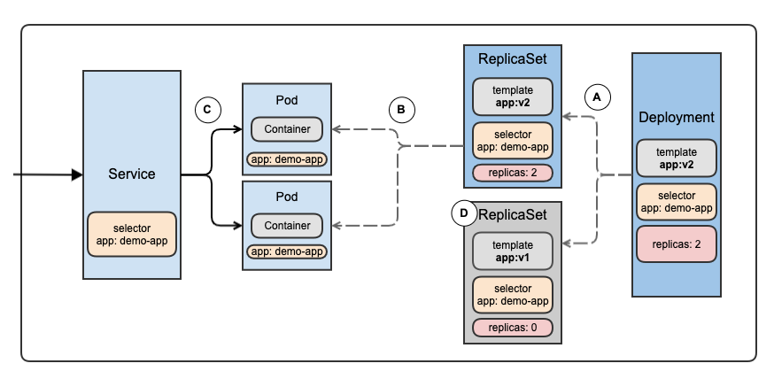

*Figure 9 : lors d'une mise à jour, le Deployment (A) crée un nouveau ReplicaSet qui lance les nouveaux pods (B) ; le Service (C) envoie le trafic à tous les pods portant l'étiquette `app: demo-app` ; l'ancien ReplicaSet (D) est ramené à 0 réplica.*

#### Caractéristiques clés

- **Mise à l'échelle automatique** (*autoscaling*) : Kubernetes ajuste le nombre de pods selon des critères comme la consommation de CPU ou de mémoire.
- **Répartition de charge** : le trafic réseau est distribué entre les pods d'un même Service.
- **Auto-réparation** : Kubernetes vérifie en continu la santé des conteneurs (sondes *liveness* et *readiness*) et remplace ceux qui ne répondent plus.
- **Tolérance aux pannes** : grâce à la réplication, à la détection automatique des défaillances et au redémarrage des instances, l'application continue de fonctionner même si certains composants tombent.
- **Mises à jour sans interruption** : les nouvelles versions sont déployées progressivement, et l'on revient en arrière en une commande en cas de problème.
- **Gestion du stockage** : Kubernetes monte automatiquement le système de stockage choisi (disques locaux, stockage réseau, stockage cloud).

#### Outils et extensions

- **kubectl** : l'outil en ligne de commande pour piloter un cluster.
- **Helm** : le gestionnaire de paquets de Kubernetes. Ses *charts* permettent de définir, d'installer et de mettre à jour des applications complètes.
- **kubeadm** : un outil pour initialiser facilement un cluster.
- **Minikube**, kind ou k3s : des outils pour créer un cluster léger, souvent à un seul nœud, sur un poste de travail, pour le développement et les tests.

> **À retenir**
>
> - L'automatisation exécute une tâche ; l'orchestration coordonne de nombreuses tâches pour gérer un système entier.
> - Scaling vertical = machine plus grosse ; scaling horizontal = plus de machines.
> - Kubernetes est déclaratif : on décrit l'état désiré, le plan de contrôle le fait advenir et le maintient.
> - Pod = unité de base ; Deployment = application et ses mises à jour ; Service = point d'accès stable.

**Pour aller plus loin**

- [Kubernetes, « Vue d'ensemble »](https://kubernetes.io/fr/docs/concepts/overview/)
- [Kubernetes, « Composants de Kubernetes »](https://kubernetes.io/fr/docs/concepts/overview/components/)
- [IBM, « Qu'est-ce que l'orchestration de conteneurs ? »](https://www.ibm.com/fr-fr/topics/container-orchestration)
- [Red Hat, « Qu'est-ce que l'orchestration ? »](https://www.redhat.com/fr/topics/automation/what-is-orchestration)

---

## 6. Cloud

### Introduction au cloud

Le **cloud computing** (informatique en nuage) consiste à fournir à la demande, via le réseau, des services informatiques : puissance de calcul, stockage, bases de données, logiciels… Plutôt que d'acheter et d'exploiter leurs propres serveurs, entreprises et particuliers consomment ces ressources chez un fournisseur, via Internet, et paient selon leur usage. Ce modèle a bouleversé la manière dont les organisations déploient et exploitent leurs applications et leurs données.

La virtualisation est le socle technique du cloud : c'est elle qui permet de découper et de louer finement des ressources physiques partagées entre de nombreux clients.

Les avantages du cloud sont nombreux :

- **Agilité et élasticité** : les ressources s'allouent, s'étendent ou se réduisent en quelques minutes, au rythme de la demande.
- **Réduction des investissements** : le paiement à l'usage évite d'investir dans du matériel coûteux. On ne paie que ce que l'on consomme : les dépenses d'investissement (CAPEX) deviennent des dépenses de fonctionnement (OPEX).
- **Rapidité de mise en œuvre** : un service se déploie en quelques clics ou quelques lignes de code, ce qui raccourcit le délai de mise sur le marché.
- **Disponibilité et redondance** : les fournisseurs proposent une infrastructure redondante, répartie sur plusieurs centres de données (zones et régions), qui réduit le risque d'interruption.
- **Accès universel** : les ressources sont accessibles de partout, ce qui facilite la collaboration et le travail à distance.

Dans une infrastructure traditionnelle, l'organisation investit dans ses serveurs, ses salles et ses équipes de maintenance. Le cloud transfère une partie de cette responsabilité au fournisseur. L'entreprise peut alors se concentrer sur ses applications et ses services plutôt que sur l'exploitation du matériel.

### Les modèles de service

Le cloud propose trois grands modèles de service, qui se distinguent par la part de l'empilement gérée par le fournisseur.

#### IaaS, Infrastructure as a Service

L'**IaaS** fournit des ressources d'infrastructure virtuelles : machines virtuelles, stockage, réseaux. Le client les configure à sa guise et gère tout ce qui se trouve au-dessus : système d'exploitation, middleware, applications. C'est le modèle le plus souple.

*Exemple :* une jeune entreprise en forte croissance doit étendre rapidement son infrastructure. Grâce à l'IaaS, elle loue à la demande calcul, stockage et réseau, et adapte son environnement à ses besoins sans investir dans du matériel. Services typiques : Amazon EC2, Azure Virtual Machines, OVHcloud Public Cloud.

#### PaaS, Platform as a Service

Le **PaaS** fournit une plateforme complète de développement et d'exécution : environnements d'exécution, bases de données gérées, outils préconfigurés. Les développeurs déploient leur code sans se soucier des serveurs ni des systèmes sous-jacents, ce qui accélère le développement et la mise en production.

*Exemples :* Heroku, Google App Engine, Azure App Service, Scalingo.

#### SaaS, Software as a Service

Le **SaaS** fournit des applications complètes, hébergées par le fournisseur et utilisées via Internet, généralement dans un navigateur. Rien à installer ni à maintenir : les mises à jour sont automatiques.

*Exemple :* une entreprise veut se doter d'un logiciel de gestion de la relation client (CRM). Plutôt que de l'installer sur chaque poste, elle souscrit à un CRM en SaaS : les employés y accèdent depuis leur navigateur, sans se soucier de la maintenance. Services typiques : Salesforce, Microsoft 365, Google Workspace.

Ces modèles offrent des niveaux de contrôle différents : à chacun de choisir selon qu'il veut gérer des ressources, développer des applications ou simplement utiliser un logiciel. Lorsqu'une organisation a besoin d'un contrôle total sur son environnement, elle conserve son infrastructure sur site (*on-premise*).

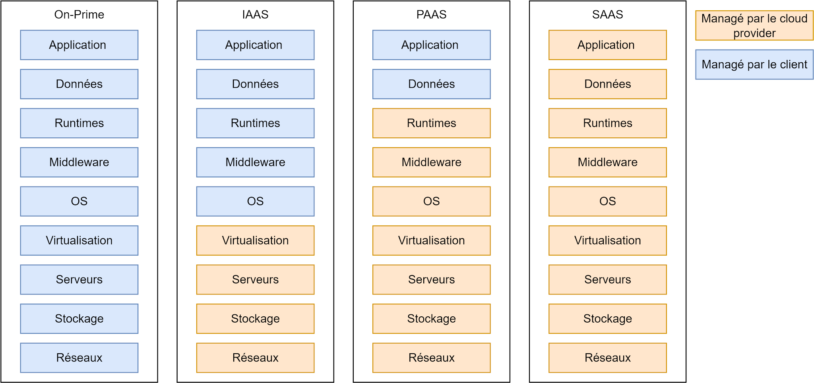

*Figure 10 : de gauche à droite, le fournisseur (en orange) prend en charge une part croissante de l'empilement ; le client (en bleu) n'en gère plus qu'une part décroissante. La colonne « On-Prime » désigne l'hébergement sur site (*on-premise*).*

<!-- Source du schéma (draw.io) : https://app.diagrams.net/?page-id=GBStZavkyGiN6YYiA_E0&scale=auto#G1Y2tp5pJnp4KH7Wphgl4elJzLfcWbzrsz -->

D'autres modèles, plus récents, s'intercalent entre ceux-ci :

- **CaaS** (*Containers as a Service*) : le fournisseur exécute et orchestre les conteneurs du client (Kubernetes géré, AWS Fargate, Google Cloud Run).
- **FaaS** (*Functions as a Service*) : le client ne déploie que des fonctions, exécutées à la demande et facturées à l'appel (AWS Lambda, Azure Functions). C'est le cœur de l'approche *serverless*.

Quel que soit le modèle, la sécurité suit un modèle de responsabilité partagée : le fournisseur sécurise ce qu'il gère (matériel, centres de données, hyperviseurs…), le client reste responsable de ce qu'il configure (accès, données, applications).

### Les modèles de déploiement

Les modèles de déploiement définissent où se trouvent les ressources et avec qui elles sont partagées.

#### Cloud public

Le fournisseur met ses ressources à disposition de tous ses clients via Internet. Plusieurs clients partagent la même infrastructure physique (on parle de mutualisation ou *multi-tenant*) et profitent ainsi des économies d'échelle. C'est une option économique, notamment pour les petites entreprises et les jeunes pousses, qui n'ont pas à investir dans du matériel.

#### Cloud privé

L'infrastructure est dédiée à **une seule organisation**, sur site ou dans un centre de données privé. Elle offre davantage de contrôle sur la sécurité et la personnalisation, mais demande des investissements plus lourds en matériel et en exploitation.

#### Cloud hybride

Le cloud hybride **combine** cloud public et cloud privé. L'entreprise confie au cloud public ses charges de travail les moins sensibles et conserve ses données et applications critiques dans son cloud privé. Elle gagne en souplesse tout en maintenant un haut niveau de sécurité. Lorsqu'on combine plusieurs fournisseurs de cloud public, on parle de multicloud.

#### Cloud communautaire

Les ressources sont partagées entre **plusieurs organisations aux besoins communs** (même secteur, même réglementation). On combine ainsi les avantages de la mutualisation avec des exigences spécifiques de sécurité et de conformité, par exemple dans la santé ou le secteur public.

### Les défis du cloud

#### Sécurité et confidentialité

Stocker et traiter des données chez un tiers soulève des questions de sécurité et de protection de la vie privée. Les entreprises doivent mettre en place des mesures de sécurité solides et respecter les lois et normes en vigueur, comme le RGPD en Europe.

#### Souveraineté

Un fournisseur soumis à une loi étrangère peut être contraint de livrer des données à ses autorités, même si elles sont hébergées en Europe (c'est le cas du *Cloud Act* américain). Pour les données sensibles, on se tourne vers des offres de cloud de confiance, comme celles qualifiées SecNumCloud par l'ANSSI en France.

#### Dépendance à Internet

L'accès au cloud repose sur une connexion fiable : une coupure rend applications et données indisponibles. Côté fournisseur, les centres de données doivent eux aussi résister aux coupures de courant et de réseau.

#### Migration et intégration

Migrer des systèmes existants vers le cloud est complexe et demande une planification soignée. Faire communiquer services cloud et systèmes restés sur site pose aussi des difficultés.

#### Contrôle réduit et dépendance au fournisseur

Une partie du contrôle sur l'infrastructure est déléguée au fournisseur, ce qui limite parfois la personnalisation. Les services propres à un fournisseur rendent aussi le départ vers un concurrent difficile : c'est l'enfermement propriétaire (*vendor lock-in*).

#### Maîtrise des coûts

Le paiement à l'usage est un avantage, mais aussi un piège : des ressources oubliées ou surdimensionnées font vite grimper la facture. Le pilotage financier du cloud s'appelle le FinOps.

### Tendances

Le cloud évolue rapidement. Quelques tendances qui dessinent son avenir :

- **Edge computing** : les objets connectés (IoT) produisent d'énormes volumes de données. L'edge computing les traite au plus près de leur source, en périphérie du réseau, pour réduire la latence et gagner en réactivité.
- **Intelligence artificielle et apprentissage automatique** : le cloud fournit la puissance de calcul (notamment des GPU) nécessaire pour entraîner des modèles et analyser de grands volumes de données.
- **Serverless** : les développeurs exécutent leur code sans se soucier de l'infrastructure, qui s'adapte automatiquement à la charge.
- **Cloud durable** (*green cloud*) : les préoccupations environnementales poussent à des centres de données plus économes en énergie pour réduire l'empreinte carbone du numérique.

> **À retenir**
>
> - Le cloud fournit des ressources informatiques à la demande, payées à l'usage ; la virtualisation en est le socle.
> - IaaS = infrastructure, PaaS = plateforme, SaaS = logiciel : plus on monte, plus le fournisseur gère.
> - Public, privé, hybride, communautaire : le modèle de déploiement dit où sont les ressources et avec qui on les partage.
> - Sécurité, souveraineté, dépendance au fournisseur et maîtrise des coûts sont les principaux points de vigilance.

**Pour aller plus loin**

- [IBM, « What is cloud computing? »](https://www.ibm.com/topics/cloud-computing)
- [IBM, « IaaS, PaaS, SaaS »](https://www.ibm.com/topics/iaas-paas-saas)
- [Intel, « Qu'est-ce que le cloud computing ? »](https://www.intel.fr/content/www/fr/fr/cloud-computing/what-is-cloud-computing.html)
- [ANSSI, qualification SecNumCloud](https://cyber.gouv.fr/secnumcloud)

---

## 7. Le DevOps

Dans une organisation traditionnelle, les équipes de développement (*Dev*) et d'exploitation (*Ops*) poursuivent des objectifs opposés : les premières veulent livrer vite des nouveautés, les secondes veulent préserver la stabilité de la production. Souvent rattachées à des managers différents, elles communiquent peu. Ces silos entraînent des reproches mutuels lors des incidents et des processus manuels qui ralentissent tout.

Le **DevOps** est une culture et un ensemble de pratiques qui rapprochent ces deux mondes. Son objectif : livrer des applications plus souvent, plus vite et avec une meilleure qualité, en partageant les responsabilités. Il répond au besoin des entreprises d'évoluer au rythme du marché, tout en réduisant les conflits entre équipes.

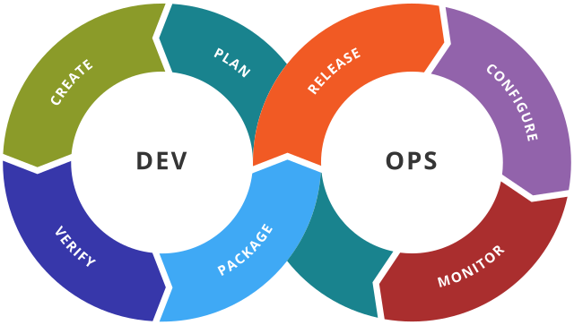

*Figure 11 : le cycle DevOps est une boucle continue où la supervision de la production alimente la planification suivante.*

### Les principes fondamentaux

- **Automatisation** : elle est au cœur du DevOps. Compilation, tests, déploiement : toute tâche manuelle et répétitive est automatisée. Les processus vont plus vite, les erreurs humaines diminuent et les résultats sont reproductibles. La virtualisation et les conteneurs garantissent des environnements d'exécution homogènes, du poste du développeur à la production.
- **Collaboration** : développeurs, testeurs et exploitants travaillent ensemble, partagent l'information et visent un objectif commun.
- **Intégration et livraison continues** : l'intégration continue (CI) consiste à intégrer très fréquemment les modifications du code dans une base commune, chacune étant vérifiée par des tests automatisés. La livraison continue (CD) prolonge la démarche : le logiciel est toujours prêt à être déployé, et la mise en production se déclenche d'un clic. Dans le déploiement continu, elle se fait même automatiquement dès que les tests passent.
- **Mesure et amélioration continue** : la supervision constante de la production détecte rapidement les problèmes. Les retours d'expérience, après les succès comme après les incidents, permettent aux équipes de progresser en continu, sans chercher de coupable.

### Avantages et défis

**Avantages**

- **Agilité** : des cycles de développement et de déploiement courts permettent de répondre vite aux évolutions du marché.
- **Qualité** : les tests automatisés garantissent une qualité constante du code livré.
- **Réduction des risques** : des déploiements fréquents et petits sont moins risqués que de grosses mises en production occasionnelles.
- **Collaboration** : la communication permanente entre Dev et Ops améliore la compréhension mutuelle.

**Défis**

- **Changement culturel** : faire évoluer la culture de l'entreprise vers la collaboration et la responsabilité partagée est souvent la partie la plus difficile.
- **Complexité technique** : les nouveaux outils et pratiques demandent un apprentissage et doivent s'intégrer à l'existant.
- **Sécurité** : l'automatisation des déploiements impose des contrôles de sécurité rigoureux tout au long de la chaîne. Intégrer la sécurité dès le départ est l'objet du DevSecOps.

### Outils et pratiques

- **Gestion de versions** : Git permet de suivre toutes les modifications du code, de travailler à plusieurs et de revenir en arrière. Il est généralement associé à une forge comme GitLab ou GitHub.
- **Automatisation des builds et des tests** : Jenkins, GitLab CI ou GitHub Actions construisent des pipelines d'intégration continue qui compilent et testent le code à chaque modification.
- **Provisionnement de l'infrastructure** : l'Infrastructure as Code crée et gère les environnements de façon cohérente et reproductible, avec des outils comme Terraform et Ansible (voir le [chapitre 8](#8-infrastructure-as-code)).
- **Conteneurisation** : Docker isole les applications et leurs dépendances, pour un déploiement rapide et identique sur toutes les plateformes.
- **Supervision** : Prometheus, Grafana ou la suite Elastic mesurent le comportement des applications en production (voir le [chapitre 9](#9-monitoring)).

> **À retenir**
>
> - Le DevOps rapproche développement et exploitation autour d'objectifs communs.
> - Ses piliers : automatisation, collaboration, intégration et livraison continues, mesure et amélioration continue.
> - Le principal défi n'est pas technique mais culturel.

**Pour aller plus loin**

- Gene Kim, Kevin Behr et George Spafford, *The Phoenix Project*, roman sur la transformation DevOps d'une entreprise
- [Microsoft Azure, « Qu'est-ce que le DevOps ? »](https://azure.microsoft.com/fr-fr/resources/cloud-computing-dictionary/what-is-devops)
- [Red Hat, « Le DevOps, qu'est-ce que c'est ? »](https://www.redhat.com/fr/topics/devops)

---

## 8. Infrastructure as Code

### Introduction à l'IaC

L'**Infrastructure as Code** (IaC) consiste à décrire et à provisionner l'infrastructure (serveurs, réseaux, stockage, configuration) au moyen de fichiers de code, plutôt que par des opérations manuelles. Création, configuration et gestion de l'infrastructure deviennent automatiques, cohérentes et répétables. L'IaC simplifie l'administration, rapproche les équipes Dev et Ops, réduit les erreurs humaines et rend les déploiements reproductibles.

### Les principes clés

**Décrire l'infrastructure dans du code.** Au lieu de configurer chaque composant à la main, on écrit des fichiers qui décrivent les ressources nécessaires : serveurs, réseaux, règles de pare-feu, logiciels installés. L'état souhaité de l'infrastructure est ainsi défini de façon reproductible.

**Automatiser le déploiement.** Une fois l'infrastructure décrite, l'outil d'IaC se charge de la créer conformément à la description. Toute évolution passe par une modification du code, ce qui garantit la cohérence entre les environnements de développement, de test et de production.

**Versionner l'infrastructure.** Le code d'infrastructure se gère comme le code d'une application : il est stocké dans un gestionnaire de versions comme Git. On collabore plus facilement (relecture des modifications), on sait qui a changé quoi et quand, et l'on revient en arrière en cas de problème.

**Viser l'idempotence.** Appliquer deux fois le même code doit produire le même résultat : si l'infrastructure est déjà dans l'état décrit, l'outil ne fait rien. C'est ce qui rend l'IaC sûre à rejouer.

L'IaC distingue deux approches :

- **déclarative** : on décrit le résultat attendu (« un serveur nginx doit être installé ») et l'outil détermine les actions nécessaires (Terraform, Puppet, Kubernetes) ;
- **impérative** : on décrit la suite d'actions à exécuter (« installer nginx, puis copier tel fichier »), comme dans un script shell.

L'IaC apporte ainsi :

- **la reproductibilité** : le même code produit des environnements identiques ;
- **des déploiements fiables** : l'automatisation élimine les erreurs des manipulations manuelles ;
- **l'évolutivité** : ajouter des ressources revient à modifier quelques lignes de code ;
- **une documentation à jour** : le code décrit précisément l'infrastructure réelle et sert de référence à toute l'équipe.

### Panorama des outils

Le bon outil dépend des besoins et du contexte. On distingue les outils de provisionnement, qui créent les ressources, et les outils de gestion de configuration, qui configurent les systèmes existants.

#### Ansible

**Ansible** est un outil open source de gestion de configuration et d'automatisation, créé en 2012 et racheté par Red Hat en 2015. Il décrit les configurations dans des fichiers YAML appelés playbooks, exécutés dans l'ordre sur les machines cibles. Ses modules sont déclaratifs et idempotents : contrairement à un script bash, rejouer un playbook donne un résultat prévisible. Ansible est sans agent : il se connecte aux machines cibles par SSH, sans rien installer dessus. Sa simplicité en fait l'un des outils les plus utilisés.

#### Chef et Puppet

**Chef** et Puppet sont des outils de gestion de configuration plus anciens. Ils décrivent l'état souhaité des systèmes dans des « recettes » (Chef) ou des « manifestes » (Puppet) et veillent à ce que les machines y restent conformes. Ils sont adaptés aux très grands parcs de serveurs. À la différence d'Ansible, ils exigent un agent installé sur chaque machine gérée, qui récupère régulièrement sa configuration auprès d'un serveur central. Leurs éditeurs commercialisent surtout des versions sous licence pour un usage professionnel.

#### Terraform

**Terraform**, édité par HashiCorp (groupe IBM depuis 2025), est dédié au provisionnement de l'infrastructure : création, modification et suppression de VM, de réseaux, d'espaces de stockage, de services cloud… Il décrit l'état désiré dans des fichiers de configuration déclaratifs, et sait prévisualiser les changements avant de les appliquer. Il est multicloud : il pilote AWS, Azure, Google Cloud, OVHcloud, VMware, Proxmox et bien d'autres. Depuis le changement de licence de Terraform en 2023, sa variante open source OpenTofu, hébergée par la Linux Foundation puis accueillie à la CNCF en 2025, est une alternative compatible.

| | Ansible | Chef / Puppet | Terraform |
| --- | --- | --- | --- |
| Rôle principal | configuration, déploiement d'applications | configuration | provisionnement d'infrastructure |
| Approche | playbooks exécutés dans l'ordre, modules déclaratifs | déclarative | déclarative |
| Agent sur les cibles | non (SSH) | oui | non (API des fournisseurs) |
| Langage | YAML | DSL Ruby / DSL Puppet | HCL |

Ces outils sont complémentaires : on crée typiquement les machines avec Terraform, puis on les configure avec Ansible.

### Ansible en pratique

#### L'inventaire

L'**inventaire** est un fichier (au format INI ou YAML) qui liste les machines gérées par Ansible, par adresse IP ou par nom. Ces machines doivent être joignables en SSH depuis le poste qui exécute Ansible. On les regroupe en groupes selon leur rôle, par exemple `serveurs_web` et `serveurs_db` :

```ini
[serveurs_web]
192.168.1.10
192.168.1.11

[serveurs_db]
db.example.com
```

Pour vérifier la connectivité et l'authentification SSH vers toutes les machines :

```bash
ansible all -i inventaire.ini -m ping
```

#### Playbooks, tâches et modules

Un **playbook** est un fichier YAML qui associe des groupes de machines à une liste de tâches. Chaque tâche appelle un module, c'est-à-dire une action prête à l'emploi : copier un fichier, installer un paquet, gérer un service… Ansible en fournit plusieurs milliers.

```yaml
- name: Configurer les serveurs web
  hosts: serveurs_web
  become: true                         # exécuter en tant que root
  vars:
    logiciel_name: nginx
  tasks:
    - name: Installer {{ logiciel_name }}
      ansible.builtin.apt:
        name: "{{ logiciel_name }}"
        state: present                 # état souhaité : le paquet est installé
        update_cache: true

    - name: Copier le fichier de configuration
      ansible.builtin.copy:
        src: fichier.conf
        dest: /etc/fichier.conf
```

```bash
ansible-playbook -i inventaire.ini site.yml
```

#### Variables et facts

Les **variables** adaptent un même playbook à différents environnements : dans l'exemple ci-dessus, `logiciel_name` peut valoir `nginx` en production et `apache2` ailleurs. Elles rendent les automatisations souples et réutilisables.

Ansible collecte aussi automatiquement des informations sur chaque machine, les facts (système d'exploitation, processeur, adresses réseau…), utilisables comme des variables dans les playbooks :

```bash
$ ansible localhost -m setup
[...]
"ansible_processor": [
    "0",
    "AuthenticAMD",
    "AMD Ryzen 5 4500U with Radeon Graphics"
[...]
```

#### Gestion des erreurs

Par défaut, Ansible arrête de traiter une machine dès qu'une tâche échoue. Plusieurs mécanismes permettent d'affiner ce comportement. Ici, `ignore_errors` laisse le playbook continuer malgré l'échec de la commande, dont le résultat est enregistré pour être examiné par la tâche suivante :

```yaml
- name: Lancer une commande qui peut échouer
  ansible.builtin.command: /usr/bin/example-command -x -y -z
  register: command_result
  ignore_errors: true

- name: Arrêter le play si la commande a échoué
  ansible.builtin.fail:
    msg: "La commande a échoué"
  when: "'FAILED' in command_result.stderr"
```

Pour des traitements plus élaborés, les blocs `block` / `rescue` / `always` fonctionnent comme un `try` / `catch` / `finally`.

#### Rôles

Les **rôles** regroupent tâches, variables, fichiers et modèles selon une arborescence standard, pour structurer et réutiliser les configurations. La plateforme [Ansible Galaxy](https://galaxy.ansible.com/) propose des milliers de rôles prêts à l'emploi, par exemple pour installer une pile ELK.

#### Ansible Vault

**Ansible Vault** chiffre les informations sensibles (mots de passe, clés d'API) pour pouvoir les versionner sans les exposer :

```bash
ansible-vault create secrets.yml
```

#### Les templates

Les **templates** Ansible reposent sur le moteur Jinja2. Ils génèrent des fichiers de configuration à partir de variables, de boucles et de conditions :

- une variable s'écrit entre doubles accolades : `{{ variable }}` ;
- une instruction s'écrit entre accolades et pourcentages : `` ;
- un commentaire s'écrit entre accolades et dièses : `{# commentaire #}`.

```jinja
{# Définition de la liste #}


{# Parcours de la liste pour afficher chaque valeur #}

Valeur : {{ value }}

```

### Terraform en pratique

Une configuration Terraform se compose de fichiers `.tf`, écrits dans le langage HCL, qui décrivent les ressources à créer et leurs paramètres.

Les **providers** sont des extensions qui permettent à Terraform de dialoguer avec l'API d'un service : fournisseur de cloud, hyperviseur, équipement réseau, plateforme de conteneurs… Il en existe des milliers, répertoriés dans le [registre Terraform](https://registry.terraform.io/browse/providers) (voir aussi la [documentation des providers](https://developer.hashicorp.com/terraform/language/providers)).

Exemple : une instance (VM) EC2 chez AWS, créée à partir de la dernière image Ubuntu de la région, dont on récupère l'adresse IP publique.

```hcl
terraform {
  required_providers {
    aws = {
      source  = "hashicorp/aws"
      version = "~> 6.0"
    }
  }
}

provider "aws" {
  region = "eu-west-3"                      # région de Paris
}

# Recherche de l'image Ubuntu 24.04 la plus récente dans la région
data "aws_ami" "ubuntu" {
  most_recent = true
  owners      = ["099720109477"]            # Canonical

  filter {
    name   = "name"
    values = ["ubuntu/images/hvm-ssd-gp3/ubuntu-noble-24.04-amd64-server-*"]
  }
}

resource "aws_instance" "example" {
  ami           = data.aws_ami.ubuntu.id
  instance_type = "t3.micro"
}

output "ip_publique" {
  value = aws_instance.example.public_ip
}
```

Les notions à connaître :

- **Provider** : l'extension qui fait le lien avec l'API d'un service.
- **Ressource** (*resource*) : un objet d'infrastructure à gérer, comme une instance de calcul ou un réseau virtuel.
- **Source de données** (*data*) : une lecture d'information existante chez le fournisseur, sans rien créer (ici, l'identifiant de l'image Ubuntu la plus récente de la région).
- **Variable** (*variable*) et valeur de sortie (*output*) : les paramètres d'entrée d'une configuration et les données qu'elle renvoie, réutilisables par d'autres configurations.
- **Module** : un ensemble de fichiers Terraform regroupés dans un dossier, qui forme un composant réutilisable.
- **État** (*state*) : le fichier `terraform.tfstate`, dans lequel Terraform mémorise l'infrastructure qu'il gère et la correspondance entre le code et les ressources réelles. En équipe, il est stocké de façon centralisée et protégé, car il peut contenir des secrets.
- **Plan** : l'étape qui compare le code à l'état réel et calcule les actions nécessaires (création, modification, suppression) pour atteindre l'état souhaité.
- **Apply** : l'étape qui exécute effectivement ces actions.

Le cycle de travail tient en quatre commandes :

```bash
terraform init      # initialiser le répertoire et télécharger les providers
terraform plan      # afficher les changements qui seront appliqués
terraform apply     # appliquer les changements
terraform destroy   # supprimer toutes les ressources gérées
```

### CI/CD

La **CI/CD** (intégration continue / livraison continue) automatise les étapes qui mènent d'une modification du code à sa mise en production : construction, tests, déploiement. Les équipes livrent ainsi plus vite et plus sûrement. Docker, Terraform et Ansible y sont des briques de base.

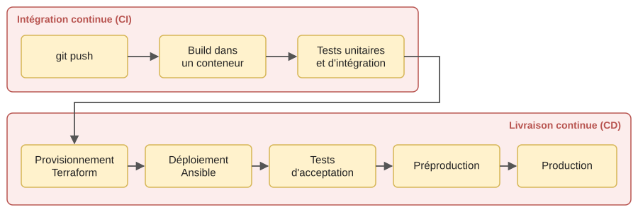

*Figure 12 : une chaîne CI/CD type, de la modification du code à la mise en production.*

#### Exemple d'intégration continue

1. Un développeur pousse ses modifications vers le dépôt Git du projet.
2. L'outil de CI (GitLab CI, Jenkins, GitHub Actions…) détecte la nouvelle modification.
3. Il déclenche automatiquement la construction (*build*) de l'application dans un conteneur Docker, ce qui garantit un environnement identique à chaque fois.
4. Les tests unitaires et d'intégration s'exécutent dans ce conteneur pour vérifier que les modifications n'ont rien cassé (absence de régression).

#### Exemple de livraison continue

1. Si les tests réussissent, l'outil déclenche un déploiement automatique vers un environnement de test.
2. Terraform provisionne l'infrastructure nécessaire (machines virtuelles, réseaux…), ce qui garantit un environnement cohérent.
3. Ansible déploie l'application sur les machines nouvellement créées et configure ses dépendances et ses paramètres.
4. Des tests d'acceptation automatisés valident le bon fonctionnement de l'application dans cet environnement.
5. Le même processus est rejoué sur un environnement de préproduction, pour une validation fonctionnelle par le client ou une équipe de recette, puis les changements sont appliqués en production.

> **À retenir**
>
> - L'IaC décrit l'infrastructure dans du code versionné, reproductible et idempotent.
> - Terraform crée l'infrastructure (provisionnement), Ansible la configure (gestion de configuration).
> - Ansible : inventaire + playbooks, sans agent, via SSH. Terraform : `init`, `plan`, `apply`, avec un fichier d'état.
> - La CI/CD enchaîne automatiquement build, tests et déploiements jusqu'en production.

**Pour aller plus loin**

- [Documentation Ansible](https://docs.ansible.com/)
- [Documentation Terraform](https://developer.hashicorp.com/terraform/docs)
- [OpenTofu](https://opentofu.org/)

---

## 9. Monitoring

Le **monitoring** (supervision) d'un système d'information consiste à surveiller en continu l'état et les performances des systèmes, des applications et des réseaux. Il vise à garantir leur disponibilité, leurs performances et leur fiabilité, en détectant et en résolvant rapidement les problèmes. La virtualisation, en mutualisant les ressources, renforce encore son importance : une VM trop gourmande peut dégrader toutes ses voisines.

### Pourquoi superviser

- **Détecter tôt les problèmes** : repérer une anomalie avant qu'elle ne devienne une panne réduit les interruptions de service et la gêne pour les utilisateurs.
- **Optimiser les performances** : le suivi des métriques clés révèle les goulets d'étranglement et les axes d'amélioration.
- **Planifier les capacités** : l'historique d'utilisation des ressources permet d'anticiper les besoins futurs et d'éviter la saturation.
- **Décider sur des faits** : les données de supervision fondent les décisions et l'allocation des ressources.

Le monitoring joue un rôle clé dans la boucle d'amélioration continue du DevOps.

Une chaîne de supervision comporte quatre étapes :

1. **Collecte** : les outils recueillent des données de sources variées (serveurs, équipements réseau, applications…).
2. **Stockage** : les données sont conservées dans une base adaptée, souvent une base de séries temporelles, pour être analysées.
3. **Analyse** : on recherche tendances, anomalies et problèmes. Des seuils déclenchent des alertes lorsqu'ils sont franchis.
4. **Visualisation** : les résultats sont présentés sous forme de tableaux de bord, de graphiques et de rapports.

On parle aujourd'hui d'**observabilité** pour désigner la capacité à comprendre l'état interne d'un système à partir de trois types de données : les métriques (mesures chiffrées), les logs (journaux d'événements) et les traces (le parcours d'une requête à travers les services).

### Les types de monitoring

#### Monitoring des performances

Il suit les performances des systèmes, des applications et des réseaux : utilisation du processeur, de la mémoire, du réseau et des disques, temps de réponse des applications. Des alertes se déclenchent quand un seuil est dépassé, pour réagir avant l'interruption de service.

- **Prometheus et Grafana** : Prometheus est un système de supervision open source qui collecte et stocke des métriques. Grafana construit des tableaux de bord visuels et personnalisables à partir de ces données, pour suivre les performances en temps réel.
- **Nagios et SNMP** : Nagios est un outil de supervision open source qui vérifie l'état des hôtes et des services à l'aide de plugins. SNMP (*Simple Network Management Protocol*) est le protocole standard de supervision des équipements réseau et des périphériques : il remonte leur utilisation du processeur, de la mémoire, leur température, etc.

#### Monitoring de la sécurité

Il surveille les activités suspectes ou malveillantes dans le système d'information : détection d'intrusions, analyse des journaux d'événements, détection comportementale des menaces. Ces outils sont ceux des SOC (*Security Operations Center*).

- **SIEM** (*Security Information and Event Management*) : des plateformes comme Splunk, Elastic Security ou IBM QRadar collectent, corrèlent et analysent les données de sécurité de multiples sources pour détecter menaces et anomalies.
- **IDS/IPS** (*Intrusion Detection / Prevention Systems*) : ils inspectent le trafic réseau à la recherche de signatures ou de comportements suspects ; un IPS peut en plus bloquer le trafic malveillant. Snort et Suricata sont des références open source.

#### Monitoring des logs

La collecte et l'analyse des **journaux** produits par les différents composants permettent de retracer les événements passés, de diagnostiquer les problèmes et de dégager des tendances à long terme, comme les usages ou les erreurs récurrentes.

- **Elastic Stack** (ELK) : cette suite open source réunit Elasticsearch, qui indexe les logs, Logstash, qui les collecte et les transforme, et Kibana, qui fournit des tableaux de bord interactifs.
- **Splunk** : plateforme commerciale d'indexation, de recherche et de visualisation des logs, très répandue, qui détecte tendances et anomalies.
- **Grafana Loki** : alternative plus légère, intégrée à l'écosystème Grafana.

### Les principaux outils

Il existe de très nombreux outils de supervision, propriétaires ou open source. Certains se spécialisent dans un domaine, d'autres se veulent des solutions globales. Comparons trois outils très présents en entreprise.

- **Prometheus** : système de supervision et d'alerte fondé sur les métriques. Il interroge activement ses cibles à intervalle régulier (modèle *pull*), stocke les données en séries temporelles et fournit un langage de requête, PromQL. Conçu pour les environnements *cloud native*, il est particulièrement adapté aux infrastructures dynamiques comme les conteneurs et Kubernetes.
- **Nagios** : outil de supervision plus traditionnel, fondé sur des vérifications actives de l'état et de la disponibilité des hôtes et des services. Il alerte en cas de dépassement de seuil et convient aux infrastructures plutôt statiques. Zabbix, très utilisé en France, couvre des besoins similaires.
- **Splunk** : plateforme de gestion de données qui va au-delà de la supervision. Elle collecte, indexe, recherche et visualise des données de toutes sources, en particulier les logs et les événements. Elle sert aussi bien à la sécurité qu'à l'analyse opérationnelle et à la supervision.

| | Prometheus | Nagios | Splunk |
| --- | --- | --- | --- |
| Données | métriques | état des services (OK, WARNING, CRITICAL) | logs et événements |
| Collecte | *pull* des métriques exposées | vérifications actives par plugins | agents et intégrations |
| Points forts | conteneurs, Kubernetes, PromQL | simplicité, disponibilité des services | recherche, corrélation, sécurité |
| Licence | open source | open source (Nagios Core) | commerciale |

Le choix dépend des besoins, de la complexité de l'infrastructure et des objectifs de supervision. En pratique, on combine souvent plusieurs outils.

### SLA, SLO et SLI

Trois notions permettent de formuler et de vérifier la qualité de service attendue. Elles ont des conséquences concrètes : ne pas tenir ses engagements peut entraîner des pénalités financières, voire la rupture d'un contrat.

#### SLI, Service Level Indicator

Un **SLI** (indicateur de niveau de service) est une mesure quantitative d'un aspect du service : taux de disponibilité, temps de réponse, taux d'erreurs…

*Exemple :* pour une plateforme de streaming vidéo, le temps de chargement des vidéos. On le mesure de préférence en percentile (par exemple, le temps sous lequel se chargent 95 % des vidéos) plutôt qu'en moyenne, qui masque les mauvaises expériences.

#### SLO, Service Level Objective

Un **SLO** (objectif de niveau de service) est la cible que l'on fixe pour un SLI, sur une période donnée. C'est en général un objectif interne, plus exigeant que l'engagement contractuel, pour garder une marge.

*Exemple :* pour une messagerie, 95 % des messages doivent être distribués en moins de 10 secondes, sur une période glissante de 30 jours.

#### SLA, Service Level Agreement

Un **SLA** (accord de niveau de service) est le contrat passé entre un prestataire et son client. Il fixe les engagements de qualité et de performance, et les pénalités prévues en cas de manquement.

*Exemple :* un hébergeur garantit une disponibilité de 99,9 % par mois pour les sites de ses clients. Au-delà de 0,1 % d'indisponibilité (environ 43 minutes sur un mois de 30 jours), il manque à son engagement et doit indemniser ses clients.

| Disponibilité | Indisponibilité tolérée par an | par mois (30 jours) |
| --- | --- | --- |
| 99 % | 3 j 15 h 36 min | 7 h 12 min |
| 99,9 % | 8 h 45 min 36 s | 43 min 12 s |
| 99,95 % | 4 h 22 min 48 s | 21 min 36 s |
| 99,99 % | 52 min 34 s | 4 min 19 s |

L'écart entre 100 % et le SLO forme le **budget d'erreur** : la quantité d'indisponibilité que l'on peut « dépenser », par exemple en mises en production risquées, avant de devoir privilégier la stabilité.

En résumé :

- le SLI est ce que l'on mesure ;
- le SLO est l'objectif que l'on se fixe pour cette mesure ;
- le SLA est l'engagement contractuel pris envers le client, assorti de pénalités.

Les équipes d'exploitation s'en servent pour :

- définir des objectifs de performance clairs et mesurables (SLO) pour chaque service ;
- mesurer les performances réelles (SLI) et les comparer aux objectifs ;
- vérifier que les niveaux de service promis (SLA) sont tenus et, si nécessaire, prendre des mesures correctives.

> **À retenir**
>
> - Le monitoring suit quatre étapes : collecte, stockage, analyse (avec alertes), visualisation.
> - Métriques, logs et traces forment les trois piliers de l'observabilité.
> - Prometheus pour les métriques et le cloud native, Nagios pour la disponibilité des services, Splunk et ELK pour les logs et la sécurité.
> - SLI = mesure, SLO = objectif, SLA = contrat. 99,9 % de disponibilité autorise environ 8 h 45 min d'arrêt par an.

**Pour aller plus loin**

- [Prometheus, présentation](https://prometheus.io/docs/introduction/overview/)
- [Google Cloud, « SRE fundamentals: SLIs, SLAs and SLOs »](https://cloud.google.com/blog/products/devops-sre/sre-fundamentals-slis-slas-and-slos)
- [Google, *Site Reliability Engineering*, chapitre « Service Level Objectives »](https://sre.google/sre-book/service-level-objectives/)

---

## 10. Glossaire

| Terme | Définition |
| --- | --- |
| **Cgroups** | Mécanisme du noyau Linux qui limite et comptabilise les ressources (CPU, mémoire, E/S) d'un groupe de processus. |
| **Cloud hybride** | Combinaison d'un cloud privé et d'un cloud public. |
| **Conteneur** | Instance en cours d'exécution d'une image, isolée par le noyau de l'hôte qu'elle partage. |
| **Deployment** | Ressource Kubernetes qui maintient un nombre de pods et gère leurs mises à jour progressives. |
| **Émulation** | Simulation logicielle d'un matériel différent de celui de l'hôte. |
| **Hôte** | Système physique qui exécute les machines virtuelles ou les conteneurs. |
| **Hyperviseur** | Logiciel qui crée et exécute des machines virtuelles (type 1 sur le matériel, type 2 sur un OS). |
| **IaaS / PaaS / SaaS** | Modèles de service cloud : infrastructure, plateforme ou logiciel fournis à la demande. |
| **IaC** | Infrastructure as Code : description de l'infrastructure dans des fichiers de code versionnés. |
| **Idempotence** | Propriété d'une opération qui produit le même résultat qu'on l'exécute une ou plusieurs fois. |
| **Image** | Modèle immuable, en couches, à partir duquel on crée des conteneurs. |
| **Invité** | Système d'exploitation ou application exécuté dans une VM ou un conteneur. |
| **LVM** | Gestionnaire de volumes logiques de Linux (PV, VG, LV). |
| **Namespace** | Sous Linux, mécanisme qui donne à un processus sa propre vue d'une ressource système ; sous Kubernetes, partition logique d'un cluster. |
| **Orchestration** | Coordination automatisée de multiples tâches et ressources pour gérer un système complet. |
| **Pod** | Plus petite unité déployable de Kubernetes, regroupant un ou plusieurs conteneurs. |
| **RAID** | Regroupement de disques pour améliorer performances et/ou tolérance aux pannes. |
| **SAN / NAS / DAS** | Stockage en mode bloc sur réseau dédié / stockage de fichiers en réseau / stockage local. |
| **Scaling** | Ajustement de la capacité d'un système : vertical (machine plus puissante) ou horizontal (plus de machines). |
| **SLA / SLO / SLI** | Contrat de service / objectif de service / indicateur de service. |
| **Thin provisioning** | Allocation de l'espace de stockage au fur et à mesure de son utilisation réelle. |
| **VM** | Machine virtuelle : ordinateur complet simulé par un hyperviseur, avec son propre système d'exploitation. |
