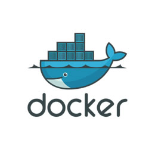
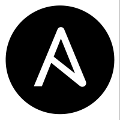
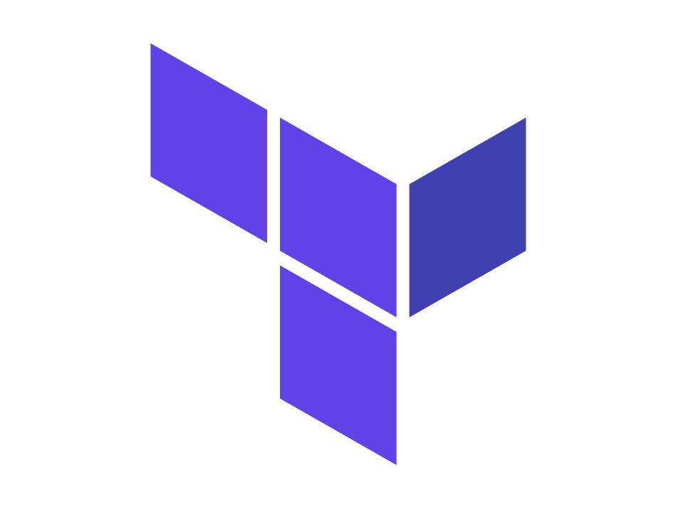
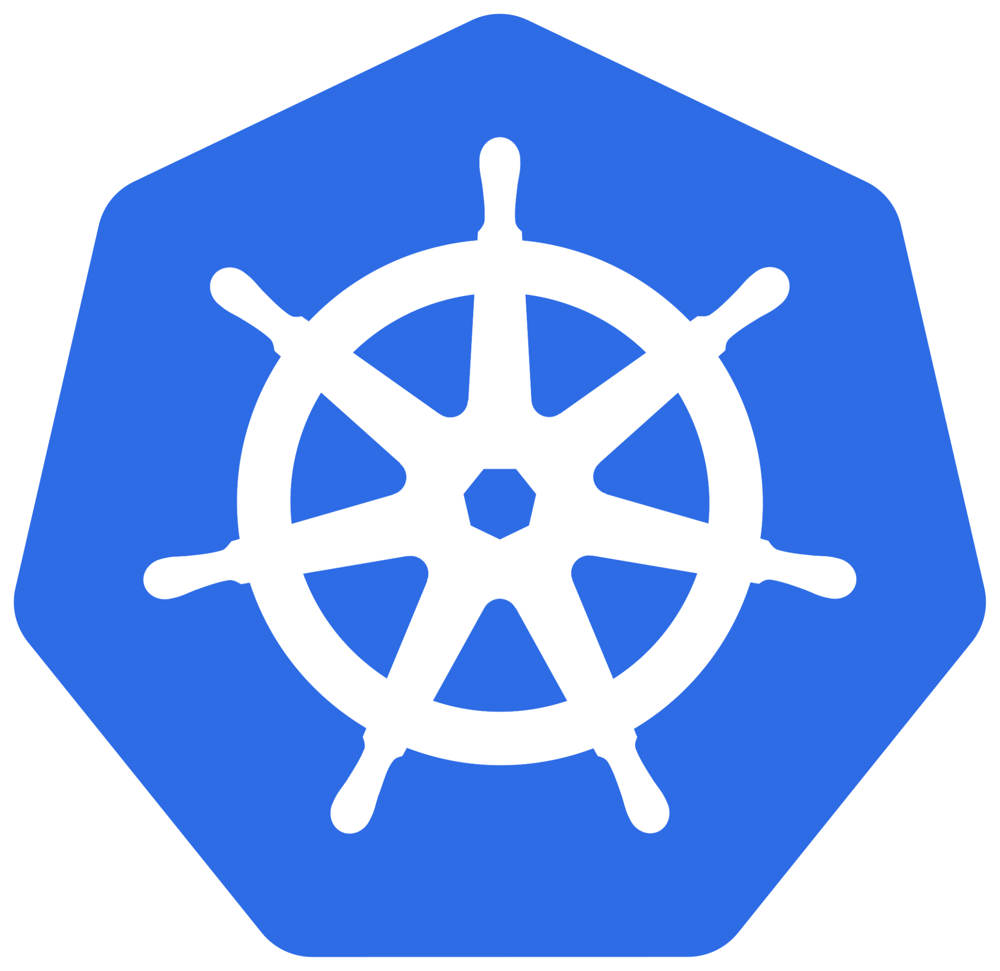

# Présentation du module

## Objectifs

1. Approfondir les notions de virtualisation vues l'an dernier.
2. Comprendre comment optimiser l'utilisation d'un système par la mutualisation des ressources.
3. Appréhender les différentes méthodes de virtualisation.

## Fil rouge

Le fil rouge de ce cours est la conférence [« Une architecture GitOps from scratch : GitLab, Ansible, Terraform, Kubernetes et AWS »](https://www.youtube.com/watch?v=FyAD_-LAMLo) (L. Ortola et A. Moreau, Devoxx France), sur YouTube.

## Compétences

1. Intégrer des solutions logicielles dans un environnement virtualisé.
2. Anticiper les résultats de diverses métriques d'un environnement virtualisé.

## Planning

| TD | Durée | Thème |
| --- | --- | --- |
| TD 1 | 4 h 30 | Introduction à la virtualisation avancée |
| TD 2 | 3 h | Infrastructure as Code |
| TD 3 | 3 h | Monitoring d'infrastructures virtualisées |
| TD 4 | 3 h | Orchestration |

## Évaluation

| Modalité | Part de la note |
| --- | --- |
| Devoir sur table (évaluation finale) | 75 % |
| Compte rendu des exercices pratiques (évaluation continue) | 25 % |

### Compte rendu des exercices pratiques (évaluation continue)

Les exercices pratiques peuvent être réalisés seul ou en groupe de trois personnes au maximum. Un groupe ne peut pas changer de composition au cours du module.

Le compte rendu, lui, est **individuel** : chacun rédige et rend le sien, même en cas de travail en groupe. Il doit alors indiquer le nom de tous les membres du groupe.

Chaque exercice est documenté en détail : résultats, notes et remarques. Des captures d'écran et des copies du code attestent de votre progression, ainsi que les fichiers `seance1.txt` à `seance4.txt` produits par la commande `script`. Le compte rendu couvre les quatre séances et se rend en PDF dans la section « Compte rendu exercice pratique » de webetud.

Il est noté selon la grille suivante :

| Critère | Points |
| --- | --- |
| Progression : exercices réalisés au fil des quatre séances | 6 |
| Réponses aux questions : exactitude et justification | 8 |
| Preuves : sorties de commandes et captures d'écran pertinentes | 3 |
| Clarté et qualité de la rédaction | 3 |
| **Total** | **20** |

Cette note peut être bonifiée selon votre participation pendant les séances et vos retours dans la section « Les notions essentielles feedback » de webetud.

### Devoir sur table (évaluation finale)

L'épreuve évalue votre compréhension des concepts abordés pendant le module. Elle dure **1 heure**.

- **Documents autorisés** : une feuille A4 manuscrite recto verso, avec toutes les informations que vous jugez utiles (notes, schémas, commandes…). Votre stylo et cette feuille sont les seuls éléments autorisés.
- **Programme** : tous les thèmes de ce document. Les questions portent sur les exercices pratiques des TD et sur le cours [*Les notions essentielles*](cours/README.md), en particulier ses encadrés « À retenir ».

Le devoir est noté sur 20, en deux parties :

| Partie | Points | Règles |
| --- | --- | --- |
| QCM | 10 | Pour chaque question, cochez entre une et trois options. Réponse correcte : **+1** ; réponse partiellement correcte : **0** ; réponse incorrecte : **−0,5**. La note de la partie reste comprise entre 0 et 10. |
| Questions ouvertes | 10 | Réponses claires, concises, précises et argumentées. La qualité de la réponse, la pertinence des exemples et la justesse des explications sont évaluées. |

## Présentation des TD

### TD 1 : Introduction à la virtualisation avancée

➜ [Sujet du TD 1](td/td1-introduction-a-la-virtualisation-avancee.md)

 

#### Objectifs

Rappeler les notions évoquées dans le cours R4.A.08.

Définitions, avantages et inconvénients, exemples réels :

- virtualisation, paravirtualisation, émulation, hôte, invité, hyperviseurs de type 1 et 2 ;
- réseaux virtuels (VLAN, VPN, SDN) ;
- conteneurisation :
  - cgroups, namespaces, chroot, UnionFS, Netfilter ;
  - rôle de systemd vis-à-vis des conteneurs.

Utiliser Docker Compose :

- persistance des données (volumes) ;
- réseau interne/externe.

#### Exercices

Comparer les performances d'un serveur web sous Docker et sur VM :

- déployer un serveur web sur une VM avec Virt-Manager sous Linux ;
- déployer un serveur web avec Docker Compose ;
- comparer l'utilisation de la RAM et du CPU, le temps d'exécution et le temps de déploiement.

Déployer une application complexe avec Docker Compose :

- déployer OpenCTI (API, stockage, cache, connecteurs) ;
- gestion des interfaces réseau ;
- gestion de la persistance des données.

### TD 2 : Infrastructure as Code

➜ [Sujet du TD 2](td/td2-infrastructure-as-code.md)

 

#### Objectif

Aborder la notion d'Infrastructure as Code (IaC) et ses enjeux :

- DevOps ;
- cloud.

Automatiser le déploiement d'une application.

#### Exercices

- Utiliser Ansible pour automatiser le déploiement d'une application web.
- Utiliser Terraform pour déployer des conteneurs.

### TD 3 : Monitoring d'infrastructures virtualisées

➜ [Sujet du TD 3](td/td3-monitoring-d-infrastructures-virtualisees.md)

 

#### Objectifs

Comprendre et manipuler les outils de monitoring :

- métriques avec Prometheus et Grafana (SNMP et Nagios sont présentés en cours).

Aller plus loin avec les concepts de partitionnement et d'isolation :

- partage des ressources entre l'hôte et le conteneur ;
- partitionnement LVM.

#### Exercices

Installer une stack de monitoring Grafana et Prometheus avec Docker Compose :

- monitorer son système avec cAdvisor et Node Exporter ;
- analyser ces métriques à l'aide de Grafana ;
- proposer des règles d'alerting.

Faire face à un incident de production (manque d'espace disque) :

- ajouter de l'espace disque à sa VM avec LVM.

### TD 4 : Orchestration

➜ [Sujet du TD 4](td/td4-orchestration.md)

#### Objectif

Comprendre l'intérêt de l'orchestration :

- orchestration de VM (OpenStack, VMware) et de conteneurs (Kubernetes, Swarm), présentée en cours ;
- réplication ;
- autoscaling ;
- tolérance aux pannes (*fault tolerance*).

Introduire l'utilisation de Kubernetes :

- nodes, pods, services.

#### Exercice

Déployer une application web à l'aide de Minikube :

- utilisation de Minikube et de kubectl ;
- mise à l'échelle manuelle puis automatique (HPA) ;
- remplacement automatique d'un pod supprimé.
