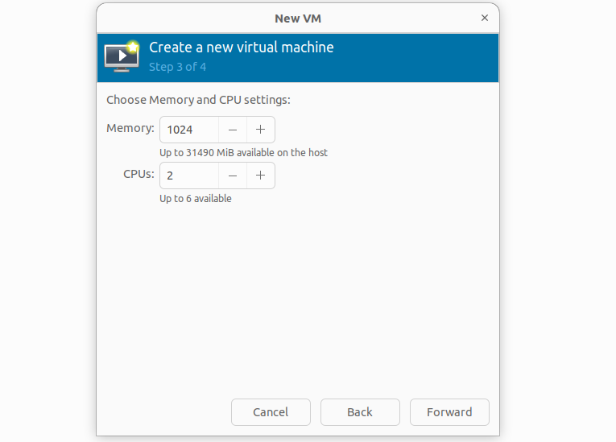
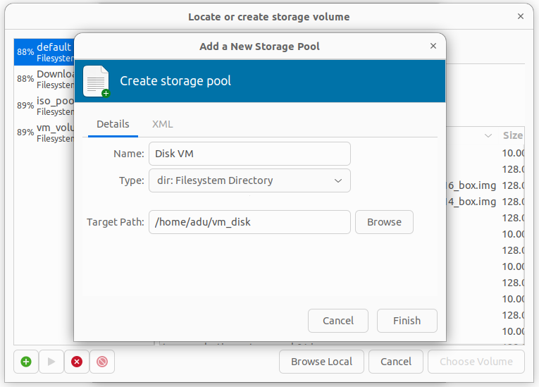

# TD 1 : Introduction à la virtualisation avancée

## Exercices théoriques

### Rappel des notions de virtualisation (R4.A.08)

Les exercices suivants ont pour but de vous rappeler les notions essentielles pour aborder ce module. Pour les réaliser, vous pouvez vous appuyer sur les pages suivantes ainsi que sur les cours de cette année et de l'année précédente :

- [Glossaire Docker](https://docs.docker.com/glossary/)
- [IBM : qu'est-ce que le cloud computing ?](https://www.ibm.com/topics/cloud-computing)
- [IBM : qu'est-ce que la virtualisation ?](https://www.ibm.com/fr-fr/topics/virtualization)
- [IBM : IaaS, PaaS et SaaS](https://www.ibm.com/topics/iaas-paas-saas)
- [Red Hat : la virtualisation](https://www.redhat.com/fr/topics/virtualization)

Liste des exercices à réaliser :

- [Exercice théorique 1 : Définitions (test)](https://webetud.iut-blagnac.fr/mod/quiz/view.php?id=29264)
- [Exercice théorique 2 : Avantages et inconvénients (test)](https://webetud.iut-blagnac.fr/mod/quiz/view.php?id=29266)
- [Exercice théorique 3 : Les différents types de virtualisation (test)](https://webetud.iut-blagnac.fr/mod/quiz/view.php?id=29299)
- [Exercice théorique 4 : La conteneurisation avec Docker](https://webetud.iut-blagnac.fr/mod/quiz/view.php?id=29300)

Ces exercices doivent être terminés avant la prochaine séance.

Les mêmes questions existent sous forme de document : [QCM du TD 1](td1-qcm.md), à compléter dans votre compte rendu si vous n'avez pas accès à Moodle.

La suite de la séance se déroule en autonomie, sur les ordinateurs de l'IUT, sous la partition Ubuntu 22.04. N'oubliez pas de prendre des notes et de faire des captures d'écran pour rédiger votre compte rendu individuel, qui sera évalué. Ce compte rendu devra présenter votre progression sur les quatre séances ainsi que vos réponses aux questions de l'énoncé.

## Préparation du poste

### Installation de Docker

Vérifiez si Docker et Docker Compose sont déjà installés sur votre poste :

```bash
$ docker compose version
```

Si la commande est introuvable, installez Docker et Docker Compose avec leurs dépendances, depuis le dépôt officiel de Docker :

```bash
$ sudo apt update
$ sudo apt-get install ca-certificates curl
$ sudo install -m 0755 -d /etc/apt/keyrings
$ sudo curl -fsSL https://download.docker.com/linux/ubuntu/gpg \
    -o /etc/apt/keyrings/docker.asc
$ sudo chmod a+r /etc/apt/keyrings/docker.asc
$ sudo tee /etc/apt/sources.list.d/docker.sources <<EOF
Types: deb
URIs: https://download.docker.com/linux/ubuntu
Suites: $(. /etc/os-release && echo "$VERSION_CODENAME")
Components: stable
Architectures: $(dpkg --print-architecture)
Signed-By: /etc/apt/keyrings/docker.asc
EOF
$ sudo apt-get update
$ sudo apt-get install docker-ce docker-ce-cli containerd.io \
    docker-buildx-plugin docker-compose-plugin
```

Le démon Docker est piloté par une socket (`/var/run/docker.sock`) réservée à `root` et au groupe `docker`. Sans ce groupe, chaque commande `docker` lancée sans `sudo` échoue avec l'erreur `permission denied while trying to connect to the Docker daemon socket`. Ajoutez votre compte au groupe `docker`, puis activez ce groupe dans le terminal courant :

```bash
$ sudo usermod -aG docker $USER
$ newgrp docker
```

La commande `newgrp` ne vaut que pour le terminal où vous la lancez : pour que tous vos terminaux en profitent, fermez votre session et reconnectez-vous.

Testez l'installation :

```bash
$ docker run hello-world
```

### Compte Docker Hub

Docker Hub limite les téléchargements d'images (*pulls*) anonymes à 100 par période de 6 heures et par adresse IP. Or tous les postes de la salle sortent sur Internet par la même adresse IP publique (NAT) : avec une douzaine d'images par étudiant dans ce TD, la limite est vite atteinte pour toute la salle, et les téléchargements échouent avec l'erreur `toomanyrequests`. Un compte Docker Hub gratuit dispose de son propre quota (200 téléchargements par période de 6 heures), indépendant de l'adresse IP.

Créez donc un compte gratuit sur [Docker Hub](https://hub.docker.com) si vous n'en avez pas, puis, dans **Account Settings → Personal access tokens**, créez un jeton d'accès (*Access Token*) en lecture seule. Connectez-vous ensuite depuis votre poste, en saisissant ce jeton à la place du mot de passe :

```bash
$ docker login -u votre_identifiant_docker_hub
```

Vos identifiants sont enregistrés dans `~/.docker/config.json` : vous vous déconnecterez avec `docker logout` à la fin de la séance.

### Répertoire de travail

Tous les fichiers du module sont rangés dans `~/R5A09/${MonNom}`. Commencez par définir la variable `MonNom` avec votre nom. Cette variable n'existe que dans le terminal où vous l'avez définie : redéfinissez-la dans chaque nouveau terminal (ou après une reconnexion), sinon les chemins de l'énoncé ne désignent plus votre répertoire.

Je vous recommande ensuite d'utiliser la commande `script` pour récupérer, en fin de séance, tout ce qui s'est affiché dans votre terminal :

```bash
$ export MonNom=dupont   # votre nom, en minuscules, sans espace
$ mkdir -p ~/R5A09/"${MonNom:?}" && cd $_ && script seance1.txt
[... Commandes de la séance ...]
$ exit
```

## Exercice pratique 0 : création d'une image Hello World

### 0.1 Préparation de l'environnement

Assurez-vous que Docker est installé sur votre machine :

```bash
$ docker version
```

Créez un répertoire pour votre site web et placez-y un fichier HTML `index.html` contenant un message de bienvenue :

```bash
$ mkdir -p ~/R5A09/${MonNom}/hello-world
$ echo "Bonjour ${MonNom}" > ~/R5A09/${MonNom}/hello-world/index.html
```

### 0.2 Création d'un fichier Dockerfile

Créez un fichier nommé `Dockerfile` dans le même répertoire que votre site web. Éditez ce fichier pour décrire la construction de l'image Docker. Voici un exemple minimal de Dockerfile :

```dockerfile
FROM fedora:latest
RUN dnf -y install httpd
COPY index.html /var/www/html/
USER root
CMD ["httpd", "-D", "FOREGROUND"]
```

**Question 0.1 :** expliquez le Dockerfile ligne par ligne.

### 0.3 Test de votre image

Depuis le répertoire de votre site web, construisez une image Docker nommée `my-hello-world` :

```bash
$ cd ~/R5A09/${MonNom}/hello-world
$ docker build -t my-hello-world .
```

Lancez un conteneur nommé `my-hello-world-container` : pour cela, modifiez la seconde commande ci-dessous en vous aidant de l'aide de `docker run`. Testez ensuite votre page dans votre navigateur, à l'adresse <http://localhost:8080>.

```bash
$ docker run --help
$ docker run -p 8080:80 my-hello-world
```

**Question 0.2 :** montrez le résultat. Quelle est la différence entre un conteneur et une image Docker ?

Arrêtez ensuite le conteneur (`Ctrl+C`, ou `docker stop my-hello-world-container` depuis un autre terminal) : le port 8080 servira de nouveau dans l'exercice 2.

## Exercice pratique 1 : comparer les performances d'un serveur web sous Docker et dans une VM

### 1.1 Installation de WordPress dans une machine virtuelle

Dans cet exercice, vous allez installer Virt-manager, KVM, QEMU et libvirt sur votre PC. L'objectif est de vous familiariser avec ces outils essentiels de la virtualisation, afin de savoir créer et gérer des machines virtuelles. Ils vous serviront tout au long de ce module.

**Virt-manager** est une interface graphique de gestion de machines virtuelles : elle permet de créer, de configurer et de surveiller simplement des environnements virtualisés.

**Libvirt** est une API (*Application Programming Interface*) qui sert de couche d'abstraction pour la gestion des machines virtuelles.

Virt-manager s'appuie sur libvirt pour piloter l'hyperviseur de type 1 KVM, ainsi que d'autres hyperviseurs comme Xen ou VirtualBox.

**QEMU** (*Quick Emulator*) prend le relais en l'absence des extensions matérielles de virtualisation sur le processeur : il émule le matériel nécessaire au bon fonctionnement de la machine virtuelle. Vous pouvez par exemple émuler un système d'exploitation x86 (32 ou 64 bits) sur un hôte ARM.

**KVM** (*Kernel-based Virtual Machine*) est un composant essentiel de cette pile et joue le rôle d'hyperviseur de type 1 : il transforme le noyau Linux en un hyperviseur capable de créer et de gérer des machines virtuelles sur le système hôte. KVM exploite les extensions matérielles de virtualisation des processeurs modernes (Intel VT-x, AMD-V) pour offrir de bonnes performances et une isolation solide entre les machines virtuelles.

Avant de commencer l'installation, vérifiez que vous disposez d'au moins 20 Go d'espace libre sur votre partition `/` :

```bash
$ df -h /
```

Installez Virt-manager et toutes ses dépendances, ainsi que les outils `htop` et `setfacl` (paquet `acl`) utilisés plus loin :

```bash
$ sudo apt update
$ sudo apt-get install virt-manager htop acl
```

Si une mise à jour de GRUB est nécessaire, redémarrez votre PC.

Vous allez installer dans une VM l'appliance [TurnKey Linux WordPress](https://www.turnkeylinux.org/wordpress) : une image ISO (546 Mio à télécharger) qui installe en quelques minutes une Debian 13 avec WordPress, Apache et MariaDB déjà configurés. Téléchargez-la, avec le fichier de sommes de contrôle qui l'accompagne, puis vérifiez son intégrité :

```bash
$ TKL=https://mirror.turnkeylinux.org/turnkeylinux/images/iso
$ ISO=turnkey-wordpress-19.0-trixie-amd64.iso
$ cd ~/Téléchargements && wget $TKL/$ISO $TKL/$ISO.hash
$ sha256sum --ignore-missing -c $ISO.hash
```

La dernière commande doit afficher `turnkey-wordpress-19.0-trixie-amd64.iso: OK`. L'avertissement sur les lignes « improperly formatted » est normal : le fichier `.hash` contient aussi des explications et une signature.

Créez le répertoire qui accueillera le disque de la VM, puis affichez son chemin absolu :

```bash
$ mkdir -p ~/R5A09/${MonNom}/vm_disk
$ echo ~/R5A09/$MonNom/vm_disk
```

Virt-manager ne développe ni `~` ni `${MonNom}` : c'est ce chemin absolu, par exemple `/home/dupont/R5A09/dupont/vm_disk`, que vous devrez saisir dans ses fenêtres.

Ouvrez Virt-manager et créez une nouvelle machine virtuelle :

**File → New Virtual Machine**

Créez la machine virtuelle à partir de l'image ISO :

**Step 1 → Local install media (ISO image or CDROM) → Forward**

**Step 2 → Browse… → Browse Local** : sélectionnez le fichier `turnkey-wordpress-19.0-trixie-amd64.iso` dans le dossier `Téléchargements`. Si Virt-manager signale que l'émulateur n'a pas les droits d'accès au fichier (*search permissions*) et propose de les corriger, acceptez. Décochez **Automatically detect from the installation media / source**, choisissez **Debian 13** (ou, s'il n'est pas proposé, la version de Debian la plus récente de la liste), puis cliquez sur **Forward**.

Attribuez du processeur et de la mémoire à la VM :

**Step 3 → Memory : 1024, CPUs : 2 → Forward**



*Figure 1 : étape 3, réglage de la mémoire et du nombre de processeurs.*

Pour placer le disque de la VM dans votre répertoire `vm_disk`, vous devez ajouter un nouveau pool de stockage :

**Step 4 → Select or create custom storage → Manage… → Add pool** (bouton **+** en bas à gauche) avec **Name** : `Disk_VM`, **Type** : `dir: Filesystem Directory`, **Target Path** : le chemin absolu affiché par la commande `echo` ci-dessus.



*Figure 2 : ajout d'un pool de stockage de type répertoire ; le chemin cible est un chemin absolu.*

Dans le pool `Disk_VM`, créez le disque de la VM avec le bouton **+** (*Create new volume*) : **Name** : `wordpress-tp1`, **Format** : `qcow2`, **Max Capacity** : `10` GiB. Sélectionnez ce volume, cliquez sur **Choose Volume**, puis sur **Forward**.

**Step 5 →** renommez la VM en `WordPress_TP1`, conservez les autres réglages par défaut (dont le réseau NAT) et cliquez sur **Finish**.

**Dépannage :** si la VM refuse de démarrer avec une erreur « Permission denied » sur l'image ISO ou sur le disque, c'est que le compte `libvirt-qemu`, qui exécute QEMU, ne peut pas traverser votre répertoire personnel (droits `750` par défaut sous Ubuntu 22.04). Donnez-lui uniquement le droit de traverser ce répertoire (`x`), sans droit de lecture, puis relancez la VM :

```bash
$ setfacl -m u:libvirt-qemu:x $HOME
```

La VM démarre alors sur l'image ISO. Installez le système sur le disque :

1. Dans le menu TurnKey, choisissez **Install to hard disk**.
2. Choisissez le disque `/dev/vda` (10 GiB), puis le partitionnement **guided** (partitions ext4 simples) et **No** pour la partition `/boot` séparée. Validez le schéma de partitionnement et l'avertissement d'effacement du disque.
3. À la question **Begin installation?**, répondez **Yes** (le bouton sélectionné par défaut est **No**).
4. Au bout d'une à deux minutes, acceptez le redémarrage (**Yes**).

Au premier démarrage, TurnKey vous pose quelques questions :

- mots de passe du compte `root`, du compte MariaDB `adminer` et du compte WordPress `admin` : au moins 8 caractères, dont 3 types parmi majuscules, minuscules, chiffres et symboles. Notez-les ;
- adresse électronique du compte `admin` : conservez la valeur proposée ;
- **WordPress domain** : saisissez `http://` suivi de l'adresse IP de la VM, par exemple `http://192.168.122.84`. Pour connaître cette adresse, exécutez sur votre PC (et non dans la VM) la commande ci-dessous. Si vous laissez la valeur par défaut (`www.example.com`), le site s'affiche sans mise en forme et la connexion à l'administration renvoie vers un domaine qui n'est pas le vôtre ;
- **Initialize Hub services**, **System Notifications** et **Security updates** : choisissez **Skip** (la mise à jour de sécurité prendrait plusieurs minutes).

```bash
$ sudo virsh net-dhcp-leases default
```

Si vous vous êtes trompé de domaine, connectez-vous à la VM en `root` et relancez la configuration de WordPress, qui vous redemandera le mot de passe et l'adresse électronique de `admin` :

```bash
$ /usr/lib/inithooks/bin/wordpress.py --domain=http://192.168.122.84
```

La console de la VM affiche ensuite l'écran *WORDPRESS appliance services*, qui récapitule les adresses du site web, de Webmin, d'Adminer et du service SSH.

Testez WordPress depuis votre navigateur, à l'adresse `http://` suivie de l'adresse IP de la VM ; l'administration est accessible dans `/wp-admin` avec le compte `admin`.

**Question 1.1.1 :** quelles fonctionnalités Virt-manager propose-t-il ?

Redémarrez la VM et mesurez le temps nécessaire pour que le site soit accessible.

**Question 1.1.2 :** combien de temps l'application met-elle à démarrer ?

Vérifiez aussi l'espace disque occupé par votre VM :

```bash
$ du -sh ~/R5A09/${MonNom}/vm_disk
```

**Question 1.1.3 :** quel espace disque l'application occupe-t-elle sur l'hyperviseur ?

**Bonus**

Connectez-vous à la VM en `root`, depuis votre PC avec `ssh root@192.168.122.84` (adaptez l'adresse IP), et listez les programmes en cours d'exécution :

```bash
$ ps -ef
```

**Question bonus 1.1.4 :** comparez les programmes en cours d'exécution liés à WordPress sur la VM et sur l'hyperviseur.

Listez les ports TCP à l'écoute sur le serveur et les programmes associés :

```bash
$ ss -tlnp
```

**Question bonus 1.1.5 :** comparez les ports à l'écoute liés à WordPress sur la VM et sur l'hyperviseur.

Vérifiez l'espace disponible :

```bash
$ df -h
```

**Question bonus 1.1.6 :** comparez l'espace occupé par WordPress sur la VM et sur l'hyperviseur.

Sur votre PC, vérifiez la consommation de processeur et de mémoire de votre VM :

```bash
$ htop -u libvirt-qemu
```

**Question bonus 1.1.7 :** comparez l'utilisation du processeur et de la mémoire sur la VM et sur l'hyperviseur.

### 1.2 Installation de WordPress avec Docker

Vous allez maintenant déployer WordPress avec Docker Compose, à partir des images officielles `wordpress` et `mariadb` de Docker Hub. Dans votre répertoire de travail, créez un répertoire `docker/tp1-wordpress` :

```bash
$ mkdir -p ~/R5A09/${MonNom}/docker/tp1-wordpress
$ cd ~/R5A09/${MonNom}/docker/tp1-wordpress
```

Créez-y le fichier `docker-compose.yml` suivant :

```yaml
services:
  db:
    image: mariadb:11.4
    restart: unless-stopped
    environment:
      MARIADB_DATABASE: wordpress
      MARIADB_USER: wordpress
      MARIADB_PASSWORD: Wp-Td1-Mdp-2026
      MARIADB_ROOT_PASSWORD: Root-Td1-Mdp-2026
    volumes:
      - db_data:/var/lib/mysql
    healthcheck:
      test: ["CMD", "healthcheck.sh", "--connect", "--innodb_initialized"]
      interval: 5s
      timeout: 5s
      retries: 20

  wordpress:
    image: wordpress:6
    restart: unless-stopped
    depends_on:
      db:
        condition: service_healthy
    ports:
      - "127.0.0.1:8000:80"
    environment:
      WORDPRESS_DB_HOST: db
      WORDPRESS_DB_USER: wordpress
      WORDPRESS_DB_PASSWORD: Wp-Td1-Mdp-2026
      WORDPRESS_DB_NAME: wordpress
    volumes:
      - wp_data:/var/www/html

volumes:
  db_data:
  wp_data:
```

Le service `wordpress` joint la base de données par le nom du service (`db`) et attend, grâce au *healthcheck*, que MariaDB soit prête. Le serveur web du conteneur écoute sur le port 80 : il est publié sur le port 8000 de votre PC, et uniquement sur l'adresse `127.0.0.1`, car seul votre navigateur a besoin d'y accéder. Les données (fichiers de WordPress et base de données) sont conservées dans deux volumes.

Lancez l'application :

```bash
$ docker compose up -d
```

Testez l'application dans votre navigateur : <http://localhost:8000/>. WordPress affiche son assistant d'installation : choisissez la langue, le titre du site et le compte administrateur.

**Question 1.2.1 :** combien de temps l'application met-elle à démarrer ? Pour le mesurer, arrêtez-la puis relancez-la :

```bash
$ docker compose stop
$ time docker compose up -d
```

**Question 1.2.2 :** quel espace disque l'application occupe-t-elle ?

```bash
$ docker system df
```

### 1.3 Comparatif de WordPress sous Docker et dans une VM

**Question 1.3.1 :** au vu des exercices précédents, comparez les avantages et les inconvénients d'une VM et de Docker pour installer, utiliser et maintenir un site web.

## Exercice pratique 2 : installation d'une application complexe

OpenCTI est une plateforme de gestion du renseignement sur les cybermenaces : elle permet aux organisations de collecter, d'enrichir, de gérer et de partager des informations sur les menaces et les indicateurs de compromission. Elle facilite la collaboration entre les équipes de sécurité en centralisant les données sur les menaces et en fournissant des outils d'analyse et de visualisation.

Pour plus d'informations, consultez la [présentation d'OpenCTI sur le site de Filigran](https://filigran.io/products/opencti).

Cette application moderne nécessite de nombreux composants pour fonctionner. Chacun d'eux sera isolé dans un conteneur. L'objectif de cet exercice est de comprendre comment faire interagir des conteneurs à l'aide de Docker Compose.


*Figure 3 : architecture d'OpenCTI. Les connecteurs alimentent la file RabbitMQ, les workers insèrent les données dans la plateforme, qui les stocke dans Elasticsearch, Redis et un stockage S3 (service `minio`).*

La pile OpenCTI utilise environ 4,5 Go de mémoire vive, dont 2,5 Go pour Elasticsearch. Avant de la lancer, arrêtez la VM `WordPress_TP1` et la pile WordPress (`docker compose stop` dans le répertoire `tp1-wordpress`).

Créez le répertoire suivant pour y enregistrer votre fichier Docker Compose :

```bash
$ mkdir -p ~/R5A09/${MonNom}/docker/tp-opencti
$ cd ~/R5A09/${MonNom}/docker/tp-opencti
```

Le fichier Docker Compose officiel d'OpenCTI est publié dans le dépôt [OpenCTI-Platform/docker](https://github.com/OpenCTI-Platform/docker). Ce dépôt ne publie pas de versions (*tags*) et sa branche `master` évolue en permanence : pour que tout le monde travaille sur les mêmes fichiers, téléchargez-les depuis un commit précis (celui du 16 octobre 2026). Récupérez le fichier `docker-compose.yml` ainsi que le fichier `rabbitmq.conf`, que ce dernier monte dans le conteneur RabbitMQ :

```bash
$ OCTI=https://raw.githubusercontent.com/OpenCTI-Platform/docker
$ OCTI=$OCTI/60285adb360e3823a334333ae4744255d8ac1821
$ curl -fsSLO $OCTI/docker-compose.yml
$ curl -fsSLO $OCTI/rabbitmq.conf
```

Un fichier `docker-compose.yml` sert à définir et à configurer les services, les réseaux et les volumes nécessaires au déploiement d'une application multi-conteneurs avec Docker.

Il est principalement constitué des sections YAML suivantes :

- **services** : sous cette section, vous définissez chaque service, c'est-à-dire chaque conteneur à déployer. Chaque service porte un nom unique et se configure avec diverses propriétés : l'image à utiliser, les ports à exposer, les variables d'environnement, etc.
- **networks** : si vos services ont besoin de réseaux spécifiques, vous pouvez définir des réseaux personnalisés pour isoler ou regrouper des conteneurs.
- **volumes** : vous pouvez définir des volumes pour conserver les données en dehors du conteneur. C'est utile pour ne pas perdre l'état des bases de données ou les fichiers de configuration au redémarrage d'un conteneur.

Les fichiers plus anciens commencent parfois par une clé `version` : elle est obsolète, Docker Compose l'ignore, et vous ne devez pas l'ajouter dans vos propres fichiers.

Pour plus d'informations, consultez la [référence du format de fichier Compose](https://docs.docker.com/reference/compose-file/).

Comme vous avez pu le constater, ce fichier contient des variables (`${OPENCTI_ADMIN_TOKEN}`, `${MINIO_ROOT_PASSWORD}`, etc.). Docker Compose les remplace par les valeurs du fichier `.env` placé à côté du fichier `docker-compose.yml`. Générez ce fichier à partir du modèle `.env.sample` du dépôt : chaque identifiant de connecteur doit être un UUID unique, fourni ici par le noyau Linux, et chaque mot de passe une chaîne aléatoire :

```bash
$ uuid() { cat /proc/sys/kernel/random/uuid; }
$ mdp() { openssl rand -hex 16; }
$ cat > .env <<EOF
COMPOSE_PROJECT_NAME=opencti
MINIO_ROOT_USER=opencti
MINIO_ROOT_PASSWORD=$(mdp)
RABBITMQ_DEFAULT_USER=opencti
RABBITMQ_DEFAULT_PASS=$(mdp)
SMTP_HOSTNAME=localhost
OPENSEARCH_ADMIN_PASSWORD=$(mdp)
ELASTIC_MEMORY_SIZE=2G
XTM_COMPOSER_ID=$(uuid)
PLATFORM_REGISTRATION_TOKEN=$(openssl rand -hex 32)

OPENCTI_HOST=localhost
OPENCTI_PORT=8080
OPENCTI_EXTERNAL_SCHEME=http
OPENCTI_ADMIN_EMAIL=admin@opencti.io
OPENCTI_ADMIN_PASSWORD=$(mdp)
OPENCTI_ADMIN_TOKEN=$(uuid)
OPENCTI_HEALTHCHECK_ACCESS_KEY=$(mdp)
OPENCTI_ENCRYPTION_KEY=$(openssl rand -base64 32)

CONNECTOR_EXPORT_FILE_STIX_ID=$(uuid)
CONNECTOR_EXPORT_FILE_CSV_ID=$(uuid)
CONNECTOR_EXPORT_FILE_TXT_ID=$(uuid)
CONNECTOR_IMPORT_FILE_STIX_ID=$(uuid)
CONNECTOR_IMPORT_DOCUMENT_ID=$(uuid)
CONNECTOR_IMPORT_FILE_YARA_ID=$(uuid)
CONNECTOR_IMPORT_EXTERNAL_REFERENCE_ID=$(uuid)
CONNECTOR_ANALYSIS_ID=$(uuid)
CONNECTOR_OPENCTI_ID=$(uuid)
CONNECTOR_MITRE_ID=$(uuid)

XTM_ONE_HOST=localhost
XTM_ONE_PORT=8090
XTM_ONE_EXTERNAL_SCHEME=http
XTM_ONE_ADMIN_EMAIL=admin@opencti.io
XTM_ONE_ADMIN_PASSWORD=$(mdp)
XTM_ONE_SECRET_KEY=$(openssl rand -hex 32)
XTM_ONE_POSTGRES_USER=xtmone
XTM_ONE_POSTGRES_PASSWORD=$(mdp)
XTM_ONE_S3_BUCKET=xtm-one-files
XTM_ONE_ENTERPRISE_LICENSE=
XTM_ONE_LOG_LEVEL=info
XTM_ONE_LOG_FORMAT=json
EOF
$ chmod 600 .env
```

Vérifiez que toutes les variables sont définies : la commande suivante ne doit afficher aucun avertissement `variable is not set` (un éventuel avertissement sur `deploy.mode` est sans conséquence) :

```bash
$ docker compose config -q
```

Le fichier officiel démarre aussi l'assistant IA XTM One, un gestionnaire d'intégrations (`xtm-composer`, qui a accès à la socket Docker de votre PC) et une dizaine de connecteurs. Pour alléger la pile, modifiez le fichier `docker-compose.yml` :

- supprimez tous les services, sauf `redis`, `elasticsearch`, `minio`, `rabbitmq`, `opencti`, `worker`, `connector-export-file-stix` et `connector-import-file-stix` ;
- dans la section `volumes` en fin de fichier, supprimez les volumes `rsakeys` et `pgsqlxtmonedata`, qui ne servent plus ;
- dans le service `opencti`, supprimez les lignes de configuration inutiles suivantes :

```yaml
- SMTP__HOSTNAME=${SMTP_HOSTNAME}
- SMTP__PORT=25
# XTM One
- XTM__XTM_ONE_URL=http://xtm-one:4000
- XTM__XTM_ONE_TOKEN=${PLATFORM_REGISTRATION_TOKEN}
```

- dans le service `minio`, supprimez la section `ports` : seuls les conteneurs d'OpenCTI ont besoin de joindre le stockage S3.

Les images d'OpenCTI et du stockage S3 portent l'étiquette `latest`, qui désigne une version différente à chaque nouvelle publication. Fixez leurs versions, puis vérifiez la liste des services restants (vous devez en obtenir 8) :

```bash
$ sed -i 's#\(opencti/[a-z-]*\):latest#\1:7.261030.1#' docker-compose.yml
$ sed -i 's#pgsty/silo:latest#pgsty/silo:RELEASE.2026-10-26T00-00-00Z#' \
    docker-compose.yml
$ docker compose config --services
```

**Question 2.1 :** quels conteneurs Docker va-t-il démarrer ?

**Question 2.2 :** comment mettre à jour l'un des composants de l'application ?

La persistance des données est assurée par des volumes. Par défaut, les volumes sont stockés dans `/var/lib/docker/volumes`.

**Question 2.3 :** quels composants verront leurs données conservées lors d'une mise à jour grâce aux volumes ?

Depuis le répertoire `~/R5A09/${MonNom}/docker/tp-opencti/`, lancez tous les conteneurs. Le premier démarrage prend plusieurs minutes : la commande attend que chaque service soit opérationnel (*healthcheck*) avant de lancer ceux qui en dépendent.

```bash
$ docker compose up -d
```

Affichez les journaux :

```bash
$ docker compose logs
```

Si besoin, arrêtez les conteneurs :

```bash
$ docker compose down
```

En cas de problème avec Elasticsearch, exécutez la commande suivante sur votre poste :

```bash
$ sudo sysctl -w vm.max_map_count=1048575
```

Depuis votre navigateur, testez la page <http://localhost:8080>. Connectez-vous avec l'adresse et le mot de passe de l'administrateur, enregistrés dans le fichier `.env` :

```bash
$ grep -E 'OPENCTI_ADMIN_(EMAIL|PASSWORD)' .env
```

**Question 2.4 :** combien de conteneurs sont en cours d'exécution sur votre machine ? Pourquoi ce nombre ne correspond-il pas au nombre de services ?

```bash
$ docker stats
$ docker ps
```

**Question 2.5 :** Docker Compose crée de nombreux objets par défaut au lancement des conteneurs. À l'aide de la commande `docker inspect` appliquée au conteneur OpenCTI, donnez le nom du réseau auquel tous les conteneurs sont rattachés.

**Question 2.6 :** le conteneur OpenCTI communique avec Redis grâce à la configuration suivante : `HOSTNAME=redis`, `PORT=6379`. Comment expliquer que vous ne puissiez pas joindre Redis depuis votre poste ?

**Question 2.7 :** quelle configuration faudrait-il ajouter au service `redis` pour le rendre accessible depuis votre poste ?

**Question 2.8 :** le port 8080 n'est pas le port standard de HTTP. Quelle ligne faut-il modifier pour accéder à OpenCTI par le port 80 ?

**Question 3 :** retours sur la séance

- Quelles difficultés avez-vous rencontrées ?
- Comment améliorer cette séance ?

## Nettoyage

Avant la fin de la séance, sauvegardez tous les fichiers dont vous aurez besoin pour rédiger votre compte rendu (dont `seance1.txt`), puis supprimez toutes vos traces. Ne supprimez que ce que vous avez créé pendant ce TD : d'autres projets Docker ou d'autres VM peuvent exister sur le poste.

Si vous travaillez dans un nouveau terminal, redéfinissez d'abord la variable `MonNom`. Arrêtez et supprimez les conteneurs, les réseaux, les volumes et les images de chaque projet Docker Compose, tant que ses fichiers existent encore, puis le conteneur et les images de l'exercice 0, et déconnectez-vous de Docker Hub :

```bash
$ cd ~/R5A09/${MonNom}/docker/tp-opencti
$ docker compose down -v --rmi all
$ cd ~/R5A09/${MonNom}/docker/tp1-wordpress
$ docker compose down -v --rmi all
$ docker rm -f my-hello-world-container
$ docker rmi my-hello-world fedora:latest hello-world
$ docker logout
```

Arrêtez la VM, puis supprimez-la avec son disque, ainsi que le pool de stockage. La commande `virsh destroy` coupe la VM comme un arrêt électrique : elle renvoie une erreur sans gravité si la VM est déjà arrêtée.

```bash
$ sudo virsh destroy WordPress_TP1
$ sudo virsh undefine WordPress_TP1 --remove-all-storage
$ sudo virsh pool-destroy Disk_VM
$ sudo virsh pool-undefine Disk_VM
$ sudo virsh pool-list --all
```

Si la dernière commande affiche un autre pool créé pendant la séance (par exemple pour le dossier `Téléchargements`), supprimez-le de la même façon avec `pool-destroy` et `pool-undefine`. Si vous avez appliqué le dépannage `setfacl`, retirez aussi ce droit :

```bash
$ setfacl -x u:libvirt-qemu $HOME
```

Supprimez enfin vos fichiers et vos téléchargements :

```bash
$ cd ~
$ rm -f ~/Téléchargements/turnkey-wordpress-19.0-trixie-amd64.iso*
$ rm -fr ~/Téléchargements/bitnami*
$ rm -fr ~/R5A09/"${MonNom:?}"
```

Supprimez votre historique :

```bash
$ history -d ${votre_premiere_ligne}-${votre_derniere_ligne}
```
