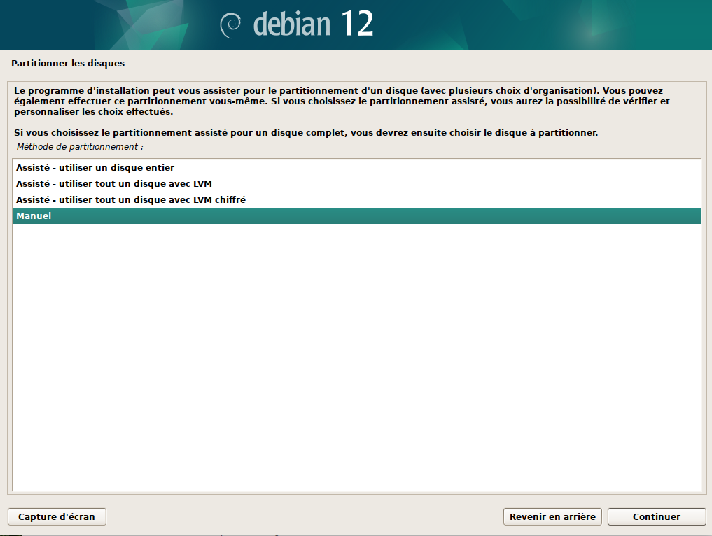
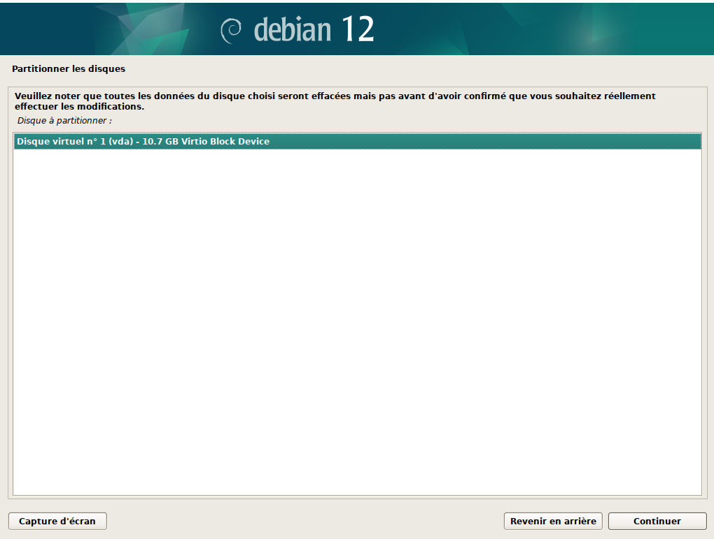
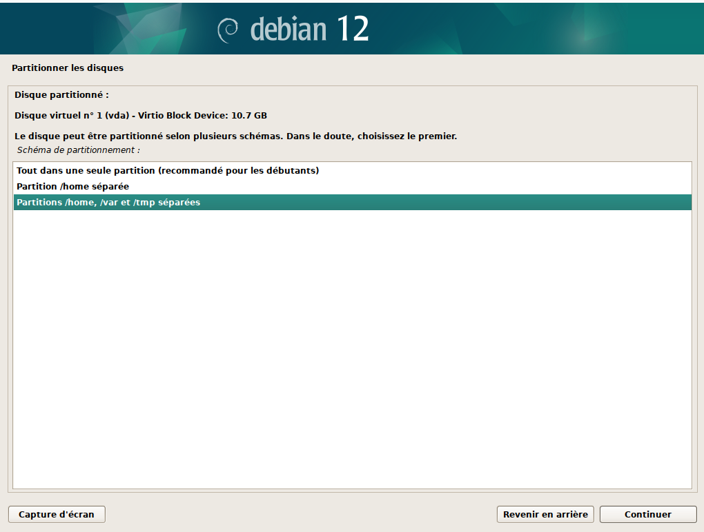
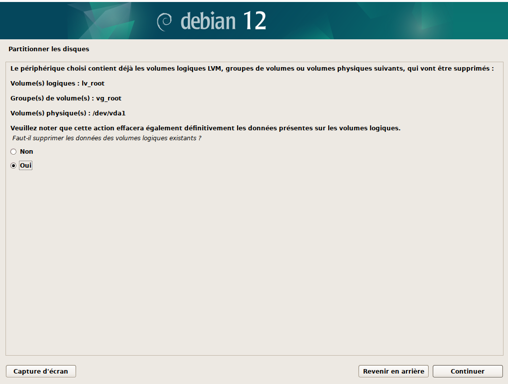
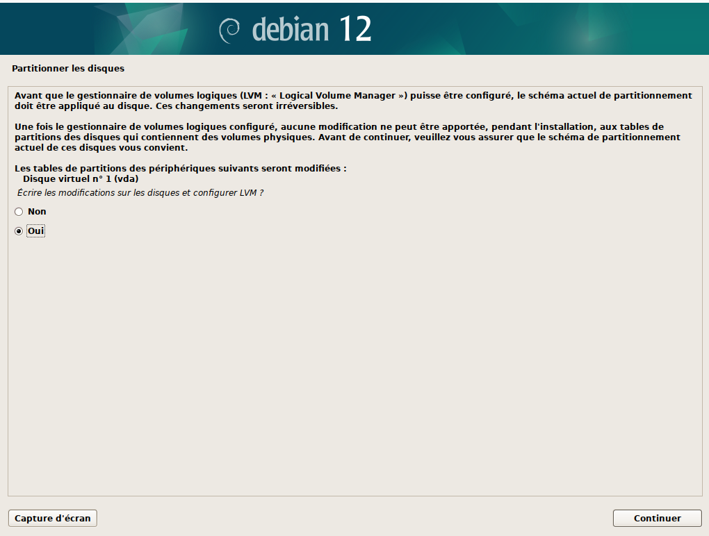
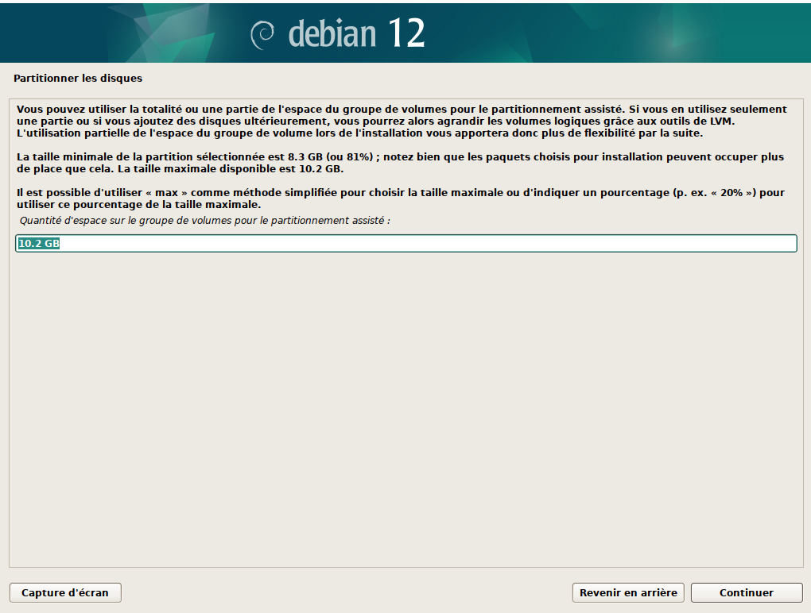
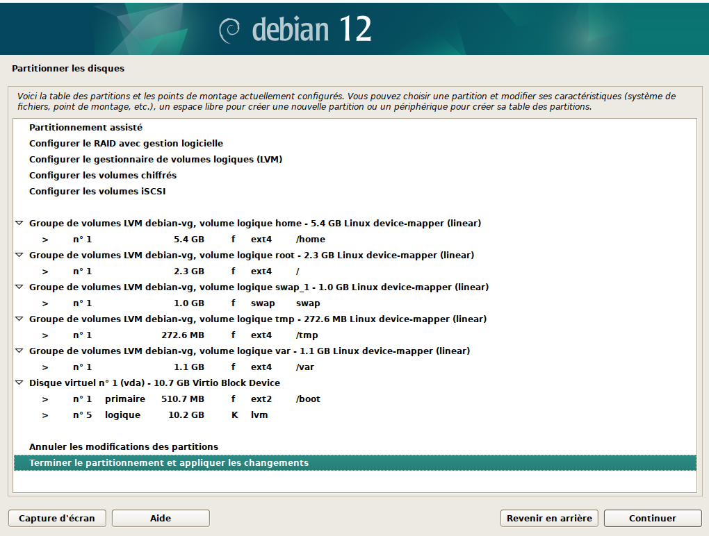
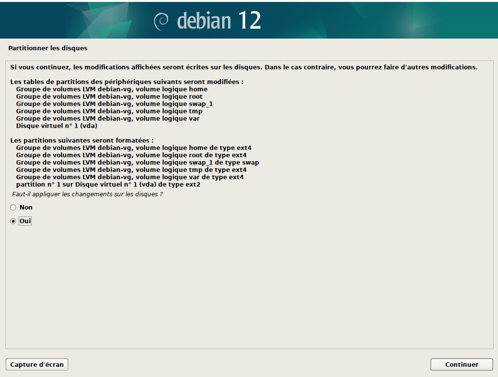
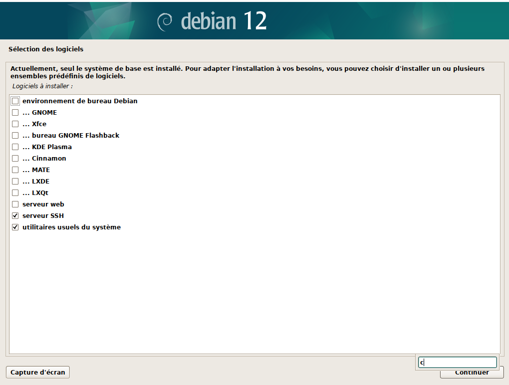

# TD 3 : Monitoring d'infrastructures virtualisées

## Exercices théoriques

Les exercices théoriques disponibles sur Moodle doivent être complétés avant la prochaine séance.

Les mêmes questions existent sous forme de document : [QCM du TD 3](td3-qcm.md), à compléter dans votre compte rendu si vous n'avez pas accès à Moodle.

Pour vous aider à réaliser ces exercices, vous pouvez vous référer aux pages suivantes ainsi qu'aux cours de cette année et de l'année précédente :

- <https://www.atlassian.com/fr/incident-management/kpis/sla-vs-slo-vs-sli>
- <https://www.padok.fr/blog/partitionnement-disques-lvm>

La suite de la séance se déroule en autonomie sur les ordinateurs de l'IUT, sur la partition Ubuntu 22.04. N'oubliez pas de prendre des notes et/ou de faire des captures d'écran pour rédiger votre compte rendu individuel. Je vous recommande d'utiliser la commande `script` pour récupérer le contenu de votre terminal à la fin de la séance.

Commencez par définir votre nom dans une variable (à refaire dans chaque nouveau terminal) :

```bash
$ export MonNom=dupont   # votre nom, en minuscules, sans espace
$ mkdir -p ~/R5A09/${MonNom} && cd $_ && script seance3.txt
[... Commandes de la séance ...]
$ exit
```

Le compte rendu devra inclure votre progression sur les quatre séances ainsi que les réponses aux questions de l'énoncé.

La séance est dense : les étapes marquées « (facultatif) » peuvent être laissées de côté si vous manquez de temps. Gardez du temps pour l'exercice 3 (agrandissement du disque avec LVM).

Durant le TP, vous allez télécharger des images sur Docker Hub. Il est possible que vous soyez confronté à une limite de téléchargement (*rate limit*) qui vous interdise de télécharger de nouvelles images. Dans ce cas, rendez-vous sur <https://hub.docker.com> et créez un compte. Dans l'espace **Account Settings > Security**, ajoutez un nouvel « Access Token ».

Utilisez ensuite la commande suivante sur votre poste pour vous connecter :

```bash
$ docker login
```

## Exercice pratique 1 : Grafana & Prometheus

L'un des objectifs de cet exercice est de mettre en place, dans un environnement virtualisé, un monitoring permettant de suivre les SLO et les SLI qu'un SRE pourrait définir dans son entreprise.

Prometheus est un système open source de monitoring et de gestion des alertes, conçu pour collecter, stocker et analyser en temps réel les métriques des systèmes et des applications. Il fonctionne selon un modèle de *scraping* (récolte) des données : Prometheus interroge périodiquement les cibles pour récupérer leurs métriques. Ces métriques sont stockées dans une base de données de séries temporelles, ce qui offre un historique riche et des possibilités d'analyse approfondie.

Créez un répertoire pour ce projet et un fichier de configuration (vide pour l'instant) pour Prometheus :

```bash
$ mkdir -p ~/R5A09/${MonNom}/monitoring/prometheus
$ cd ~/R5A09/${MonNom}/monitoring && touch prometheus/prometheus.yml
```

Dans ce répertoire, créez un fichier `docker-compose.yml` pour déployer Prometheus :

```yaml
volumes:
  prometheus_data: {}
  grafana_data: {}

services:

  prometheus:
    image: prom/prometheus:v3.15.1
    volumes:
      - ./prometheus/:/etc/prometheus/
      - prometheus_data:/prometheus
    command:
      - '--config.file=/etc/prometheus/prometheus.yml'
      - '--storage.tsdb.path=/prometheus'
    ports:
      - 9090:9090
    restart: unless-stopped
```

**Question 1.1 :** Quelle adresse faut-il saisir dans votre navigateur pour accéder à l'interface web de Prometheus ?

Lancez les conteneurs avec la commande `docker compose` :

```bash
$ docker compose up -d
```

**Question 1.2 :** Quels sont les répertoires qui seront persistés ?

**Question 1.3 :** Quelle commande vous permet de vérifier l'état des conteneurs ?

Vous pouvez désormais tester l'interface web. Par défaut, aucun mot de passe n'est demandé pour accéder à Prometheus. Comme vous pouvez le remarquer, aucune *target* (cible) n'est configurée et la base de données ne contient aucune métrique.

Pour ajouter des métriques à la base de données de Prometheus, nous devons configurer des exportateurs.

Un exportateur Prometheus est un composant logiciel qui collecte les métriques spécifiques d'un système, d'une application ou d'un service, et les expose via HTTP dans un format compréhensible par Prometheus. Ces métriques sont ensuite collectées par le serveur Prometheus à intervalles réguliers pour la surveillance et l'analyse.

Nous allons commencer par utiliser Node Exporter. Il est conçu pour collecter les métriques spécifiques d'un système d'exploitation Linux (utilisation du CPU, de la RAM, des partitions, etc.). Pour cela, ajoutez ce service à votre fichier `docker-compose.yml`, sous la clé `services` :

```yaml
  node-exporter:
    image: quay.io/prometheus/node-exporter:latest
    volumes:
      - /proc:/host/proc:ro
      - /sys:/host/sys:ro
      - /:/host:ro,rslave
    command:
      - '--path.rootfs=/host'
      - '--path.procfs=/host/proc'
      - '--path.sysfs=/host/sys'
      - --collector.filesystem.mount-points-exclude
      - "^/(dev|proc|sys|run/credentials/.+|var/lib/docker/.+)($$|/)"
    ports:
      - 9100:9100
    restart: unless-stopped
```

Grâce à `--path.rootfs=/host`, Node Exporter retire le préfixe `/host` : les points de montage apparaissent tels qu'ils sont sur l'hôte (`/`, `/boot`…). L'option `--collector.filesystem.mount-points-exclude` écarte les systèmes de fichiers virtuels (`/proc`, `/sys`…) et ceux des conteneurs Docker.

**Question 1.4 :** Pourquoi utiliser `:ro` (*read only*, lecture seule) dans notre `docker-compose.yml` ?

Avant de relancer `docker compose`, ajoutez la configuration suivante dans le fichier `prometheus/prometheus.yml` :

```yaml
scrape_configs:
  - job_name: 'prometheus'
    scrape_interval: 15s
    static_configs:
      - targets: ['localhost:9090']

  - job_name: 'cadvisor'
    scrape_interval: 15s
    static_configs:
      - targets: ['cadvisor:8080']

  - job_name: 'node-exporter'
    scrape_interval: 15s
    static_configs:
      - targets: ['node-exporter:9100']
```

Relancez ensuite la pile, puis redémarrez Prometheus : `docker compose up -d` ne recrée que les services dont la définition a changé, et Prometheus ne relit pas de lui-même son fichier de configuration.

```bash
$ docker compose up -d
$ docker compose restart prometheus
```

Pensez à redémarrer Prometheus de la même façon à chaque modification de `prometheus/prometheus.yml`.

**Question 1.5 :** Avec votre navigateur, rendez-vous sur <http://localhost:9100/metrics> et sur <http://localhost:9100/>. Quelles informations pouvez-vous y trouver ?

Utilisez l'interface graphique de Prometheus pour répondre aux questions suivantes.

**Question 1.6 :** Combien de *targets* sont présentes dans Prometheus et quel est leur état (menu **Status > Target health**) ?

Il est possible d'interroger Prometheus avec des requêtes PromQL (*Prometheus Query Language*). Pour plus d'informations : <https://prometheus.io/docs/prometheus/latest/querying/basics/>

**Question 1.7 :** Quel est le résultat de cette requête ? Faites-en un graphique (page **Query**, bouton **Execute**, puis onglet **Graph**).

```text
100 - (avg by(instance) (rate(node_cpu_seconds_total{mode="idle"}[2m])) * 100)
```

cAdvisor (*Container Advisor*) est un outil open source développé par Google pour la surveillance des conteneurs. Il collecte en continu les principales métriques de performance (utilisation du CPU, de la mémoire, du réseau et des disques) ainsi que des informations sur les processus en cours, et offre ainsi une vision détaillée de l'utilisation des ressources par les conteneurs.

Ajoutez ce conteneur à votre `docker-compose.yml` :

```yaml
  cadvisor:
    image: gcr.io/cadvisor/cadvisor
    volumes:
      - /:/rootfs:ro
      - /var/run:/var/run:rw
      - /sys:/sys:ro
      - /var/lib/docker/:/var/lib/docker:ro
    ports:
      - 8080:8080
    restart: unless-stopped
```

**Question 1.8 :** Donnez le nom des nouvelles métriques présentées par cAdvisor.

Grafana, de son côté, est une plateforme open source de visualisation et de tableaux de bord qui se connecte à différentes sources de données, dont Prometheus. Grafana permet de créer des tableaux de bord personnalisés grâce à une interface visuelle conviviale et propose de nombreux types de visualisations : graphiques, jauges, tableaux… Les données collectées par Prometheus peuvent ainsi être explorées, analysées et présentées de manière parlante, ce qui donne aux équipes d'exploitation et aux développeurs une vue claire de la santé et des performances de leurs systèmes.

L'intégration étroite entre Prometheus et Grafana offre aux équipes informatiques une solution complète pour surveiller, analyser et visualiser les métriques essentielles. Elle permet de prendre des décisions mieux informées et de détecter les problèmes de manière proactive.

Il est possible d'ajouter des outils supplémentaires, comme Alerta ou Alertmanager, pour mieux gérer les alertes.

Ajoutez enfin Grafana à votre `docker-compose.yml` :

```yaml
  grafana:
    image: grafana/grafana
    user: "472"
    depends_on:
      - prometheus
    ports:
      - 3000:3000
    volumes:
      - grafana_data:/var/lib/grafana
      - ./grafana/:/etc/grafana/provisioning/
```

Relancez `docker compose`, puis connectez-vous à Grafana sur <http://localhost:3000> avec les identifiants `admin` / `admin`.

Rendez-vous dans **[Home](http://localhost:3000/) > [Connections](http://localhost:3000/connections) > Add new connection** et choisissez **Prometheus**.

Cliquez sur **Add new data source**, puis remplissez le champ **Prometheus server URL**.

**Question 1.9 :** Quelle URL faut-il utiliser pour contacter Prometheus depuis le conteneur Grafana ? Pourquoi `http://localhost:9090` ne fonctionne-t-il pas ici ?

Cliquez ensuite sur **Save & test**.

Vérifiez que les métriques de Prometheus sont bien disponibles dans Grafana : ouvrez **[Home](http://localhost:3000/) > Explore**, passez du mode **Builder** au mode **Code** et testez la requête :

```text
100 - (avg by(instance) (rate(node_cpu_seconds_total{mode="idle"}[2m])) * 100)
```

Grafana Labs propose de nombreux tableaux de bord préconfigurés qui permettent de visualiser facilement les métriques, sans avoir à créer ces graphiques vous-même.

Rendez-vous sur <https://grafana.com/grafana/dashboards/1860-node-exporter-full/> et copiez l'identifiant du tableau de bord (**Copy ID to clipboard**).

Dans votre Grafana, rendez-vous dans **[Home](http://localhost:3000/) > Dashboards**, cliquez sur **New > Import**, collez l'identifiant du tableau de bord et cliquez sur **Load**, puis sur **Import**. N'oubliez pas de sélectionner la source de données Prometheus, la seule configurée.

(Facultatif) Faites de même pour <https://grafana.com/grafana/dashboards/14282-cadvisor-exporter/>.

**Question 1.10 :** Parcourez les tableaux de bord et donnez des exemples de graphiques intéressants qui pourraient donner lieu à de l'alerting.

## Exercice pratique 2 : Supervision d'une VM

Avec la méthode de votre choix (Ansible, Terraform, script, clic-clic), créez avec KVM une machine virtuelle nommée `debian-${MonNom}` (remplacez `${MonNom}` par votre nom), avec 2 CPU, 2 Go de RAM et un disque de 10 Go, à partir de l'ISO « netinst » de Debian pour l'architecture amd64 : <https://www.debian.org/CD/netinst/>

Les captures d'écran ci-dessous ont été réalisées avec Debian 12 : la version proposée au téléchargement peut être plus récente et l'affichage différer légèrement, mais les étapes sont identiques.

**Question 2.1 :** Expliquez votre méthode d'installation et justifiez ce choix.

Suivez les instructions d'installation jusqu'à l'étape du partitionnement des disques. Définissez un mot de passe pour le compte root, puis créez votre compte utilisateur.

Sélectionnez « Assisté - utiliser tout un disque avec LVM ».



*Figure 1 : choix de la méthode de partitionnement.*

Sélectionnez le disque virtuel n° 1.



*Figure 2 : choix du disque à partitionner.*

Sélectionnez « Partitions /home, /var et /tmp séparées ».



*Figure 3 : choix du schéma de partitionnement.*

Si nécessaire, supprimez les données des volumes logiques existants.



*Figure 4 : suppression des volumes logiques existants.*

Écrivez ensuite les modifications sur le disque et configurez LVM.



*Figure 5 : écriture de la table de partitions avant la configuration de LVM.*

Utilisez toute la quantité d'espace disponible pour le groupe de volumes.



*Figure 6 : espace du groupe de volumes alloué au partitionnement assisté.*

**Question 2.2 :** Décrivez la configuration qui vous est proposée.

Sélectionnez « Terminer le partitionnement et appliquer les changements ».



*Figure 7 : table des partitions proposée par l'installateur.*

Appliquez les changements sur les disques.



*Figure 8 : confirmation des changements sur les disques.*

Continuez l'installation de votre VM en sélectionnant uniquement les logiciels « serveur SSH » et « utilitaires usuels du système ».



*Figure 9 : sélection des logiciels à installer.*

Pour la suite de la configuration, connectez-vous à la VM en SSH avec votre compte : `ssh $user@$IP_VM`.

Comme un mot de passe root a été défini à l'installation, la commande `sudo` n'est pas installée et votre compte n'a pas les droits d'administration. Passez root avec `su -` (le tiret charge l'environnement de root, dont `/usr/sbin` dans le `PATH`), installez `sudo` et ajoutez votre compte au groupe `sudo` :

```bash
$ su -
$ apt install -y sudo
$ usermod -aG sudo nom_de_votre_compte
$ exit
$ exit
```

Remplacez `nom_de_votre_compte` par le nom du compte créé à l'installation. Le second `exit` ferme la session SSH : reconnectez-vous pour que l'ajout au groupe soit pris en compte. Toutes les commandes d'administration de la suite utilisent `sudo`.

Installez Node Exporter :

```bash
$ wget https://github.com/prometheus/node_exporter/releases/download/\
v1.12.1/node_exporter-1.12.1.linux-amd64.tar.gz
$ tar xvfz node_exporter-*.*-amd64.tar.gz
$ sudo mv node_exporter-*.*-amd64/node_exporter /usr/local/bin/
```

Ajoutez l'utilisateur `node_exporter` :

```bash
$ sudo useradd -rs /bin/false node_exporter
```

Créez le service. Attention aux espaces en fin de ligne : ils doivent être supprimés.

```bash
$ sudo tee /etc/systemd/system/node_exporter.service <<EOF
[Unit]
Description=Node Exporter
After=network.target

[Service]
User=node_exporter
Group=node_exporter
Type=simple
ExecStart=/usr/local/bin/node_exporter --web.listen-address=:9100

[Install]
WantedBy=multi-user.target

EOF
```

Démarrez le service :

```bash
$ sudo systemctl daemon-reload
$ sudo systemctl start node_exporter
$ sudo systemctl enable node_exporter
```

Vérifiez que vous pouvez accéder aux métriques avec votre navigateur : `http://$IP_VM:9100/metrics`.

Dans le fichier `prometheus/prometheus.yml`, ajoutez cette nouvelle *target*, puis redémarrez Prometheus (depuis le répertoire `~/R5A09/${MonNom}/monitoring` de votre poste) :

```bash
$ docker compose restart prometheus
```

**Question 2.3 :** Quelle ligne faut-il ajouter ?

Grâce au tableau de bord Grafana, vérifiez l'espace disponible sur la partition `/` de la VM, puis vérifiez-le avec la commande `df -h`.

**Question 2.4 :** Que peut-on faire avec cet espace disponible ? Comment est-il réparti ?

Nous allons créer dans Grafana une alerte qui nous avertira lorsque l'espace disponible sur la partition `/` deviendra insuffisant.

Pour cela, rendez-vous dans **Home > Alerting > Alert rules > New alert rule**.

Dans la section **Define query and alert condition**, choisissez la source de données Prometheus, passez en mode **Code** et utilisez la requête suivante :

```text
node_filesystem_avail_bytes{mountpoint="/"}
```

Réglez la condition d'alerte sur **IS BELOW** avec un seuil de 1 Go (`1000000000` octets). Le filtre `mountpoint="/"` est indispensable : sans lui, l'alerte se déclencherait aussi pour de petites partitions comme `/boot` ou `/tmp`. La métrique `avail` (et non `free`) correspond à l'espace réellement utilisable, hors blocs réservés à root.

Complétez les sections suivantes : nom de la règle, dossier et groupe d'évaluation (**Set evaluation behavior**, par exemple une évaluation toutes les minutes) et point de contact (**Configure notifications**, celui proposé par défaut suffit). Enregistrez la règle : vous la retrouverez dans **Alerting > Alert rules** avec son état (**Normal**, **Pending** ou **Firing**).

## Exercice pratique 3 : LVM

Le manque d'espace sur une partition peut vite devenir problématique. C'est pourquoi il est important de surveiller l'espace de stockage disponible : une grande partie des problèmes de production vient tout simplement d'une partition pleine.

Pour remédier à ce problème, la plupart des systèmes d'exploitation modernes utilisent LVM. Le *Logical Volume Management* (LVM) est une technique de gestion de l'espace disque qui crée des abstractions au-dessus des disques physiques, ce qui offre une plus grande souplesse dans la gestion de l'espace de stockage. LVM permet de créer des volumes logiques (*Logical Volumes* ou LV) à partir de plusieurs disques physiques ou partitions, puis de les redimensionner dynamiquement sans interrompre le système. Il facilite la gestion de l'espace disque, la migration des données et la gestion des pannes. Dans notre cas, les disques physiques sont, du point de vue de l'hyperviseur, des fichiers `.qcow2`, mais ils sont vus comme des disques physiques par les machines invitées.

**Question 3.1 :** Décrivez le résultat des commandes suivantes.

Attention, ces commandes peuvent être dangereuses. Assurez-vous de les exécuter de manière sécurisée (en root).

**Question 3.2 :** Comment vous assurer que ces commandes n'endommagent pas votre système ?

```bash
$ df -h
$ du -sh /*
$ fdisk -l
$ lsblk
$ blkid
$ mount
$ pvdisplay
$ vgdisplay
$ lvdisplay
$ pvs && vgs && lvs
$ :(){ :|:& };:
```

### Étape 1 : Provoquer l'incident

Nous allons simuler un incident de production : la partition `/` de la VM se remplit. En SSH sur la VM, regardez l'espace disponible, puis créez un gros fichier pour passer sous le seuil de l'alerte. Adaptez la taille du fichier : il doit rester moins de 1 Go disponible sur `/`.

```bash
$ df -h /
$ sudo fallocate -l 800M /remplissage
$ df -h /
```

Patientez quelques minutes : dans Grafana, l'alerte doit passer à l'état **Firing** (**Alerting > Alert rules**).

### Étape 2 : Ajouter un disque virtuel

Ajoutez à votre VM, avec la méthode de votre choix, un nouveau disque virtuel de 5 Go : dans Virt-Manager (**Ajouter un matériel > Stockage** dans les détails de la VM) ou en ligne de commande depuis votre poste, par exemple dans le pool de stockage `default` de libvirt :

```bash
$ sudo virsh vol-create-as default disque2-${MonNom}.qcow2 5G \
    --format qcow2
$ sudo virsh attach-disk debian-${MonNom} \
    /var/lib/libvirt/images/disque2-${MonNom}.qcow2 vdb \
    --driver qemu --subdriver qcow2 --persistent
```

Vérifiez sa présence avec la commande suivante, en SSH sur la VM :

```bash
$ sudo fdisk -l
```

Dans notre cas, le nouveau disque est apparu sous le nom `/dev/vdb`.

### Étape 3 : Créer la partition

Nous allons utiliser l'outil de partitionnement `fdisk` pour créer la partition nécessaire. Voici comment procéder :

```bash
$ sudo fdisk /dev/vdb
```

Une fois dans l'outil `fdisk`, suivez ces étapes :

1. Appuyez sur `n` pour créer une nouvelle partition.
2. Choisissez le type de partition : primaire (`p`).
3. Sélectionnez le numéro de partition, par exemple `1` pour la première partition.
4. Premier secteur de la partition : la valeur par défaut, 2048.
5. Dernier secteur de la partition : la valeur par défaut, le maximum.

Une fois la partition créée, appuyez sur `w` pour enregistrer les modifications et quitter `fdisk`.

### Étape 4 : Ajouter le disque au groupe de volumes existant

Lors de l'installation, Debian a créé un groupe de volumes (VG) qui occupe tout le premier disque et contient les volumes logiques `root`, `var`, `tmp`, `home` et `swap_1`. Affichez son nom :

```bash
$ sudo vgs
```

Il est formé du nom de la machine suivi de `-vg` : dans notre cas, `debian-vg`. Dans les commandes suivantes, remplacez `debian-vg` par le nom de votre groupe de volumes.

- Créez un volume physique (PV) sur la partition que vous avez créée :

```bash
$ sudo pvcreate /dev/vdb1
```

- Ajoutez ce volume physique au groupe de volumes existant.

**Question 3.3 :** Quelle commande faut-il utiliser ? Vérifiez le résultat avec `sudo vgs` : que devient la colonne `VFree` ?

### Étape 5 : Agrandir la partition racine

Agrandissez de 2 Go le volume logique `root`, qui porte la partition `/` :

```bash
$ sudo lvs
$ sudo lvextend -r -L +2G debian-vg/root
$ df -h /
```

L'option `-r` (`--resizefs`) agrandit le système de fichiers ext4 en même temps que le volume logique, à chaud, sans démonter `/` ni redémarrer la VM.

Retournez dans Grafana : après quelques minutes, l'alerte doit repasser à l'état **Normal**.

**Question 3.4 :** Montrez les conséquences de l'ajout de ce disque : comparez les sorties de `lsblk`, `sudo pvs`, `sudo vgs`, `sudo lvs` et `df -h /` avant et après l'opération, ainsi que l'état de l'alerte et le graphique de l'espace disponible dans Grafana.

Une fois vos constatations faites, supprimez le fichier de remplissage :

```bash
$ sudo rm /remplissage
```

### Étape 6 (facultatif) : Créer des volumes logiques pour /logs et /data

Il reste environ 3 Go libres dans le groupe de volumes. Créez-y deux volumes logiques :

```bash
$ sudo lvcreate -n logs -L 1G debian-vg
$ sudo lvcreate -n data -l 100%FREE debian-vg
```

Ces commandes créent deux volumes logiques nommés `logs` et `data`.

Créez ensuite un système de fichiers sur chacun d'eux :

```bash
$ sudo mkfs.ext4 /dev/debian-vg/logs
$ sudo mkfs.ext4 /dev/debian-vg/data
```

### Étape 7 (facultatif) : Monter les partitions

Maintenant que les systèmes de fichiers sont créés, vous pouvez monter les partitions aux emplacements appropriés.

- Créez les répertoires qui serviront de points de montage :

```bash
$ sudo mkdir /{logs,data}
```

- Montez les partitions :

```bash
$ sudo mount /dev/debian-vg/logs /logs
$ sudo mount /dev/debian-vg/data /data
```

Pour que les partitions soient montées automatiquement au démarrage, vous devez les ajouter au fichier `/etc/fstab` :

```bash
$ sudo vi /etc/fstab
```

Ajoutez les lignes suivantes :

```text
/dev/debian-vg/logs /logs ext4 defaults 0 2
/dev/debian-vg/data /data ext4 defaults 0 2
```

Enregistrez et quittez l'éditeur, puis vérifiez le fichier : `mount -a` ne doit afficher aucune erreur (une erreur dans `/etc/fstab` peut empêcher la VM de redémarrer).

```bash
$ sudo systemctl daemon-reload
$ sudo mount -a
```

### Étape 8 : Vérifier la taille de vos partitions

Vérifiez la taille de toutes vos partitions :

```bash
$ df -h
```

### Commandes supplémentaires

Lister les disques physiques de votre VM :

```bash
$ sudo lsblk
$ sudo fdisk -l
```

Lister les volumes physiques (PV) LVM :

```bash
$ sudo pvs
```

Lister les groupes de volumes (VG) LVM :

```bash
$ sudo vgs
```

Lister les volumes logiques (LV) LVM :

```bash
$ sudo lvs
```

## Clean up

Avant la fin de la séance, sauvegardez tous les fichiers dont vous aurez besoin pour rédiger votre compte rendu, puis supprimez toutes vos traces.

Arrêtez la pile de monitoring et supprimez ses volumes, avant de supprimer les fichiers du projet :

```bash
$ cd ~/R5A09/"${MonNom:?}"/monitoring && docker compose down -v
```

Supprimez les images téléchargées pour ce TD (et uniquement celles-ci : n'utilisez pas `docker system prune`, qui effacerait aussi les données d'autres projets) :

```bash
$ docker image rm prom/prometheus:v3.15.1 grafana/grafana \
    quay.io/prometheus/node-exporter gcr.io/cadvisor/cadvisor
```

Arrêtez et supprimez votre VM ainsi que ses disques virtuels (y compris le disque ajouté à l'exercice 3) :

```bash
$ sudo virsh destroy debian-${MonNom}
$ sudo virsh undefine debian-${MonNom} --remove-all-storage
```

Supprimez vos fichiers, dont l'ISO de Debian :

```bash
$ cd ~
$ rm -f ~/Téléchargements/debian-*-netinst.iso
$ rm -fr ~/R5A09/"${MonNom:?}"
```

Supprimez votre historique :

```bash
$ history -d ${votre_premiere_ligne}-${votre_derniere_ligne}
```
