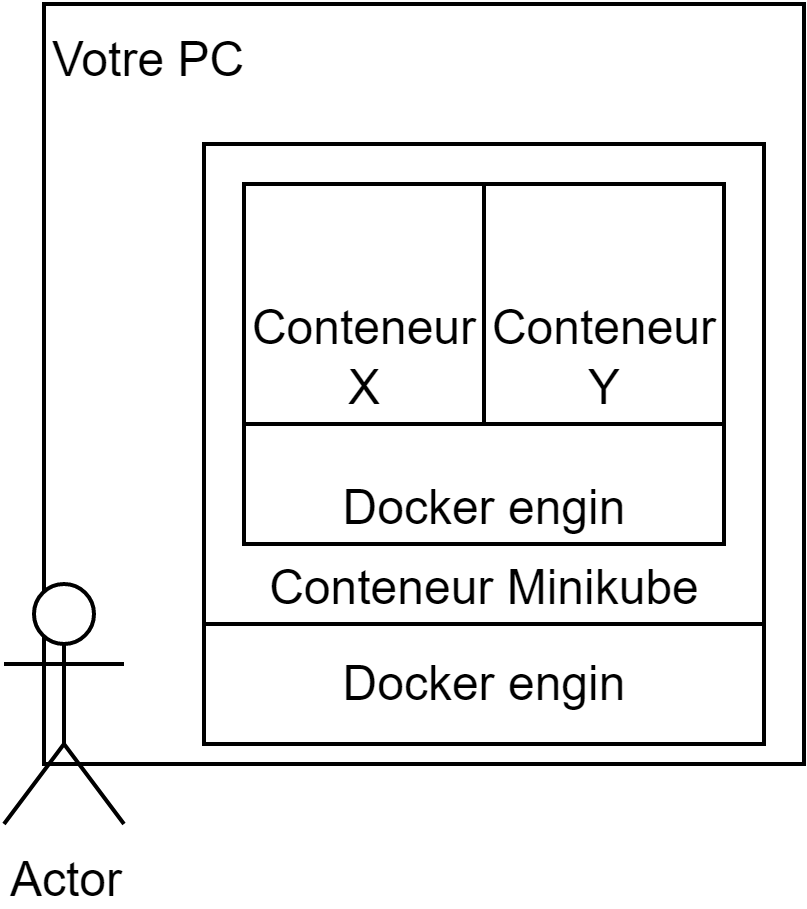

# TD 4 : Orchestration

Les exercices théoriques disponibles sur Moodle doivent être complétés avant la prochaine séance.

Pour vous aider à réaliser ces exercices, vous pouvez vous référer aux pages suivantes ainsi qu'aux cours de cette année et de l'année précédente :

- <https://www.ibm.com/fr-fr/topics/container-orchestration>
- <https://www.redhat.com/fr/topics/automation/what-is-orchestration>
- <https://kubernetes.io/fr/docs/concepts/>

La suite de la séance se déroule en autonomie sur les ordinateurs de l'IUT, sur la partition Ubuntu 22.04. N'oubliez pas de prendre des notes et/ou de faire des captures d'écran pour rédiger votre compte rendu individuel. Je vous recommande d'utiliser la commande `script` pour récupérer le contenu de votre terminal à la fin de la séance.

Commencez par définir votre nom dans une variable (à refaire dans chaque nouveau terminal) :

```bash
$ export MonNom=dupont   # votre nom, en minuscules, sans espace
$ mkdir -p ~/R5A09/${MonNom} && cd $_ && script seance4.txt
[... Commandes de la séance ...]
$ exit
```

Le compte rendu devra inclure votre progression sur les quatre séances ainsi que les réponses aux questions de l'énoncé.

Durant le TP, le cluster va télécharger des images sur Docker Hub. Il est possible que vous soyez confronté à une limite de téléchargement (*rate limit*) qui vous interdise de télécharger de nouvelles images. Attention : les images des pods sont téléchargées par le moteur de conteneurs du nœud Minikube, pas par le Docker de votre poste. Un `docker login` sur votre poste ne s'applique donc pas à ces téléchargements, et la limite de Docker Hub s'applique quand même au cluster.

Si vous atteignez cette limite, rendez-vous sur <https://hub.docker.com> et créez un compte. Dans l'espace **Account Settings > Security**, ajoutez un nouvel « Access Token ». Connectez-vous avec ce compte sur votre poste, téléchargez-y l'image, puis copiez-la dans le cluster avec `minikube image load` (une fois le cluster démarré) :

```bash
$ docker login
$ docker pull nginxdemos/hello:0.4
$ minikube image load nginxdemos/hello:0.4
```

## Exercice pratique 1 : Installation de Minikube

Minikube va nous permettre de créer et de gérer notre propre cluster Kubernetes local, sans avoir à déployer une infrastructure complexe.

```bash
$ curl -LO https://storage.googleapis.com/minikube/releases/latest/\
minikube_latest_amd64.deb
$ sudo dpkg -i minikube_latest_amd64.deb
```

Minikube crée le cluster dans un conteneur Docker : votre compte doit donc pouvoir utiliser Docker sans `sudo` (ne lancez pas Minikube en root). Si vous ne l'avez pas fait au TD 1, ajoutez votre compte au groupe `docker`, puis appliquez ce changement au terminal courant :

```bash
$ sudo usermod -aG docker $USER
$ newgrp docker
```

Lancez Minikube avec la commande suivante :

```bash
$ minikube start --container-runtime=docker
```

Par défaut, les versions récentes de Minikube utilisent le moteur de conteneurs containerd à l'intérieur du nœud ; l'option `--container-runtime=docker` y installe un moteur Docker, ce qui permet d'observer les conteneurs du cluster avec la commande `docker` (question 1.4).

Vérifiez que le cluster fonctionne bien en listant les pods en cours d'exécution avec la commande suivante :

```bash
$ minikube kubectl -- get pods --all-namespaces
```

**Question 1.1 :** Décrivez la liste des pods.

Pour contrôler un cluster distant, vous utiliserez la commande `kubectl`, qui n'est pas forcément installée sur votre poste. La commande `minikube kubectl --` permet d'obtenir le même fonctionnement avec le cluster installé en local.

Pour vous simplifier la suite des exercices, vous pouvez ajouter l'alias suivant à votre shell :

```bash
$ alias kubectl="minikube kubectl --"
```

Listez les nœuds (*nodes*) de votre cluster Kubernetes :

```bash
$ kubectl get nodes
```

**Question 1.2 :** Combien de nœuds sont présents dans votre cluster ?

Utilisez la commande suivante pour déployer l'interface Dashboard de Kubernetes :

```bash
$ minikube dashboard &
```

Utilisez les commandes suivantes pour décrire les ressources qui ont été déployées par la commande `minikube dashboard` :

```bash
$ kubectl get namespace
$ kubectl get deployments --namespace=kubernetes-dashboard
$ kubectl get services --namespace=kubernetes-dashboard
$ kubectl get replicaset --namespace=kubernetes-dashboard
$ kubectl get pods --namespace=kubernetes-dashboard
```

**Question 1.3 :** Décrivez le résultat de chacune de ces commandes.

Explorez l'interface graphique avec votre navigateur pour retrouver toutes ces informations.

**Question 1.4 :** Comment, à l'aide de Docker, lister les conteneurs gérés par Kubernetes ?

Vous allez vous rendre compte que Minikube n'a lancé qu'un seul conteneur. Ce conteneur héberge l'intégralité du cluster Kubernetes. Lancez un terminal à l'intérieur de ce conteneur pour lister les conteneurs gérés par Kubernetes.



*Figure 1 : Minikube exécute tout le cluster dans un seul conteneur Docker, qui embarque son propre moteur Docker pour les conteneurs du cluster.*

<!-- Source du schéma (draw.io) : https://app.diagrams.net/?page-id=hPySdNexf4fTco7VScYX&scale=auto#G1jUg8K_4mMXytOLoX50kY7M77hOSbnf6J -->

```bash
$ docker exec -it minikube /bin/bash
$ docker ps
```

Vérifiez la présence du fichier `~/.kube/config` sur votre poste.

**Question 1.5 :** À quoi sert ce fichier ?

## Exercice pratique 2 : Déploiement d'une première application

Nous allons déployer une première application conteneurisée.

Création d'un déploiement :

```bash
$ kubectl create deployment microbot --image=nginxdemos/hello:0.4
```

L'image `nginxdemos/hello` contient un serveur web NGINX, qui écoute sur le port 80 et affiche une page de démonstration.

**Question 2.1 :** Comment contrôler le bon déploiement de cette ressource ?

Pour rendre l'application accessible depuis l'extérieur, nous devons exposer ce déploiement en tant que service de type NodePort :

```bash
$ kubectl expose deployment microbot --type=NodePort --port=80 \
    --name=microbot-service
```

**Question 2.2 :** Comment contrôler le bon déploiement de cette ressource ?

Utilisez la commande suivante pour accéder depuis l'extérieur à l'application que vous avez déployée :

```bash
$ minikube service microbot-service
```

**Question 2.3 :** Que constatez-vous ? Quelles informations la page affiche-t-elle ?

Nous allons simuler une utilisation intensive de notre application et augmenter le nombre de pods de traitement :

```bash
$ kubectl scale deployment microbot --replicas=5
```

Interrogez ensuite l'application plusieurs fois de suite. Le navigateur réutilise la même connexion et tombe souvent sur le même pod : utilisez plutôt `curl`, qui ouvre une nouvelle connexion à chaque requête.

```bash
$ URL=$(minikube service microbot-service --url)
$ for i in 1 2 3 4 5 6; do curl -s $URL | grep -o 'microbot-[a-z0-9-]*'; done
```

**Question 2.4 :** Que constatez-vous ? À quoi correspond le champ **Server name** de la page ?

### Remplacement automatique d'un pod

Listez les pods de l'application, supprimez l'un d'eux (remplacez le nom par celui d'un de vos pods), puis observez la liste des pods en continu (`Ctrl+C` pour arrêter) :

```bash
$ kubectl get pods
$ kubectl delete pod microbot-xxxxxxxxxx-yyyyy
$ kubectl get pods -w
```

**Question 2.5 :** Pourquoi un nouveau pod apparaît-il ? Que se passerait-il pour un pod créé sans Deployment ?

### Autoscaling

Plutôt que de fixer le nombre de pods à la main, Kubernetes peut l'ajuster automatiquement en fonction de la charge grâce à un *Horizontal Pod Autoscaler* (HPA). Celui-ci a besoin des mesures de consommation des pods, fournies par le module `metrics-server` :

```bash
$ minikube addons enable metrics-server
```

Revenez à un seul pod, indiquez la quantité de CPU réservée pour chaque pod (*request*), puis créez l'autoscaler : il vise une utilisation moyenne de 50 % du CPU réservé, avec 1 à 5 pods.

```bash
$ kubectl scale deployment microbot --replicas=1
$ kubectl set resources deployment microbot --requests=cpu=50m
$ kubectl autoscale deployment microbot --cpu=50% --min=1 --max=5
$ kubectl get hpa
```

Avec une ancienne version de `kubectl`, remplacez `--cpu=50%` par `--cpu-percent=50`. Patientez une minute : la colonne `TARGETS` doit afficher une valeur mesurée au lieu de `<unknown>`.

Dans un second terminal (redéfinissez-y l'alias `kubectl`), générez de la charge avec un pod qui interroge le service en boucle :

```bash
$ kubectl run -it --rm load --image=busybox --restart=Never -- \
    /bin/sh -c "while :; do wget -q -O /dev/null http://microbot-service; done"
```

Dans le premier terminal, observez l'autoscaler pendant quelques minutes :

```bash
$ kubectl get hpa -w
```

**Question 2.6 :** Comment évoluent l'utilisation du CPU et le nombre de pods ? Pourquoi faut-il déclarer une réservation de CPU (`requests`) pour que l'autoscaler fonctionne ?

Arrêtez la génération de charge (`Ctrl+C` dans le second terminal : le pod `load` est supprimé) et continuez d'observer l'autoscaler.

**Question 2.7 :** Au bout de combien de temps le nombre de pods redescend-il ? Pourquoi Kubernetes attend-il avant de supprimer des pods ?

### Suppression de l'application

Supprimez cette application : le déploiement, le service et l'autoscaler.

**Question 2.8 :** Quelles commandes faut-il utiliser pour supprimer cette application ?

## Exercice pratique 3 : Déploiement de WordPress

Pour déployer une application telle que WordPress, il est préférable d'utiliser des fichiers de configuration. Ces fichiers sont comparables aux `docker-compose.yml` : ils décrivent, en YAML ou en JSON, les ressources et les configurations nécessaires pour déployer et gérer des applications sur un cluster Kubernetes, en spécifiant les pods, les services, les volumes et d'autres éléments.

Téléchargez le manifeste pour déployer MySQL :

```bash
$ curl -LO \
  https://k8s.io/examples/application/wordpress/mysql-deployment.yaml
```

Puis téléchargez le manifeste pour déployer WordPress :

```bash
$ curl -LO \
  https://k8s.io/examples/application/wordpress/wordpress-deployment.yaml
```

Ces manifestes, maintenus par la documentation de Kubernetes, utilisent des images anciennes : `wordpress:6.2.1-apache` et `mysql:8.0` (fin de support en avril 2026). Elles suffisent pour ce TD, mais un déploiement réel utiliserait des versions maintenues, par exemple `wordpress:6-apache` et `mysql:8.4`.

Créez un fichier `kustomization.yaml` dans le même répertoire (`>` écrase le fichier s'il existe déjà, vous pouvez donc relancer la commande sans dupliquer son contenu) :

```bash
$ cat > kustomization.yaml <<EOF
secretGenerator:
- name: mysql-pass
  literals:
  - password=YOUR_PASSWORD
resources:
  - mysql-deployment.yaml
  - wordpress-deployment.yaml
EOF
```

**Question 3.1 :** Décrivez les ressources qui devraient être créées par `wordpress-deployment.yaml`.

Déployez l'application avec la commande :

```bash
$ kubectl apply -k ./
```

**Question 3.2 :** Testez les commandes suivantes et décrivez leur résultat :

```bash
$ kubectl get secrets
$ kubectl get pvc
$ kubectl get pods
$ kubectl get services wordpress
$ minikube service wordpress
```

## Clean up

Avant la fin de la séance, sauvegardez tous les fichiers dont vous aurez besoin pour rédiger votre compte rendu, puis supprimez toutes vos traces.

Arrêtez et supprimez votre cluster Kubernetes, ainsi que les fichiers de Minikube (`~/.minikube`) :

```bash
$ minikube delete --all --purge
```

Supprimez l'image de base de Minikube et, si vous l'avez téléchargée, l'image de démonstration :

```bash
$ docker image ls -q gcr.io/k8s-minikube/kicbase | xargs -r docker image rm
$ docker image rm nginxdemos/hello:0.4
```

Supprimez vos fichiers (manifestes, paquet Minikube téléchargé) :

```bash
$ cd ~
$ rm -fr ~/R5A09/"${MonNom:?}"
```

Supprimez votre historique :

```bash
$ history -d ${votre_premiere_ligne}-${votre_derniere_ligne}
```
